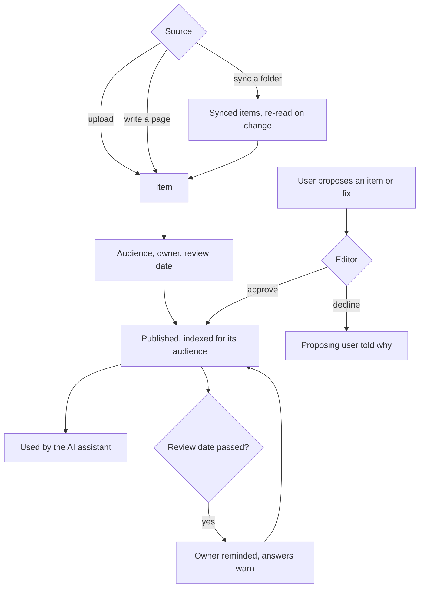

🏠 [Specs](../../../README.md) › 🧩 [Functional capabilities](../../README.md) › 🤖 [F3 Assistant](../README.md) ›
🔀 [Flows](README.md) › 🔀 FL-F3-07 Manage knowledge

# 🔀 FL-F3-07 Manage knowledge

**Status:** ✅ specified

## Summary

From a document to knowledge the AI assistant uses, kept up to date.

## Personas

- [U06 HR](../../../01-users/personas/u06-hr.md)
- [U07 Administrator](../../../01-users/personas/u07-administrator.md)
- [U13 Owner](../../../01-users/personas/u13-owner.md)
- Knowledge editors they name per folder (D176)
- Every internal persona proposes items and fixes (D176)

## Flowchart

## Sequence diagram

See [UC-F3-07](../use-cases/07-manage-knowledge/uc-f03-07-manage-the-company-knowledge-base.md#sequence-diagram).

## Steps

| Step | Persona | Screen | Use case | What happens |
|---|---|---|---|---|
| 1 | U06, U07, U13, editors | [S-F3-07](../screens/07-manage-knowledge/s-f03-07-knowledge-base.md) | [UC-F3-07](../use-cases/07-manage-knowledge/uc-f03-07-manage-the-company-knowledge-base.md) | Browse folders |
| 2 | U06, U07, U13, editors | [S-F3-08](../screens/07-manage-knowledge/s-f03-08-knowledge-item-editor.md) | [UC-F3-07](../use-cases/07-manage-knowledge/uc-f03-07-manage-the-company-knowledge-base.md) | Add an item, audience, review |
| 3 | Every internal persona | [S-F3-07](../screens/07-manage-knowledge/s-f03-07-knowledge-base.md) | [UC-F3-07](../use-cases/07-manage-knowledge/uc-f03-07-manage-the-company-knowledge-base.md) | Propose an item or a fix |
| 4 | U06, U07, U13, editors | [S-F3-07](../screens/07-manage-knowledge/s-f03-07-knowledge-base.md) | [UC-F3-07](../use-cases/07-manage-knowledge/uc-f03-07-manage-the-company-knowledge-base.md) | Approve a proposal |

### Entities and screens

| Entity | States in this flow | Shown at step and screen | Aggregated view |
|---|---|---|---|
| [E-F3-09 Knowledge item](../data/e-f03-09-knowledge-item.md) | Draft, Published, To review | 1, 3, 4 [S-F3-07](../screens/07-manage-knowledge/s-f03-07-knowledge-base.md); 2 [S-F3-08](../screens/07-manage-knowledge/s-f03-08-knowledge-item-editor.md) | Knowledge items |
| [E-F3-10 Knowledge folder](../data/e-f03-10-knowledge-folder.md) | Active | 1, 3, 4 [S-F3-07](../screens/07-manage-knowledge/s-f03-07-knowledge-base.md); 2 [S-F3-08](../screens/07-manage-knowledge/s-f03-08-knowledge-item-editor.md) | Knowledge folders |
| [E-F3-02 Assistant answer](../data/e-f03-02-assistant-answer.md) | Recorded | Shown elsewhere: [S-F3-01 Assistant panel](../screens/01-ask-the-assistant/s-f03-01-assistant-panel.md) | Assistant answers |
| [E-F1-03 User](../../f01-administration/data/e-f01-03-user.md) | Invited, Active, Deactivated | Shown elsewhere: [S-F1-03 Users](../../f01-administration/screens/03-user-lifecycle/s-f01-03-users.md) | Users |
| [E-F3-11 Knowledge proposal](../data/e-f03-11-knowledge-proposal.md) | Open, Approved, Declined | 1, 3, 4 [S-F3-07](../screens/07-manage-knowledge/s-f03-07-knowledge-base.md); 2 [S-F3-08](../screens/07-manage-knowledge/s-f03-08-knowledge-item-editor.md) | Knowledge proposals |

## Errors

A file not readable; a synced origin unreachable; a file too large.

## Images

Every step and error, for each persona taking part, in light and dark mode (D120). Steps are numbered as in the Steps
table; E rows are the error cases.

| Step | Persona | Device | Light | Dark |
|---|---|---|---|---|
| 1 | U06 | desktop | [light](../images/07-manage-knowledge/u06-hr/1-browse-desktop-light.png) | [dark](../images/07-manage-knowledge/u06-hr/1-browse-desktop-dark.png) |
| 1 | U07 | desktop | [light](../images/07-manage-knowledge/u07-administrator/1-browse-desktop-light.png) | [dark](../images/07-manage-knowledge/u07-administrator/1-browse-desktop-dark.png) |
| 1 | U13 | desktop | [light](../images/07-manage-knowledge/u13-owner/1-browse-desktop-light.png) | [dark](../images/07-manage-knowledge/u13-owner/1-browse-desktop-dark.png) |
| 1 | U13 | phone | [light](../images/07-manage-knowledge/u13-owner/1-browse-phone-light.png) | [dark](../images/07-manage-knowledge/u13-owner/1-browse-phone-dark.png) |
| 2 | U06 | desktop | [light](../images/07-manage-knowledge/u06-hr/2-add-an-item-desktop-light.png) | [dark](../images/07-manage-knowledge/u06-hr/2-add-an-item-desktop-dark.png) |
| 2 | U07 | desktop | [light](../images/07-manage-knowledge/u07-administrator/2-add-an-item-desktop-light.png) | [dark](../images/07-manage-knowledge/u07-administrator/2-add-an-item-desktop-dark.png) |
| 2 | U13 | desktop | [light](../images/07-manage-knowledge/u13-owner/2-add-an-item-desktop-light.png) | [dark](../images/07-manage-knowledge/u13-owner/2-add-an-item-desktop-dark.png) |
| 2 | U13 | phone | [light](../images/07-manage-knowledge/u13-owner/2-add-an-item-phone-light.png) | [dark](../images/07-manage-knowledge/u13-owner/2-add-an-item-phone-dark.png) |
| 3 | U01 | desktop | [light](../images/07-manage-knowledge/u01-employee/3-propose-a-fix-desktop-light.png) | [dark](../images/07-manage-knowledge/u01-employee/3-propose-a-fix-desktop-dark.png) |
| 4 | U06 | desktop | [light](../images/07-manage-knowledge/u06-hr/4-approve-a-proposal-desktop-light.png) | [dark](../images/07-manage-knowledge/u06-hr/4-approve-a-proposal-desktop-dark.png) |
| 4 | U07 | desktop | [light](../images/07-manage-knowledge/u07-administrator/4-approve-a-proposal-desktop-light.png) | [dark](../images/07-manage-knowledge/u07-administrator/4-approve-a-proposal-desktop-dark.png) |
| 4 | U13 | desktop | [light](../images/07-manage-knowledge/u13-owner/4-approve-a-proposal-desktop-light.png) | [dark](../images/07-manage-knowledge/u13-owner/4-approve-a-proposal-desktop-dark.png) |
| 4 | U13 | phone | [light](../images/07-manage-knowledge/u13-owner/4-approve-a-proposal-phone-light.png) | [dark](../images/07-manage-knowledge/u13-owner/4-approve-a-proposal-phone-dark.png) |
| E1 | U06 | desktop | [light](../images/07-manage-knowledge/u06-hr/e1-file-not-readable-desktop-light.png) | [dark](../images/07-manage-knowledge/u06-hr/e1-file-not-readable-desktop-dark.png) |
| E2 | U07 | desktop | [light](../images/07-manage-knowledge/u07-administrator/e2-sync-unreachable-desktop-light.png) | [dark](../images/07-manage-knowledge/u07-administrator/e2-sync-unreachable-desktop-dark.png) |
| E3 | U06 | desktop | [light](../images/07-manage-knowledge/u06-hr/e3-file-too-large-desktop-light.png) | [dark](../images/07-manage-knowledge/u06-hr/e3-file-too-large-desktop-dark.png) |

## Open questions

None.

---

⬅️ [FL-F3-06 Use an outside tool](fl-f03-06-use-an-outside-tool.md) · ⬆️ [Up](README.md) ·
➡️ [FL-F3-08 Manage and share conversations](fl-f03-08-manage-and-share-conversations.md)
