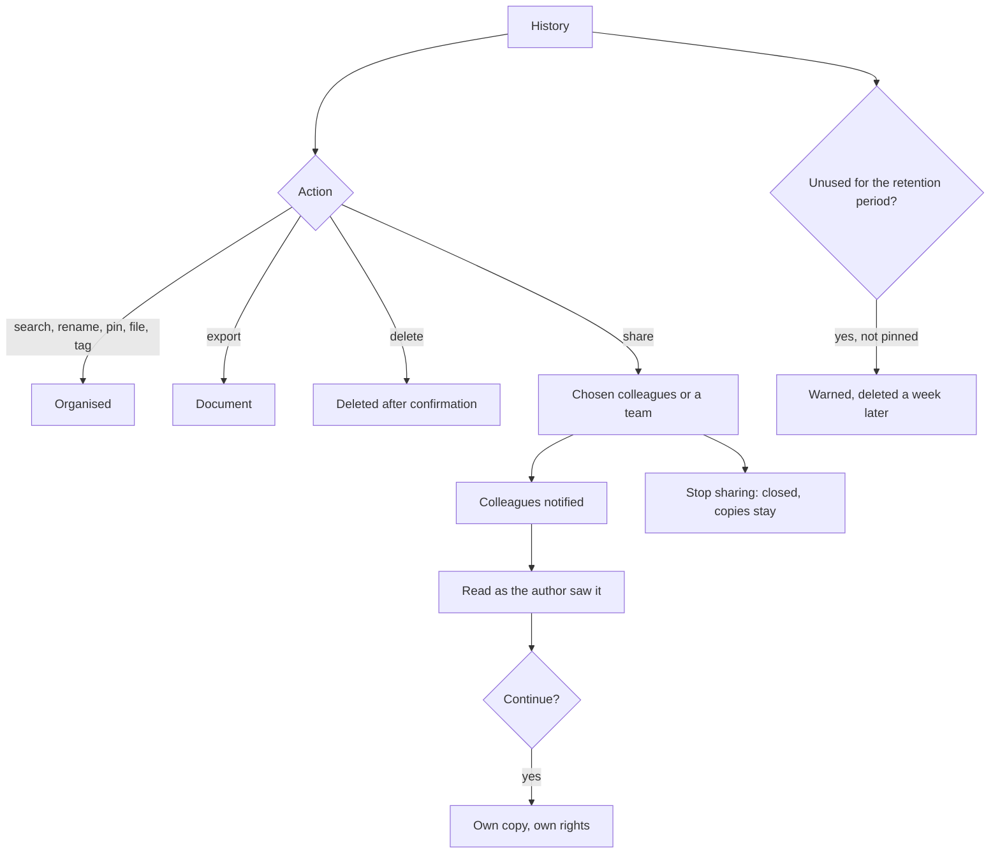

🏠 [Specs](../../../README.md) › 🧩 [Functional capabilities](../../README.md) › 🤖 [F3 Assistant](../README.md) ›
🔀 [Flows](README.md) › 🔀 FL-F3-08 Manage and share conversations

# 🔀 FL-F3-08 Manage and share conversations

**Status:** ✅ specified

## Summary

From the history to an organised, shared or deleted conversation.

## Personas

Every internal persona (D142): [U01](../../../01-users/personas/u01-employee.md),
[U02](../../../01-users/personas/u02-manager.md), [U03](../../../01-users/personas/u03-sales.md),
[U04](../../../01-users/personas/u04-purchasing.md), [U05](../../../01-users/personas/u05-accounting.md),
[U06](../../../01-users/personas/u06-hr.md), [U07](../../../01-users/personas/u07-administrator.md),
[U12](../../../01-users/personas/u12-marketing.md), [U13](../../../01-users/personas/u13-owner.md),
[U14](../../../01-users/personas/u14-field-worker.md), [U15](../../../01-users/personas/u15-warehouse-operator.md),
[U16](../../../01-users/personas/u16-office-worker.md).

## Flowchart

## Sequence diagram

See
[UC-F3-08](../use-cases/08-manage-and-share-conversations/uc-f03-08-manage-and-share-conversations.md#sequence-diagram).

## Steps

| Step | Persona | Screen | Use case | What happens |
|---|---|---|---|---|
| 1 | Every internal persona | [S-F3-09](../screens/08-manage-and-share-conversations/s-f03-09-conversation-history.md) | [UC-F3-08](../use-cases/08-manage-and-share-conversations/uc-f03-08-manage-and-share-conversations.md) | Search, organise |
| 2 | Every internal persona | [S-F3-10](../screens/08-manage-and-share-conversations/s-f03-10-share-a-conversation.md) | [UC-F3-08](../use-cases/08-manage-and-share-conversations/uc-f03-08-manage-and-share-conversations.md) | Share |
| 3 | Every internal persona | [S-F3-01](../screens/01-ask-the-assistant/s-f03-01-assistant-panel.md) | [UC-F3-08](../use-cases/08-manage-and-share-conversations/uc-f03-08-manage-and-share-conversations.md) | Read shared, continue as a copy |

### Entities and screens

| Entity | States in this flow | Shown at step and screen | Aggregated view |
|---|---|---|---|
| [E-F3-01 Conversation](../data/e-f03-01-conversation.md) | Private, Shared, Deleted | 1 [S-F3-09](../screens/08-manage-and-share-conversations/s-f03-09-conversation-history.md); 2 [S-F3-10](../screens/08-manage-and-share-conversations/s-f03-10-share-a-conversation.md); 3 [S-F3-01](../screens/01-ask-the-assistant/s-f03-01-assistant-panel.md) | Conversations |
| [E-F2-13 Document](../../f02-no-code-configuration/data/e-f02-13-document.md) | To sort, To validate, Done | Shown elsewhere: [S-F2-13 Documents workspace](../../f02-no-code-configuration/screens/07-benchmark-additions/s-f02-13-documents-workspace.md) | Documents |
| [E-F1-03 User](../../f01-administration/data/e-f01-03-user.md) | Invited, Active, Deactivated | Shown elsewhere: [S-F1-03 Users](../../f01-administration/screens/03-user-lifecycle/s-f01-03-users.md) | Users |

## Errors

Not shared with this user; deleted by its author.

## Images

Every step and error, for each persona taking part, in light and dark mode (D120). Steps are numbered as in the Steps
table; E rows are the error cases.

| Step | Persona | Device | Light | Dark |
|---|---|---|---|---|
| 1 | U13 | desktop | [light](../images/08-manage-and-share-conversations/u13-owner/1-history-desktop-light.png) | [dark](../images/08-manage-and-share-conversations/u13-owner/1-history-desktop-dark.png) |
| 2 | U13 | desktop | [light](../images/08-manage-and-share-conversations/u13-owner/2-share-desktop-light.png) | [dark](../images/08-manage-and-share-conversations/u13-owner/2-share-desktop-dark.png) |
| 3 | U02 | desktop | [light](../images/08-manage-and-share-conversations/u02-manager/3-read-and-continue-desktop-light.png) | [dark](../images/08-manage-and-share-conversations/u02-manager/3-read-and-continue-desktop-dark.png) |
| E1 | U02 | desktop | [light](../images/08-manage-and-share-conversations/u02-manager/e1-not-shared-desktop-light.png) | [dark](../images/08-manage-and-share-conversations/u02-manager/e1-not-shared-desktop-dark.png) |
| E1 | U02 | phone | [light](../images/08-manage-and-share-conversations/u02-manager/e1-not-shared-phone-light.png) | [dark](../images/08-manage-and-share-conversations/u02-manager/e1-not-shared-phone-dark.png) |
| E2 | U02 | desktop | [light](../images/08-manage-and-share-conversations/u02-manager/e2-deleted-desktop-light.png) | [dark](../images/08-manage-and-share-conversations/u02-manager/e2-deleted-desktop-dark.png) |
| E2 | U02 | phone | [light](../images/08-manage-and-share-conversations/u02-manager/e2-deleted-phone-light.png) | [dark](../images/08-manage-and-share-conversations/u02-manager/e2-deleted-phone-dark.png) |

## Open questions

None.

---

⬅️ [FL-F3-07 Manage knowledge](fl-f03-07-manage-knowledge.md) · ⬆️ [Up](README.md) ·
➡️ [FL-F3-09 Assistant on a phone](fl-f03-09-assistant-on-a-phone.md)
