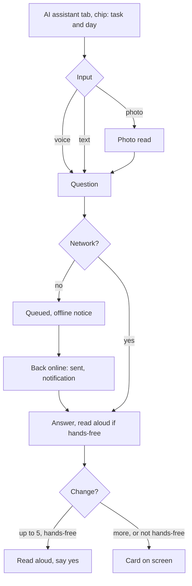

🏠 [Specs](../../../README.md) › 🧩 [Functional capabilities](../../README.md) › 🤖 [F3 Assistant](../README.md) ›
🔀 [Flows](README.md) › 🔀 FL-F3-09 Assistant on a phone

# 🔀 FL-F3-09 Assistant on a phone

**Status:** ✅ specified

## Summary

From a question by voice, text or photo, online or offline, to an answer or a confirmed change.

## Personas

- [U14 Field worker](../../../01-users/personas/u14-field-worker.md)
- [U01 Employee](../../../01-users/personas/u01-employee.md)
- Every internal persona using a phone (D34)

## Flowchart

## Sequence diagram

See [UC-F3-09](../use-cases/09-assistant-on-a-phone/uc-f03-09-use-the-assistant-on-a-phone.md#sequence-diagram).

## Steps

| Step | Persona | Screen | Use case | What happens |
|---|---|---|---|---|
| 1 | U14, U01 | [S-F3-11](../screens/09-assistant-on-a-phone/s-f03-11-phone-assistant.md) | [UC-F3-09](../use-cases/09-assistant-on-a-phone/uc-f03-09-use-the-assistant-on-a-phone.md) | Ask by voice about the visit |
| 2 | U14, U01 | [S-F3-11](../screens/09-assistant-on-a-phone/s-f03-11-phone-assistant.md) | [UC-F3-09](../use-cases/09-assistant-on-a-phone/uc-f03-09-use-the-assistant-on-a-phone.md) | Photo read, record offered |
| 3 | U14, U01 | [S-F3-11](../screens/09-assistant-on-a-phone/s-f03-11-phone-assistant.md) | [UC-F3-09](../use-cases/09-assistant-on-a-phone/uc-f03-09-use-the-assistant-on-a-phone.md) | Confirm by voice |
| 4 | U14, U01 | [S-F3-11](../screens/09-assistant-on-a-phone/s-f03-11-phone-assistant.md) | [UC-F3-09](../use-cases/09-assistant-on-a-phone/uc-f03-09-use-the-assistant-on-a-phone.md) | Offline, queued |

### Entities and screens

| Entity | States in this flow | Shown at step and screen | Aggregated view |
|---|---|---|---|
| [E-F9-18 Project and task](../../f09-hr-and-projects/data/e-f09-18-project-and-task.md) | New, Planned, Active, Delivered, Done | Shown elsewhere: [S-F9-17 Projects](../../f09-hr-and-projects/screens/06-plan-and-deliver-work/s-f09-17-projects.md) | Project and tasks |
| [E-F3-02 Assistant answer](../data/e-f03-02-assistant-answer.md) | Recorded | Shown elsewhere: [S-F3-01 Assistant panel](../screens/01-ask-the-assistant/s-f03-01-assistant-panel.md) | Assistant answers |
| [E-T10-02 Notification](../../../03-technical/t10-translations-and-notifications/data/e-t10-02-notification.md) | Active | Shown elsewhere: [S-T10-02 Notification](../../../03-technical/t10-translations-and-notifications/screens/s-t10-02-notification.md), from the admin list [S-T10-L02](../../../03-technical/t10-translations-and-notifications/screens/00-lists/s-t10-l02-notifications.md) | Notifications |

## Errors

Speech not understood; photo not readable; voice confirmation unclear; queued question failed.

## Images

Every step and error, for each persona taking part, in light and dark mode (D120). Steps are numbered as in the Steps
table; E rows are the error cases.

| Step | Persona | Device | Light | Dark |
|---|---|---|---|---|
| 1 | U14 | phone | [light](../images/09-assistant-on-a-phone/u14-field-worker/1-ask-by-voice-phone-light.png) | [dark](../images/09-assistant-on-a-phone/u14-field-worker/1-ask-by-voice-phone-dark.png) |
| 1 | U01 | desktop | [light](../images/09-assistant-on-a-phone/u01-employee/1-ask-by-voice-desktop-light.png) | [dark](../images/09-assistant-on-a-phone/u01-employee/1-ask-by-voice-desktop-dark.png) |
| 1 | U01 | phone | [light](../images/09-assistant-on-a-phone/u01-employee/1-ask-by-voice-phone-light.png) | [dark](../images/09-assistant-on-a-phone/u01-employee/1-ask-by-voice-phone-dark.png) |
| 2 | U14 | phone | [light](../images/09-assistant-on-a-phone/u14-field-worker/2-photo-read-phone-light.png) | [dark](../images/09-assistant-on-a-phone/u14-field-worker/2-photo-read-phone-dark.png) |
| 2 | U01 | desktop | [light](../images/09-assistant-on-a-phone/u01-employee/2-photo-read-desktop-light.png) | [dark](../images/09-assistant-on-a-phone/u01-employee/2-photo-read-desktop-dark.png) |
| 2 | U01 | phone | [light](../images/09-assistant-on-a-phone/u01-employee/2-photo-read-phone-light.png) | [dark](../images/09-assistant-on-a-phone/u01-employee/2-photo-read-phone-dark.png) |
| 3 | U14 | phone | [light](../images/09-assistant-on-a-phone/u14-field-worker/3-confirm-by-voice-phone-light.png) | [dark](../images/09-assistant-on-a-phone/u14-field-worker/3-confirm-by-voice-phone-dark.png) |
| 3 | U01 | desktop | [light](../images/09-assistant-on-a-phone/u01-employee/3-confirm-by-voice-desktop-light.png) | [dark](../images/09-assistant-on-a-phone/u01-employee/3-confirm-by-voice-desktop-dark.png) |
| 3 | U01 | phone | [light](../images/09-assistant-on-a-phone/u01-employee/3-confirm-by-voice-phone-light.png) | [dark](../images/09-assistant-on-a-phone/u01-employee/3-confirm-by-voice-phone-dark.png) |
| 4 | U14 | phone | [light](../images/09-assistant-on-a-phone/u14-field-worker/4-offline-queued-phone-light.png) | [dark](../images/09-assistant-on-a-phone/u14-field-worker/4-offline-queued-phone-dark.png) |
| 4 | U01 | desktop | [light](../images/09-assistant-on-a-phone/u01-employee/4-offline-queued-desktop-light.png) | [dark](../images/09-assistant-on-a-phone/u01-employee/4-offline-queued-desktop-dark.png) |
| 4 | U01 | phone | [light](../images/09-assistant-on-a-phone/u01-employee/4-offline-queued-phone-light.png) | [dark](../images/09-assistant-on-a-phone/u01-employee/4-offline-queued-phone-dark.png) |
| E1 | U14 | phone | [light](../images/09-assistant-on-a-phone/u14-field-worker/e1-speech-not-understood-phone-light.png) | [dark](../images/09-assistant-on-a-phone/u14-field-worker/e1-speech-not-understood-phone-dark.png) |
| E2 | U14 | phone | [light](../images/09-assistant-on-a-phone/u14-field-worker/e2-photo-not-readable-phone-light.png) | [dark](../images/09-assistant-on-a-phone/u14-field-worker/e2-photo-not-readable-phone-dark.png) |
| E3 | U14 | phone | [light](../images/09-assistant-on-a-phone/u14-field-worker/e3-queued-failed-phone-light.png) | [dark](../images/09-assistant-on-a-phone/u14-field-worker/e3-queued-failed-phone-dark.png) |

## Open questions

None.

---

⬅️ [FL-F3-08 Manage and share conversations](fl-f03-08-manage-and-share-conversations.md) · ⬆️ [Up](README.md) ·
➡️ [FL-F3-10 Benchmark additions](fl-f03-10-benchmark-additions.md)
