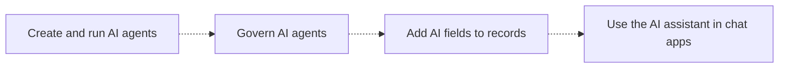

🏠 [Specs](../../../README.md) › 🧩 [Functional capabilities](../../README.md) › 🤖 [F3 Assistant](../README.md) ›
🔀 [Flows](README.md) › 🔀 FL-F3-10 Benchmark additions

# 🔀 FL-F3-10 Benchmark additions

**Status:** ✅ specified

## Summary

The benchmark additions of D301: UC-F3-10, UC-F3-11, UC-F3-12, UC-F3-13. Each step stands on its own.

## Personas

- [U01 Employee](../../../01-users/personas/u01-employee.md)
- [U02 Manager](../../../01-users/personas/u02-manager.md)
- [U03 Sales](../../../01-users/personas/u03-sales.md)
- [U05 Accounting](../../../01-users/personas/u05-accounting.md)
- [U07 Administrator](../../../01-users/personas/u07-administrator.md)
- [U13 Owner](../../../01-users/personas/u13-owner.md)

## Flowchart

## Sequence diagram

See each use case.

## Steps

| Step | Persona | Screen | Use case | What happens |
|---|---|---|---|---|
| 1 | U07, U05, U02 | [S-F3-14](../screens/10-benchmark-additions/s-f03-14-agents.md) | [UC-F3-10](../use-cases/10-benchmark-additions/uc-f03-10-create-and-run-ai-agents.md) | Create and run AI agents |
| 2 | U07, U13, U05 | [S-F3-15](../screens/10-benchmark-additions/s-f03-15-agent-governance.md) | [UC-F3-11](../use-cases/10-benchmark-additions/uc-f03-11-govern-ai-agents.md) | Govern AI agents |
| 3 | U07, U02 | [S-F3-16](../screens/10-benchmark-additions/s-f03-16-ai-fields.md) | [UC-F3-12](../use-cases/10-benchmark-additions/uc-f03-12-add-ai-fields-to-records.md) | Add AI fields to records |
| 4 | U01, U02, U03 | [S-F3-17](../screens/10-benchmark-additions/s-f03-17-chat-apps.md) | [UC-F3-13](../use-cases/10-benchmark-additions/uc-f03-13-use-the-assistant-in-chat-apps.md) | Use the AI assistant in chat apps |

### Entities and screens

| Entity | States in this flow | Shown at step and screen | Aggregated view |
|---|---|---|---|
| [E-F3-15 Agent](../data/e-f03-15-agent.md) | Paid, Paused | 1 [S-F3-14](../screens/10-benchmark-additions/s-f03-14-agents.md); 2 [S-F3-15](../screens/10-benchmark-additions/s-f03-15-agent-governance.md) | Agents |
| [E-F3-16 AI field](../data/e-f03-16-ai-field.md) | Active | 3 [S-F3-16](../screens/10-benchmark-additions/s-f03-16-ai-fields.md) | AI fields |

## Errors

As each use case; E1 shows one of them.

## Images

Every step and error, for each persona taking part, in light and dark mode (D120). Steps are numbered as in the Steps
table; E rows are the error cases.

| Step | Persona | Device | Light | Dark |
|---|---|---|---|---|
| 1 | U07 | desktop | [light](../images/10-benchmark-additions/u07-administrator/1-agents-desktop-light.png) | [dark](../images/10-benchmark-additions/u07-administrator/1-agents-desktop-dark.png) |
| 1 | U02 | desktop | [light](../images/10-benchmark-additions/u02-manager/1-agents-desktop-light.png) | [dark](../images/10-benchmark-additions/u02-manager/1-agents-desktop-dark.png) |
| 1 | U02 | phone | [light](../images/10-benchmark-additions/u02-manager/1-agents-phone-light.png) | [dark](../images/10-benchmark-additions/u02-manager/1-agents-phone-dark.png) |
| 1 | U05 | desktop | [light](../images/10-benchmark-additions/u05-accounting/1-agents-desktop-light.png) | [dark](../images/10-benchmark-additions/u05-accounting/1-agents-desktop-dark.png) |
| 2 | U07 | desktop | [light](../images/10-benchmark-additions/u07-administrator/2-governance-desktop-light.png) | [dark](../images/10-benchmark-additions/u07-administrator/2-governance-desktop-dark.png) |
| 2 | U05 | desktop | [light](../images/10-benchmark-additions/u05-accounting/2-governance-desktop-light.png) | [dark](../images/10-benchmark-additions/u05-accounting/2-governance-desktop-dark.png) |
| 2 | U13 | desktop | [light](../images/10-benchmark-additions/u13-owner/2-governance-desktop-light.png) | [dark](../images/10-benchmark-additions/u13-owner/2-governance-desktop-dark.png) |
| 2 | U13 | phone | [light](../images/10-benchmark-additions/u13-owner/2-governance-phone-light.png) | [dark](../images/10-benchmark-additions/u13-owner/2-governance-phone-dark.png) |
| 3 | U07 | desktop | [light](../images/10-benchmark-additions/u07-administrator/3-ai-fields-desktop-light.png) | [dark](../images/10-benchmark-additions/u07-administrator/3-ai-fields-desktop-dark.png) |
| 3 | U02 | desktop | [light](../images/10-benchmark-additions/u02-manager/3-ai-fields-desktop-light.png) | [dark](../images/10-benchmark-additions/u02-manager/3-ai-fields-desktop-dark.png) |
| 3 | U02 | phone | [light](../images/10-benchmark-additions/u02-manager/3-ai-fields-phone-light.png) | [dark](../images/10-benchmark-additions/u02-manager/3-ai-fields-phone-dark.png) |
| 4 | U01 | phone | [light](../images/10-benchmark-additions/u01-employee/4-chat-apps-phone-light.png) | [dark](../images/10-benchmark-additions/u01-employee/4-chat-apps-phone-dark.png) |
| 4 | U01 | desktop | [light](../images/10-benchmark-additions/u01-employee/4-chat-apps-desktop-light.png) | [dark](../images/10-benchmark-additions/u01-employee/4-chat-apps-desktop-dark.png) |
| 4 | U02 | desktop | [light](../images/10-benchmark-additions/u02-manager/4-chat-apps-desktop-light.png) | [dark](../images/10-benchmark-additions/u02-manager/4-chat-apps-desktop-dark.png) |
| 4 | U02 | phone | [light](../images/10-benchmark-additions/u02-manager/4-chat-apps-phone-light.png) | [dark](../images/10-benchmark-additions/u02-manager/4-chat-apps-phone-dark.png) |
| 4 | U03 | desktop | [light](../images/10-benchmark-additions/u03-sales/4-chat-apps-desktop-light.png) | [dark](../images/10-benchmark-additions/u03-sales/4-chat-apps-desktop-dark.png) |
| 4 | U03 | phone | [light](../images/10-benchmark-additions/u03-sales/4-chat-apps-phone-light.png) | [dark](../images/10-benchmark-additions/u03-sales/4-chat-apps-phone-dark.png) |
| 4 | U03 | tablet | [light](../images/10-benchmark-additions/u03-sales/4-chat-apps-tablet-light.png) | [dark](../images/10-benchmark-additions/u03-sales/4-chat-apps-tablet-dark.png) |
| E1 | U07 | desktop | [light](../images/10-benchmark-additions/u07-administrator/e1-over-limit-desktop-light.png) | [dark](../images/10-benchmark-additions/u07-administrator/e1-over-limit-desktop-dark.png) |

## Open questions

None.

---

⬅️ [FL-F3-09 Assistant on a phone](fl-f03-09-assistant-on-a-phone.md) · ⬆️ [Up](README.md) ·
➡️ [FL-F3-11 Trust the answers](fl-f03-11-trust-the-answers.md)
