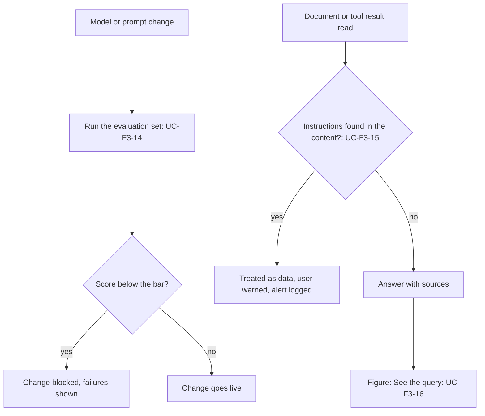

🏠 [Specs](../../../README.md) › 🧩 [Functional capabilities](../../README.md) › 🤖 [F3 Assistant](../README.md) ›
🔀 [Flows](README.md) › 🔀 FL-F3-11 Trust the answers

# 🔀 FL-F3-11 Trust the answers

**Status:** ✅ specified

## Summary

The AI assistant's answers are checked by an evaluation set at every change, protected from instructions hidden in
documents and tools, and each figure shows the query it came from.

## Personas

- [U01 Employee](../../../01-users/personas/u01-employee.md)
- [U05 Accounting](../../../01-users/personas/u05-accounting.md)
- [U07 Administrator](../../../01-users/personas/u07-administrator.md)

## Flowchart

## Sequence diagram

- [UC-F3-14 Run the quality evaluation set](../use-cases/11-trust-the-answers/uc-f03-14-run-the-quality-evaluation-set.md#sequence-diagram)

## Steps

| Step | Persona | Screen | Use case | What happens |
|---|---|---|---|---|
| 1 | [U07](../../../01-users/personas/u07-administrator.md) | [S-F3-18](../screens/11-trust-the-answers/s-f03-18-evaluation-set.md) | [UC-F3-14](../use-cases/11-trust-the-answers/uc-f03-14-run-the-quality-evaluation-set.md) | Add evaluation questions and run the set |
| 2 | [U07](../../../01-users/personas/u07-administrator.md) | [S-F3-18](../screens/11-trust-the-answers/s-f03-18-evaluation-set.md) | [UC-F3-14](../use-cases/11-trust-the-answers/uc-f03-14-run-the-quality-evaluation-set.md) | A model change is blocked by a quality drop |
| 3 | [U01](../../../01-users/personas/u01-employee.md) | [S-F3-01](../screens/01-ask-the-assistant/s-f03-01-assistant-panel.md) | [UC-F3-15](../use-cases/11-trust-the-answers/uc-f03-15-defend-against-instructions-hidden-in-content.md) | A document with hidden instructions is read as data |
| 4 | [U07](../../../01-users/personas/u07-administrator.md) | [S-F3-19](../screens/11-trust-the-answers/s-f03-19-injection-alerts.md) | [UC-F3-15](../use-cases/11-trust-the-answers/uc-f03-15-defend-against-instructions-hidden-in-content.md) | Review the injection alerts |
| 5 | [U05](../../../01-users/personas/u05-accounting.md) | [S-F3-20](../screens/11-trust-the-answers/s-f03-20-query-view.md) | [UC-F3-16](../use-cases/11-trust-the-answers/uc-f03-16-see-the-query-behind-a-figure.md) | Open the query behind a figure |

### Entities and screens

| Entity | States in this flow | Shown at step and screen | Aggregated view |
|---|---|---|---|
| [E-T07-01 Model](../../../03-technical/t07-ai-providers-and-models/data/e-t07-01-model.md) | Active | Shown elsewhere: [S-T07-01 Model](../../../03-technical/t07-ai-providers-and-models/screens/s-t07-01-model.md), from the admin list [S-T07-L01](../../../03-technical/t07-ai-providers-and-models/screens/00-lists/s-t07-l01-models.md) | Models |
| [E-T07-03 Prompt template version](../../../03-technical/t07-ai-providers-and-models/data/e-t07-03-prompt-template-version.md) | Active | Shown elsewhere: [S-T07-03 Prompt template version](../../../03-technical/t07-ai-providers-and-models/screens/s-t07-03-prompt-template-version.md), from the admin list [S-T07-L03](../../../03-technical/t07-ai-providers-and-models/screens/00-lists/s-t07-l03-prompt-template-versions.md) | Prompt template versions |
| [E-F3-17 Evaluation question](../data/e-f03-17-evaluation-question.md) | Active, Archived | 1, 2 [S-F3-18](../screens/11-trust-the-answers/s-f03-18-evaluation-set.md) | Evaluation questions |
| [E-F2-13 Document](../../f02-no-code-configuration/data/e-f02-13-document.md) | To sort, To validate, Done | Shown elsewhere: [S-F2-13 Documents workspace](../../f02-no-code-configuration/screens/07-benchmark-additions/s-f02-13-documents-workspace.md) | Documents |
| [E-T06-04 Tool call record](../../../03-technical/t06-mcp-and-a2a-gateway/data/e-t06-04-tool-call-record.md) | Recorded | Shown elsewhere: [S-T06-04 Tool call record](../../../03-technical/t06-mcp-and-a2a-gateway/screens/s-t06-04-tool-call-record.md), from the admin list [S-T06-L04](../../../03-technical/t06-mcp-and-a2a-gateway/screens/00-lists/s-t06-l04-tool-call-records.md) | Tool call records |
| [E-F3-19 Injection alert](../data/e-f03-19-injection-alert.md) | New, Harmless, Confirmed | 3 [S-F3-01](../screens/01-ask-the-assistant/s-f03-01-assistant-panel.md); 4 [S-F3-19](../screens/11-trust-the-answers/s-f03-19-injection-alerts.md) | Injection alerts |
| [E-F1-03 User](../../f01-administration/data/e-f01-03-user.md) | Invited, Active, Deactivated | Shown elsewhere: [S-F1-03 Users](../../f01-administration/screens/03-user-lifecycle/s-f01-03-users.md) | Users |
| [E-F3-02 Assistant answer](../data/e-f03-02-assistant-answer.md) | Recorded | 3 [S-F3-01](../screens/01-ask-the-assistant/s-f03-01-assistant-panel.md); 4 [S-F3-19](../screens/11-trust-the-answers/s-f03-19-injection-alerts.md); 5 [S-F3-20](../screens/11-trust-the-answers/s-f03-20-query-view.md) | Assistant answers |

## Errors

An evaluation set with too few questions, a false injection alert, a figure whose query the user may not see in full
(BR-F3-37 to BR-F3-40).

## Images

Every step and error, for each persona taking part, in light and dark mode (D120). Steps are numbered as in the Steps
table; E rows are the error cases.

| Step | Persona | Device | Light | Dark |
|---|---|---|---|---|
| 1 | U07 | desktop | [light](../images/11-trust-the-answers/u07-administrator/1-evaluation-set-desktop-light.png) | [dark](../images/11-trust-the-answers/u07-administrator/1-evaluation-set-desktop-dark.png) |
| 2 | U07 | desktop | [light](../images/11-trust-the-answers/u07-administrator/2-evaluation-set-desktop-light.png) | [dark](../images/11-trust-the-answers/u07-administrator/2-evaluation-set-desktop-dark.png) |
| 3 | U01 | desktop | [light](../images/11-trust-the-answers/u01-employee/3-assistant-panel-desktop-light.png) | [dark](../images/11-trust-the-answers/u01-employee/3-assistant-panel-desktop-dark.png) |
| 3 | U01 | phone | [light](../images/11-trust-the-answers/u01-employee/3-assistant-panel-phone-light.png) | [dark](../images/11-trust-the-answers/u01-employee/3-assistant-panel-phone-dark.png) |
| 4 | U07 | desktop | [light](../images/11-trust-the-answers/u07-administrator/4-injection-alerts-desktop-light.png) | [dark](../images/11-trust-the-answers/u07-administrator/4-injection-alerts-desktop-dark.png) |
| 5 | U05 | desktop | [light](../images/11-trust-the-answers/u05-accounting/5-query-view-desktop-light.png) | [dark](../images/11-trust-the-answers/u05-accounting/5-query-view-desktop-dark.png) |
| E1 | U07 | desktop | [light](../images/11-trust-the-answers/u07-administrator/e1-evaluation-set-refused-desktop-light.png) | [dark](../images/11-trust-the-answers/u07-administrator/e1-evaluation-set-refused-desktop-dark.png) |

## Open questions

None.

---

⬅️ [FL-F3-10 Benchmark additions](fl-f03-10-benchmark-additions.md) · ⬆️ [Up](README.md) ·
➡️ [FL-F3-12 Personal, cost-aware and learning](fl-f03-12-personal-cost-aware-and-learning.md)
