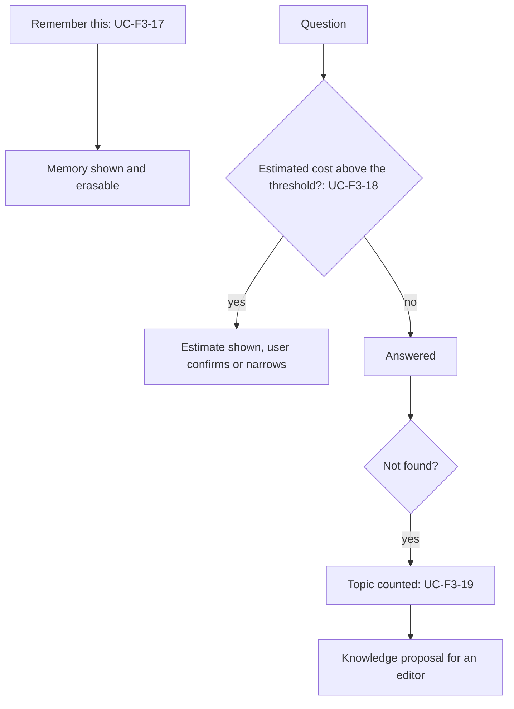

🏠 [Specs](../../../README.md) › 🧩 [Functional capabilities](../../README.md) › 🤖 [F3 Assistant](../README.md) ›
🔀 [Flows](README.md) › 🔀 FL-F3-12 Personal, cost-aware and learning

# 🔀 FL-F3-12 Personal, cost-aware and learning

**Status:** ✅ specified

## Summary

The AI assistant remembers what the user chose to keep, says what an expensive question will cost before running it, and
turns the topics it could not answer into knowledge proposals.

## Personas

- [U01 Employee](../../../01-users/personas/u01-employee.md)
- [U06 Human resources](../../../01-users/personas/u06-hr.md)
- [U13 Owner](../../../01-users/personas/u13-owner.md)

## Flowchart

## Sequence diagram

- [UC-F3-18 See the cost before an expensive question](../use-cases/12-personal-cost-aware-and-learning/uc-f03-18-see-the-cost-before-an-expensive-question.md#sequence-diagram)

## Steps

| Step | Persona | Screen | Use case | What happens |
|---|---|---|---|---|
| 1 | [U01](../../../01-users/personas/u01-employee.md) | [S-F3-21](../screens/12-personal-cost-aware-and-learning/s-f03-21-my-assistant-memory.md) | [UC-F3-17](../use-cases/12-personal-cost-aware-and-learning/uc-f03-17-keep-personal-preferences-in-the-assistants-memory.md) | Keep "my site is Lyon" in the AI assistant's memory |
| 2 | [U13](../../../01-users/personas/u13-owner.md) | [S-F3-22](../screens/12-personal-cost-aware-and-learning/s-f03-22-cost-estimate.md) | [UC-F3-18](../use-cases/12-personal-cost-aware-and-learning/uc-f03-18-see-the-cost-before-an-expensive-question.md) | See the cost estimate and confirm |
| 3 | [U06](../../../01-users/personas/u06-hr.md) | [S-F3-23](../screens/12-personal-cost-aware-and-learning/s-f03-23-unanswered-topics.md) | [UC-F3-19](../use-cases/12-personal-cost-aware-and-learning/uc-f03-19-turn-unanswered-topics-into-knowledge-proposals.md) | Turn an unanswered topic into a knowledge proposal |

### Entities and screens

| Entity | States in this flow | Shown at step and screen | Aggregated view |
|---|---|---|---|
| [E-F3-20 Memory item](../data/e-f03-20-memory-item.md) | Active | 1 [S-F3-21](../screens/12-personal-cost-aware-and-learning/s-f03-21-my-assistant-memory.md) | Memory items |
| [E-F3-02 Assistant answer](../data/e-f03-02-assistant-answer.md) | Recorded | 2 [S-F3-22](../screens/12-personal-cost-aware-and-learning/s-f03-22-cost-estimate.md) | Assistant answers |
| [E-F22-10 Run estimate](../../f22-unified-cost-management/data/e-f22-10-run-estimate.md) | Running | Shown elsewhere: [S-F22-10 Estimate](../../f22-unified-cost-management/screens/03-runs/s-f22-10-estimate.md) | Run estimates |
| [E-F1-03 User](../../f01-administration/data/e-f01-03-user.md) | Invited, Active, Deactivated | Shown elsewhere: [S-F1-03 Users](../../f01-administration/screens/03-user-lifecycle/s-f01-03-users.md) | Users |
| [E-F3-21 Unanswered topic](../data/e-f03-21-unanswered-topic.md) | Open, Proposal, Answered | 3 [S-F3-23](../screens/12-personal-cost-aware-and-learning/s-f03-23-unanswered-topics.md) | Unanswered topics |
| [E-F3-11 Knowledge proposal](../data/e-f03-11-knowledge-proposal.md) | Open, Approved, Declined | 3 [S-F3-23](../screens/12-personal-cost-aware-and-learning/s-f03-23-unanswered-topics.md) | Knowledge proposals |

## Errors

A memory item the user did not ask for, a question run without its estimate, a topic holding personal data (BR-F3-41,
BR-F3-42).

## Images

Every step and error, for each persona taking part, in light and dark mode (D120). Steps are numbered as in the Steps
table; E rows are the error cases.

| Step | Persona | Device | Light | Dark |
|---|---|---|---|---|
| 1 | U01 | desktop | [light](../images/12-personal-cost-aware-and-learning/u01-employee/1-my-assistant-memory-desktop-light.png) | [dark](../images/12-personal-cost-aware-and-learning/u01-employee/1-my-assistant-memory-desktop-dark.png) |
| 1 | U01 | phone | [light](../images/12-personal-cost-aware-and-learning/u01-employee/1-my-assistant-memory-phone-light.png) | [dark](../images/12-personal-cost-aware-and-learning/u01-employee/1-my-assistant-memory-phone-dark.png) |
| 2 | U13 | desktop | [light](../images/12-personal-cost-aware-and-learning/u13-owner/2-cost-estimate-desktop-light.png) | [dark](../images/12-personal-cost-aware-and-learning/u13-owner/2-cost-estimate-desktop-dark.png) |
| 2 | U13 | phone | [light](../images/12-personal-cost-aware-and-learning/u13-owner/2-cost-estimate-phone-light.png) | [dark](../images/12-personal-cost-aware-and-learning/u13-owner/2-cost-estimate-phone-dark.png) |
| 3 | U06 | desktop | [light](../images/12-personal-cost-aware-and-learning/u06-hr/3-unanswered-topics-desktop-light.png) | [dark](../images/12-personal-cost-aware-and-learning/u06-hr/3-unanswered-topics-desktop-dark.png) |
| E1 | U01 | desktop | [light](../images/12-personal-cost-aware-and-learning/u01-employee/e1-my-assistant-memory-refused-desktop-light.png) | [dark](../images/12-personal-cost-aware-and-learning/u01-employee/e1-my-assistant-memory-refused-desktop-dark.png) |
| E1 | U01 | phone | [light](../images/12-personal-cost-aware-and-learning/u01-employee/e1-my-assistant-memory-refused-phone-light.png) | [dark](../images/12-personal-cost-aware-and-learning/u01-employee/e1-my-assistant-memory-refused-phone-dark.png) |

## Open questions

None.

---

⬅️ [FL-F3-11 Trust the answers](fl-f03-11-trust-the-answers.md) · ⬆️ [Up](README.md) ·
➡️ [FL-F3-13 Voice, agents and briefings](fl-f03-13-voice-agents-and-briefings.md)
