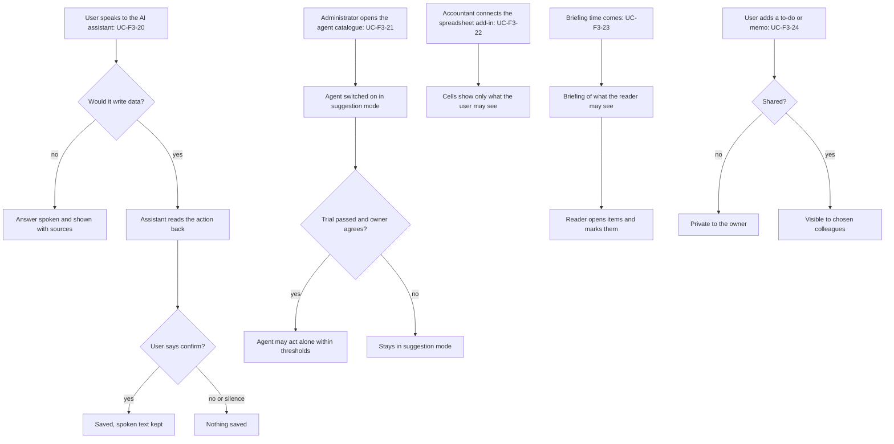
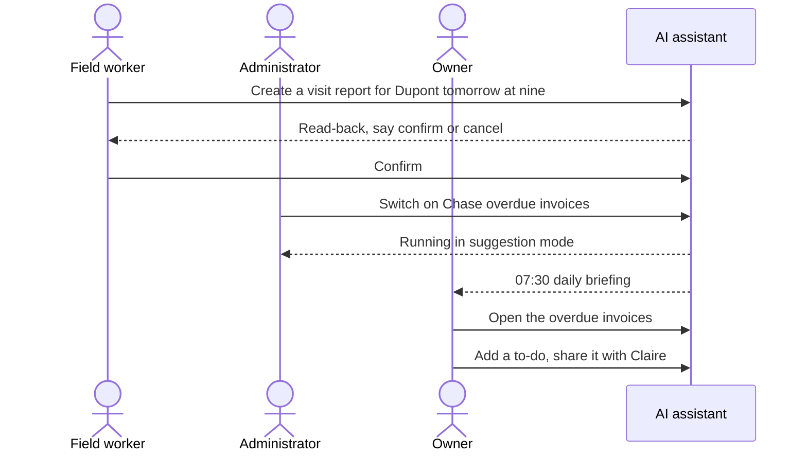

🏠 [Specs](../../../README.md) › 🧩 [Functional capabilities](../../README.md) › 🤖 [F3 Assistant](../README.md) ›
🔀 [Flows](README.md) › 🔀 FL-F3-13 Voice, agents and briefings

# 🔀 FL-F3-13 Voice, agents and briefings

**Status:** ✅ specified

## Summary

Five ways to reach the AI assistant away from the keyboard: hands-free voice with spoken confirmation
([UC-F3-20](../use-cases/13-voice-agents-and-briefings/uc-f03-20-talk-to-the-assistant-hands-free.md)), ready-made
agents that start in suggestion mode
([UC-F3-21](../use-cases/13-voice-agents-and-briefings/uc-f03-21-switch-on-a-ready-made-agent.md)), a spreadsheet add-in
on the user's own rights
([UC-F3-22](../use-cases/13-voice-agents-and-briefings/uc-f03-22-use-erp-data-in-a-spreadsheet-add-in.md)), a daily
briefing of only what the reader may see
([UC-F3-23](../use-cases/13-voice-agents-and-briefings/uc-f03-23-read-the-daily-briefing.md)) and private to-dos and
memos ([UC-F3-24](../use-cases/13-voice-agents-and-briefings/uc-f03-24-keep-personal-to-dos-and-memos.md)). The owner
chose each in the 2026-11-14 interview
([D522](../../../06-decisions/f03-assistant/d522-benchmark-gaps-f03-assistant.md)).

## Personas

- [U14 Field worker](../../../01-users/personas/u14-field-worker.md)
- [U13 Owner](../../../01-users/personas/u13-owner.md)
- [U07 Administrator](../../../01-users/personas/u07-administrator.md)
- [U05 Accounting](../../../01-users/personas/u05-accounting.md)
- [U02 Manager](../../../01-users/personas/u02-manager.md)
- [U01 Employee](../../../01-users/personas/u01-employee.md)
- [U16 Office worker](../../../01-users/personas/u16-office-worker.md)

## Flowchart

## Sequence diagram

## Steps

| Step | Persona | Screen | Use case | What happens |
|---|---|---|---|---|
| 1 | [U14](../../../01-users/personas/u14-field-worker.md), [U13](../../../01-users/personas/u13-owner.md) | [S-F3-24](../screens/13-voice-agents-and-briefings/s-f03-24-voice-mode.md) | [UC-F3-20](../use-cases/13-voice-agents-and-briefings/uc-f03-20-talk-to-the-assistant-hands-free.md) | A field worker or the owner speaks to the AI assistant and confirms an action aloud |
| 2 | [U07](../../../01-users/personas/u07-administrator.md), [U05](../../../01-users/personas/u05-accounting.md) | [S-F3-25](../screens/13-voice-agents-and-briefings/s-f03-25-agent-catalogue.md) | [UC-F3-21](../use-cases/13-voice-agents-and-briefings/uc-f03-21-switch-on-a-ready-made-agent.md) | The administrator or accounting switches on a ready-made agent in suggestion mode |
| 3 | [U05](../../../01-users/personas/u05-accounting.md), [U13](../../../01-users/personas/u13-owner.md) | [S-F3-26](../screens/13-voice-agents-and-briefings/s-f03-26-spreadsheet-add-in.md) | [UC-F3-22](../use-cases/13-voice-agents-and-briefings/uc-f03-22-use-erp-data-in-a-spreadsheet-add-in.md) | The accountant or the owner connects the spreadsheet add-in and loads a report |
| 4 | [U13](../../../01-users/personas/u13-owner.md), [U02](../../../01-users/personas/u02-manager.md) | [S-F3-27](../screens/13-voice-agents-and-briefings/s-f03-27-daily-briefing.md) | [UC-F3-23](../use-cases/13-voice-agents-and-briefings/uc-f03-23-read-the-daily-briefing.md) | The owner or a manager reads the daily briefing |
| 5 | [U01](../../../01-users/personas/u01-employee.md), [U16](../../../01-users/personas/u16-office-worker.md) | [S-F3-28](../screens/13-voice-agents-and-briefings/s-f03-28-my-to-dos.md) | [UC-F3-24](../use-cases/13-voice-agents-and-briefings/uc-f03-24-keep-personal-to-dos-and-memos.md) | An employee or an office worker adds, shares and ticks to-dos |

### Entities and screens

| Entity | States in this flow | Shown at step and screen | Aggregated view |
|---|---|---|---|
| [E-F3-24 Agent template](../data/e-f03-24-agent-template.md) | Draft, Published, Withdrawn | 2 [S-F3-25](../screens/13-voice-agents-and-briefings/s-f03-25-agent-catalogue.md) | Agent templates |
| [E-F3-25 Add-in connection](../data/e-f03-25-add-in-connection.md) | Connected, Expired, Revoked | 3 [S-F3-26](../screens/13-voice-agents-and-briefings/s-f03-26-spreadsheet-add-in.md) | Add-in connections |
| [E-F3-26 Briefing](../data/e-f03-26-briefing.md) | Planned, Generated, Delivered, Read, Failed, Skipped | 4 [S-F3-27](../screens/13-voice-agents-and-briefings/s-f03-27-daily-briefing.md) | Briefings |
| [E-F3-27 To-do](../data/e-f03-27-to-do.md) | Open, Done, Dropped | 5 [S-F3-28](../screens/13-voice-agents-and-briefings/s-f03-28-my-to-dos.md) | To-dos |

## Errors

- **E1 The voice is not understood.** The AI assistant says so and shows what it heard
  ([BR-F3-43](../business-rules/br-f03-43-voice-actions-are-confirmed-aloud-before-writing.md)), step 1.
- **E2 A new agent is asked to act alone at once.** It stays in suggestion mode until its trial
  ([BR-F3-44](../business-rules/br-f03-44-ready-made-agents-start-in-suggestion-mode.md)), step 2.
- **E3 A list the user may not see in the add-in.** It is not offered
  ([BR-F3-45](../business-rules/br-f03-45-add-ins-use-the-users-own-rights.md)), step 3.
- **E4 A briefing section is not available.** The briefing names it and goes on
  ([BR-F3-46](../business-rules/br-f03-46-briefings-show-only-what-the-reader-may-see.md)), step 4.
- **E5 A private to-do searched by an administrator.** It is never found
  ([BR-F3-47](../business-rules/br-f03-47-to-dos-are-private-unless-shared.md)), step 5.

## Images

Every step and error, for each persona taking part, in light and dark mode (D120). Steps are numbered as in the Steps
table; E rows are the error cases.

| Step | Persona | Device | Light | Dark |
|---|---|---|---|---|
| 1 | U13 | phone | [light](../images/13-voice-agents-and-briefings/u13-owner/1-voice-mode-phone-light.png) | [dark](../images/13-voice-agents-and-briefings/u13-owner/1-voice-mode-phone-dark.png) |
| 1 | U14 | phone | [light](../images/13-voice-agents-and-briefings/u14-field-worker/1-voice-mode-phone-light.png) | [dark](../images/13-voice-agents-and-briefings/u14-field-worker/1-voice-mode-phone-dark.png) |
| 1 | U13 | desktop | [light](../images/13-voice-agents-and-briefings/u13-owner/1-voice-mode-desktop-light.png) | [dark](../images/13-voice-agents-and-briefings/u13-owner/1-voice-mode-desktop-dark.png) |
| 1 | U13 | phone | [light](../images/13-voice-agents-and-briefings/u13-owner/1-voice-mode-phone-light.png) | [dark](../images/13-voice-agents-and-briefings/u13-owner/1-voice-mode-phone-dark.png) |
| 1 | U14 | phone | [light](../images/13-voice-agents-and-briefings/u14-field-worker/1-voice-mode-phone-light.png) | [dark](../images/13-voice-agents-and-briefings/u14-field-worker/1-voice-mode-phone-dark.png) |
| 2 | U05 | desktop | [light](../images/13-voice-agents-and-briefings/u05-accounting/2-agent-catalogue-desktop-light.png) | [dark](../images/13-voice-agents-and-briefings/u05-accounting/2-agent-catalogue-desktop-dark.png) |
| 2 | U07 | desktop | [light](../images/13-voice-agents-and-briefings/u07-administrator/2-agent-catalogue-desktop-light.png) | [dark](../images/13-voice-agents-and-briefings/u07-administrator/2-agent-catalogue-desktop-dark.png) |
| 2 | U05 | desktop | [light](../images/13-voice-agents-and-briefings/u05-accounting/2-agent-catalogue-desktop-light.png) | [dark](../images/13-voice-agents-and-briefings/u05-accounting/2-agent-catalogue-desktop-dark.png) |
| 2 | U07 | desktop | [light](../images/13-voice-agents-and-briefings/u07-administrator/2-agent-catalogue-desktop-light.png) | [dark](../images/13-voice-agents-and-briefings/u07-administrator/2-agent-catalogue-desktop-dark.png) |
| 3 | U05 | desktop | [light](../images/13-voice-agents-and-briefings/u05-accounting/3-spreadsheet-add-in-desktop-light.png) | [dark](../images/13-voice-agents-and-briefings/u05-accounting/3-spreadsheet-add-in-desktop-dark.png) |
| 3 | U13 | desktop | [light](../images/13-voice-agents-and-briefings/u13-owner/3-spreadsheet-add-in-desktop-light.png) | [dark](../images/13-voice-agents-and-briefings/u13-owner/3-spreadsheet-add-in-desktop-dark.png) |
| 3 | U05 | desktop | [light](../images/13-voice-agents-and-briefings/u05-accounting/3-spreadsheet-add-in-desktop-light.png) | [dark](../images/13-voice-agents-and-briefings/u05-accounting/3-spreadsheet-add-in-desktop-dark.png) |
| 3 | U13 | desktop | [light](../images/13-voice-agents-and-briefings/u13-owner/3-spreadsheet-add-in-desktop-light.png) | [dark](../images/13-voice-agents-and-briefings/u13-owner/3-spreadsheet-add-in-desktop-dark.png) |
| 3 | U13 | phone | [light](../images/13-voice-agents-and-briefings/u13-owner/3-spreadsheet-add-in-phone-light.png) | [dark](../images/13-voice-agents-and-briefings/u13-owner/3-spreadsheet-add-in-phone-dark.png) |
| 4 | U02 | desktop | [light](../images/13-voice-agents-and-briefings/u02-manager/4-daily-briefing-desktop-light.png) | [dark](../images/13-voice-agents-and-briefings/u02-manager/4-daily-briefing-desktop-dark.png) |
| 4 | U13 | phone | [light](../images/13-voice-agents-and-briefings/u13-owner/4-daily-briefing-phone-light.png) | [dark](../images/13-voice-agents-and-briefings/u13-owner/4-daily-briefing-phone-dark.png) |
| 4 | U02 | desktop | [light](../images/13-voice-agents-and-briefings/u02-manager/4-daily-briefing-desktop-light.png) | [dark](../images/13-voice-agents-and-briefings/u02-manager/4-daily-briefing-desktop-dark.png) |
| 4 | U02 | phone | [light](../images/13-voice-agents-and-briefings/u02-manager/4-daily-briefing-phone-light.png) | [dark](../images/13-voice-agents-and-briefings/u02-manager/4-daily-briefing-phone-dark.png) |
| 4 | U13 | desktop | [light](../images/13-voice-agents-and-briefings/u13-owner/4-daily-briefing-desktop-light.png) | [dark](../images/13-voice-agents-and-briefings/u13-owner/4-daily-briefing-desktop-dark.png) |
| 4 | U13 | phone | [light](../images/13-voice-agents-and-briefings/u13-owner/4-daily-briefing-phone-light.png) | [dark](../images/13-voice-agents-and-briefings/u13-owner/4-daily-briefing-phone-dark.png) |
| 5 | U01 | phone | [light](../images/13-voice-agents-and-briefings/u01-employee/5-my-to-dos-phone-light.png) | [dark](../images/13-voice-agents-and-briefings/u01-employee/5-my-to-dos-phone-dark.png) |
| 5 | U16 | desktop | [light](../images/13-voice-agents-and-briefings/u16-office-worker/5-my-to-dos-desktop-light.png) | [dark](../images/13-voice-agents-and-briefings/u16-office-worker/5-my-to-dos-desktop-dark.png) |
| 5 | U01 | desktop | [light](../images/13-voice-agents-and-briefings/u01-employee/5-my-to-dos-desktop-light.png) | [dark](../images/13-voice-agents-and-briefings/u01-employee/5-my-to-dos-desktop-dark.png) |
| 5 | U01 | phone | [light](../images/13-voice-agents-and-briefings/u01-employee/5-my-to-dos-phone-light.png) | [dark](../images/13-voice-agents-and-briefings/u01-employee/5-my-to-dos-phone-dark.png) |
| 5 | U16 | desktop | [light](../images/13-voice-agents-and-briefings/u16-office-worker/5-my-to-dos-desktop-light.png) | [dark](../images/13-voice-agents-and-briefings/u16-office-worker/5-my-to-dos-desktop-dark.png) |
| 5 | U16 | phone | [light](../images/13-voice-agents-and-briefings/u16-office-worker/5-my-to-dos-phone-light.png) | [dark](../images/13-voice-agents-and-briefings/u16-office-worker/5-my-to-dos-phone-dark.png) |
| E1 | U14 | phone | [light](../images/13-voice-agents-and-briefings/u14-field-worker/e1-the-voice-is-not-understood-phone-light.png) | [dark](../images/13-voice-agents-and-briefings/u14-field-worker/e1-the-voice-is-not-understood-phone-dark.png) |

## Open questions

None.

---

⬅️ [FL-F3-12 Personal, cost-aware and learning](fl-f03-12-personal-cost-aware-and-learning.md) · ⬆️ [Up](README.md)
