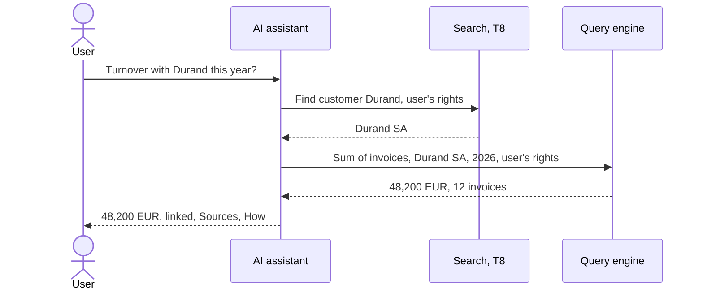

🏠 [Specs](../../../../README.md) › 🧩 [Functional capabilities](../../../README.md) › 🤖 [F3 Assistant](../../README.md) ›
📝 [Use cases](../README.md) › 📝 [Use cases: FL-F3-01 Ask the AI assistant](README.md) ›
📝 UC-F3-01 Ask a question about the company's data

# 📝 UC-F3-01 Ask a question about the company's data

**Status:** ✅ specified

## Summary

A user asks the AI assistant, in plain words, about the company's records and documents; it answers from what they may
see, with sources, exact figures and no invention.

## Personas

Every internal persona (D142): [U01](../../../../01-users/personas/u01-employee.md),
[U02](../../../../01-users/personas/u02-manager.md), [U03](../../../../01-users/personas/u03-sales.md),
[U04](../../../../01-users/personas/u04-purchasing.md), [U05](../../../../01-users/personas/u05-accounting.md),
[U06](../../../../01-users/personas/u06-hr.md), [U07](../../../../01-users/personas/u07-administrator.md),
[U12](../../../../01-users/personas/u12-marketing.md), [U13](../../../../01-users/personas/u13-owner.md),
[U14](../../../../01-users/personas/u14-field-worker.md),
[U15](../../../../01-users/personas/u15-warehouse-operator.md),
[U16](../../../../01-users/personas/u16-office-worker.md).

## Goal

Get an answer in seconds without building a report or searching screen by screen.

## Trigger

A question: "How much did Durand order this year?", "Which quotes are still open?".

## Frequency

Several times a day per user.

## Preconditions

The user is signed in; the AI assistant is on for their role (F1, UC-F1-08).

## Postconditions

The answer is saved in the user's conversation (private by default, D141); nothing is changed in the ERP.

## Main flow

1. The user opens the AI assistant panel (D49) on any screen and types or says (D145) the question.
2. The AI assistant finds the records and documents the user may see that match
   ([BR-F3-02](../../business-rules/br-f03-02-answers-use-only-what-the-user-may-see.md)).
3. A figure is computed by a query ([BR-F3-03](../../business-rules/br-f03-03-figures-come-from-queries.md)).
4. The answer shows the figure or the facts, each linked to its source, then a Sources list
   ([BR-F3-01](../../business-rules/br-f03-01-answers-cite-their-sources.md)).
5. The user opens a source in the side panel, or opens "How this was computed", or exports the table.

## Alternative flows

- 2a. **Ambiguous:** one clarifying question with clickable choices; the user picks one
  ([BR-F3-04](../../business-rules/br-f03-04-never-invent.md)).
- 3a. **Chart:** a series over time is shown as a chart with its table.
- 5a. **Follow-up:** the user asks a follow-up ("and last year?"); the AI assistant keeps the context of the
  conversation.
- 5b. **Pin:** the user pins the figure or chart to their home screen.
- 5c. **Feedback:** thumbs up or down, with an optional reason; a thumbs down on an answer using a knowledge item
  notifies its owner ([D186](../../../../06-decisions/f03-assistant/d186-answer-feedback.md),
  [E-F3-14](../../data/e-f03-14-answer-feedback.md)).

## Error flows

- Every error above that comes from a call (the model, an outside tool, a sync, a queued question) is shown only after 3
  retries with exponential backoff ([BR-F3-32](../../business-rules/br-f03-32-retry-before-an-error.md)).
- 2e. **Nothing found:** "I found nothing matching among the records you can see", with what was searched, and
  suggestions (spelling, period).
- 3e. **Cannot be computed:** the AI assistant says so and suggests a report (F2), never estimates.
- **Model unavailable:** an error message following the pattern (D122): what happened, why, what to do (try
  again, or search with the search bar), and a reference.
- **Too long:** after 30 seconds the user can stop the answer.

## Business rules

- [BR-F3-01 Answers cite their sources](../../business-rules/br-f03-01-answers-cite-their-sources.md)
- [BR-F3-02 Answers use only what the user may see](../../business-rules/br-f03-02-answers-use-only-what-the-user-may-see.md)
- [BR-F3-03 Figures come from queries, never the model](../../business-rules/br-f03-03-figures-come-from-queries.md)
- [BR-F3-04 Ask or say not found, never invent](../../business-rules/br-f03-04-never-invent.md)

- [BR-F3-33 Usage reports never show content](../../business-rules/br-f03-33-usage-reports-never-show-content.md)

## Entities

- [E-F3-01 Conversation](../../data/e-f03-01-conversation.md)
- [E-F3-02 Assistant answer](../../data/e-f03-02-assistant-answer.md)
- [E-F3-14 Answer feedback](../../data/e-f03-14-answer-feedback.md)

## Permissions

Those of the user (D12); nothing more. The AI assistant has no rights of its own.

## Notifications

A thumbs down on an answer that used a knowledge item notifies the item's owner, without the name of who rated (D186,
BR-F3-33).

## Audit events

Each question is logged with its user, time, the records read and the provider used (D5); the content of the
conversation is not in the audit trail, only in the conversation.

## AI involvement

The model understands the question, chooses the searches and queries, and writes the answer; the ERP runs the searches
(T8) and the queries, within the user's rights. Local model by default (D5); only what the request needs is sent to an
external provider (D83).

## API, MCP and A2A exposure

The same question can be asked through the MCP and A2A gateway (T6), with the caller's rights.

## Screens

- [S-F3-01 Assistant panel](../../screens/01-ask-the-assistant/s-f03-01-assistant-panel.md)

## Flowchart

See [FL-F3-01 Ask the AI assistant](../../flows/fl-f03-01-ask-the-assistant.md#flowchart).

## Sequence diagram

## Acceptance criteria

1. **Given** a question about a customer's invoices **when** answered **then** each fact links to its invoice and a
   Sources list closes the answer.
2. **Given** a user who sees only their own customers **when** they ask the company's turnover **then** the figure
   covers their customers only, with "Based on the records you can see", and nothing hints at other records.
3. **Given** a figure **when** shown **then** it comes from a query, and "How this was computed" shows the record type,
   filters, period, fields and record count.
4. **Given** two customers matching a name **when** asked **then** the AI assistant asks which one, with both as
   choices.
5. **Given** no match **when** asked **then** it says nothing was found and what it searched, and gives no invented
   answer.
6. **Given** a figure **when** the user exports it **then** the table downloads as a spreadsheet.
7. **Given** an answer that used a knowledge item **when** the user gives it a thumbs down with the reason "out of
   date" **then** the feedback is saved, counted in the usage dashboard, and the item's owner is told which item, not
   who rated.

## Non-functional notes

First words of the answer within 3 seconds on the local model for a small company (D22 sizing); figures exact
to the cent.

## Regulatory references

GDPR: personal data read only within the user's rights; EU AI Act: users know they are talking to an AI (the panel says
so).

## Related use cases

UC-F3-02 Ask about what is on screen; UC-F3-04 Summarise and draft; UC-F3-08 Manage and share conversations; F15 legal
assistant (same panel).

- [UC-F3-16 See the query behind a figure](../11-trust-the-answers/uc-f03-16-see-the-query-behind-a-figure.md)

- [UC-F3-17 Keep personal preferences in the AI assistant's memory](../12-personal-cost-aware-and-learning/uc-f03-17-keep-personal-preferences-in-the-assistants-memory.md)

- [UC-F3-18 See the cost before an expensive question](../12-personal-cost-aware-and-learning/uc-f03-18-see-the-cost-before-an-expensive-question.md)

- [UC-F3-19 Turn unanswered topics into knowledge proposals](../12-personal-cost-aware-and-learning/uc-f03-19-turn-unanswered-topics-into-knowledge-proposals.md)

## Open questions

None.

---

⬆️ [Up](README.md) ·
➡️ [UC-F3-02 Ask about what is on screen](../02-ask-about-the-screen/uc-f03-02-ask-about-what-is-on-screen.md)
