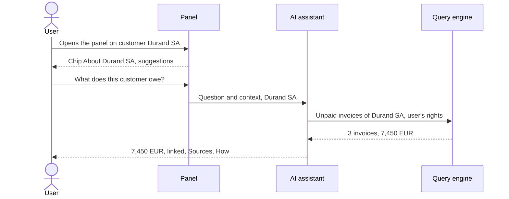

🏠 [Specs](../../../../README.md) › 🧩 [Functional capabilities](../../../README.md) › 🤖 [F3 Assistant](../../README.md) ›
📝 [Use cases](../README.md) › 📝 [Use cases: FL-F3-02 Ask about the screen](README.md) ›
📝 UC-F3-02 Ask about what is on screen

# 📝 UC-F3-02 Ask about what is on screen

**Status:** ✅ specified

## Summary

A user asks about the record, list or selection in front of them, picks a suggested question, or asks the AI assistant
to explain the screen itself.

## Personas

Every internal persona (D142): [U01](../../../../01-users/personas/u01-employee.md),
[U02](../../../../01-users/personas/u02-manager.md), [U03](../../../../01-users/personas/u03-sales.md),
[U04](../../../../01-users/personas/u04-purchasing.md), [U05](../../../../01-users/personas/u05-accounting.md),
[U06](../../../../01-users/personas/u06-hr.md), [U07](../../../../01-users/personas/u07-administrator.md),
[U12](../../../../01-users/personas/u12-marketing.md), [U13](../../../../01-users/personas/u13-owner.md),
[U14](../../../../01-users/personas/u14-field-worker.md),
[U15](../../../../01-users/personas/u15-warehouse-operator.md),
[U16](../../../../01-users/personas/u16-office-worker.md).

## Goal

Understand and act on what is on screen without describing it.

## Trigger

"What does this customer owe?", "Why can't I validate?", rows selected, a suggestion clicked.

## Frequency

Several times a day per user.

## Preconditions

As UC-F3-01; a record or list is open.

## Postconditions

As UC-F3-01; nothing is changed.

## Main flow

1. On a record or a list, the user opens the AI assistant panel; a chip shows the context ("About: Durand SA")
   ([BR-F3-05](../../business-rules/br-f03-05-screen-context-is-the-user-s-view.md)).
2. Suggested questions for the record type appear
   ([D154](../../../../06-decisions/f03-assistant/d154-suggested-questions.md)).
3. The user clicks one, or types "what does this customer owe?".
4. The AI assistant answers from the record and its linked records, with sources and exact figures (BR-F3-01, BR-F3-03).

## Alternative flows

- 1a. **Selection:** the user selects rows or text and chooses "Ask about the selection" (also right-click)
  ([D155](../../../../06-decisions/f03-assistant/d155-ask-about-selection.md)); the chip reads "About: 3 invoices".
- 1b. **List:** on a filtered list, "total?" uses the list's filters.
- 3a. **Explain:** "What does this field mean?", "why is Validate grey?", "why was my save refused?"; the AI assistant
  names the field's help, the rule, the status or the missing right, and who can help
  ([BR-F3-06](../../business-rules/br-f03-06-explanations-never-reveal-hidden-data.md)).
- 3b. **No context:** the user removes the chip; the question is answered as in UC-F3-01.

## Error flows

- 4e. As UC-F3-01: nothing found, cannot be computed, model unavailable.
- **Too large a selection:** over 1,000 rows, the AI assistant uses the list's filters instead and says so.

## Business rules

- [BR-F3-05](../../business-rules/br-f03-05-screen-context-is-the-user-s-view.md)
- [BR-F3-06](../../business-rules/br-f03-06-explanations-never-reveal-hidden-data.md)
- [BR-F3-02](../../business-rules/br-f03-02-answers-use-only-what-the-user-may-see.md)

## Entities

- [E-F3-03 Suggested question](../../data/e-f03-03-suggested-question.md)
- [E-F3-02 Assistant answer](../../data/e-f03-02-assistant-answer.md)

## Permissions

Those of the user. Configurators manage suggestions (F2, D96).

## Notifications

None.

## Audit events

As UC-F3-01.

## AI involvement

As UC-F3-01, with the screen context added to the request; only the fields the question needs are sent to an
external provider (D83).

## API, MCP and A2A exposure

None: screen context exists only in the user interface.

## Screens

- [S-F3-01 Assistant panel](../../screens/01-ask-the-assistant/s-f03-01-assistant-panel.md)

## Flowchart

See [FL-F3-02 Ask about the screen](../../flows/fl-f03-02-ask-about-the-screen.md#flowchart).

## Sequence diagram

## Acceptance criteria

1. **Given** customer Durand open **when** the user asks "what does this customer owe?" **then** the answer covers
   Durand's unpaid invoices, with sources.
2. **Given** a filtered list **when** the user asks "total?" **then** the total uses the list's filters.
3. **Given** 3 selected rows **when** "Ask about the selection" **then** the chip reads "About: 3 invoices" and the
   answer covers them only.
4. **Given** a record type with suggestions **when** the panel opens **then** they appear as chips.
5. **Given** a greyed-out action **when** the user asks why **then** the AI assistant names the missing right or status
   and who can help, and quotes no hidden value.
6. **Given** the context chip removed **when** the user asks **then** the screen is not used.

## Non-functional notes

As UC-F3-01.

## Regulatory references

As UC-F3-01.

## Related use cases

UC-F3-01; UC-F3-04 Summarise and draft; UC-F3-05 Find and get guided.

## Open questions

None.

---

⬅️ [UC-F3-01](../01-ask-the-assistant/uc-f03-01-ask-a-question-about-the-company-s-data.md) · ⬆️ [Up](README.md) ·
➡️ [UC-F3-03](../03-act-through-the-assistant/uc-f03-03-have-the-assistant-create-or-change-records.md)
