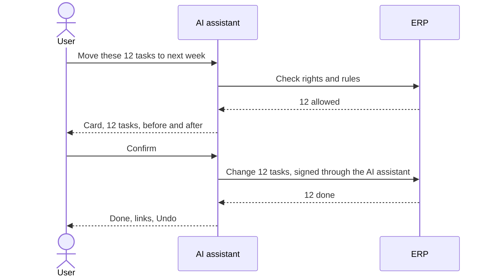

🏠 [Specs](../../../../README.md) › 🧩 [Functional capabilities](../../../README.md) › 🤖 [F3 Assistant](../../README.md) ›
📝 [Use cases](../README.md) › 📝 [Use cases: FL-F3-03 Act through the AI assistant](README.md) ›
📝 UC-F3-03 Have the AI assistant create or change records

# 📝 UC-F3-03 Have the AI assistant create or change records

**Status:** ✅ specified

## Summary

A user asks the AI assistant to create or change records; it shows exactly what it will do, the user confirms, it does
it, signed, with an Undo.

## Personas

Every internal persona (D142): [U01](../../../../01-users/personas/u01-employee.md),
[U02](../../../../01-users/personas/u02-manager.md), [U03](../../../../01-users/personas/u03-sales.md),
[U04](../../../../01-users/personas/u04-purchasing.md), [U05](../../../../01-users/personas/u05-accounting.md),
[U06](../../../../01-users/personas/u06-hr.md), [U07](../../../../01-users/personas/u07-administrator.md),
[U12](../../../../01-users/personas/u12-marketing.md), [U13](../../../../01-users/personas/u13-owner.md),
[U14](../../../../01-users/personas/u14-field-worker.md),
[U15](../../../../01-users/personas/u15-warehouse-operator.md),
[U16](../../../../01-users/personas/u16-office-worker.md).

## Goal

Do several clicks' or screens' work in one sentence, safely.

## Trigger

"Create a quote for Durand with 3 days of work", "move these 12 tasks to next week".

## Frequency

A few times a day per user.

## Preconditions

As UC-F3-01; the user has the rights for each change.

## Postconditions

The confirmed changes are made, signed (BR-F3-10), and can be undone (BR-F3-08).

## Main flow

1. The user asks for a change.
2. The AI assistant builds the change and shows a confirmation card: each record and each field, before and after
   (D140).
3. The user confirms, or edits a value in the card first.
4. The changes are made, signed ([BR-F3-10](../../business-rules/br-f03-10-changes-signed-through-the-assistant.md));
   the message shows the result and Undo ([BR-F3-08](../../business-rules/br-f03-08-a-batch-is-undone-as-a-whole.md)).
5. Each record links from the message.

## Alternative flows

- 2a. **Batch:** over the batch size ([BR-F3-09](../../business-rules/br-f03-09-batch-size-limit.md)), split into
  batches or the bulk-edit screen.
- 2b. **Irreversible or outward act:** prepared, and its screen opened for the user
  ([BR-F3-07](../../business-rules/br-f03-07-no-deletes-no-irreversible-acts.md)).
- 3a. **Cancel:** nothing is changed.
- 4a. **Undo:** the whole batch is reverted, if untouched since.

## Error flows

- 2e. **Delete asked:** refused with the records selected in their list
  ([BR-F3-07](../../business-rules/br-f03-07-no-deletes-no-irreversible-acts.md)).
- 2e. **Missing right:** "You can't change invoices; ask your administrator" (BR-F3-06).
- 4e. **A record changed between the card and the confirmation:** that record is skipped and listed; the others are
  done.
- 4e. **A business rule refuses a change:** it is listed with the rule's message, the others are done.
- Undo unavailable: who changed which record since (BR-F3-08).

## Business rules

- [BR-F3-07 No deletes, no irreversible acts](../../business-rules/br-f03-07-no-deletes-no-irreversible-acts.md)
- [BR-F3-08 A batch is undone as a whole](../../business-rules/br-f03-08-a-batch-is-undone-as-a-whole.md)
- [BR-F3-09 Batch size limit](../../business-rules/br-f03-09-batch-size-limit.md)
- [BR-F3-10 Changes signed through the AI assistant](../../business-rules/br-f03-10-changes-signed-through-the-assistant.md)

- [BR-F3-34 All capabilities via the AI assistant](../../business-rules/br-f03-34-every-capability-is-reachable-from-the-assistant.md)

## Entities

- [E-F3-04 Assistant change batch](../../data/e-f03-04-assistant-change-batch.md)
- [E-F3-22 AI assistant request](../../data/e-f03-22-ai-assistant-request.md)

## Permissions

Those of the user; the batch size setting: the administrator.

## Notifications

As the same change made by hand (assignments, status changes).

## Audit events

Each change in the record's history, signed (BR-F3-10); each batch: confirmed, done, skipped records, undone.

## AI involvement

The model turns the request into a change; the ERP checks rights and rules, shows the card, and makes the changes after
confirmation.

## API, MCP and A2A exposure

Through MCP and A2A, the same change needs the caller's confirmation step (T6).

## Screens

- [S-F3-02 Change confirmation card](../../screens/03-act-through-the-assistant/s-f03-02-change-confirmation-card.md)
- [S-F3-01 Assistant panel](../../screens/01-ask-the-assistant/s-f03-01-assistant-panel.md)

## Flowchart

See [FL-F3-03 Act through the AI assistant](../../flows/fl-f03-03-act-through-the-assistant.md#flowchart).

## Sequence diagram

## Acceptance criteria

1. **Given** a change request **when** the card shows **then** each record and field is listed before and after, and
   nothing is changed yet.
2. **Given** a confirmed card **when** done **then** the history reads "by <user>, through the assistant" with the
   conversation link.
3. **Given** a done batch untouched since **when** Undo **then** every change is reverted.
4. **Given** a record changed by someone else since **when** Undo **then** it is unavailable and names who changed what.
5. **Given** a delete request **when** asked **then** it is refused and the records are shown selected in their list.
6. **Given** "send the quote" **when** asked **then** the email is prepared and the user sends it.
7. **Given** 250 records and the default size **when** asked **then** they are offered in batches of 100 or in the
   bulk-edit screen.
8. **Given** the setting "No limit" **when** 250 records are asked **then** one card lists all 250.

## Non-functional notes

A batch of 100 changes is done within 10 seconds.

## Regulatory references

EU AI Act: human oversight, every change confirmed by a person.

## Related use cases

UC-F3-01; UC-F3-02; UC-F1-08 (assistant settings).

## Open questions

None.

---

⬅️ [UC-F3-02 Ask about what is on screen](../02-ask-about-the-screen/uc-f03-02-ask-about-what-is-on-screen.md) ·
⬆️ [Up](README.md) · ➡️ [UC-F3-04 Summarise and draft](../04-summarise-or-draft/uc-f03-04-summarise-and-draft.md)
