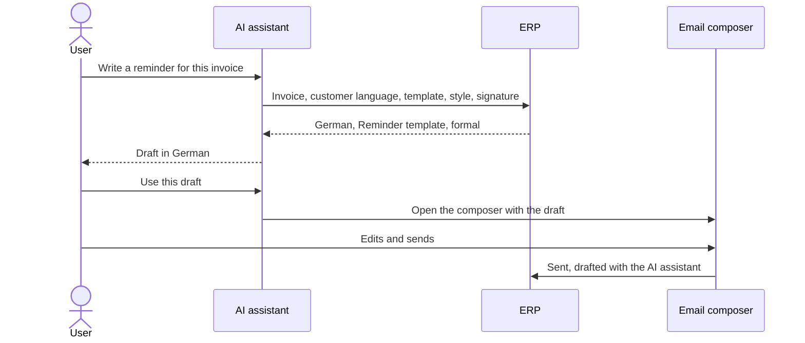

🏠 [Specs](../../../../README.md) › 🧩 [Functional capabilities](../../../README.md) › 🤖 [F3 Assistant](../../README.md) ›
📝 [Use cases](../README.md) › 📝 [Use cases: FL-F3-04 Summarise or draft](README.md) › 📝 UC-F3-04 Summarise and draft

# 📝 UC-F3-04 Summarise and draft

**Status:** ✅ specified

## Summary

A user asks the AI assistant to summarise a record, a document, a thread or a period, or to draft an email, a quote
text, a letter, a report or minutes, in the company's style.

## Personas

Every internal persona (D142): [U01](../../../../01-users/personas/u01-employee.md),
[U02](../../../../01-users/personas/u02-manager.md), [U03](../../../../01-users/personas/u03-sales.md),
[U04](../../../../01-users/personas/u04-purchasing.md), [U05](../../../../01-users/personas/u05-accounting.md),
[U06](../../../../01-users/personas/u06-hr.md), [U07](../../../../01-users/personas/u07-administrator.md),
[U12](../../../../01-users/personas/u12-marketing.md), [U13](../../../../01-users/personas/u13-owner.md),
[U14](../../../../01-users/personas/u14-field-worker.md),
[U15](../../../../01-users/personas/u15-warehouse-operator.md),
[U16](../../../../01-users/personas/u16-office-worker.md).

The writing style: [U07 Administrator](../../../../01-users/personas/u07-administrator.md),
[U13 Owner](../../../../01-users/personas/u13-owner.md)

## Goal

Read less and write faster, in the company's voice.

## Trigger

"Summarise this customer's last year", "write a reminder for this invoice".

## Frequency

Several times a day per user.

## Preconditions

As UC-F3-01.

## Postconditions

A summary in the panel, or a draft in its editor; nothing is sent.

## Main flow

1. On a record (UC-F3-02) or anywhere, the user asks for a summary or a draft.
2. The AI assistant reads what the user may see (BR-F3-02) and picks the fitting template
   ([BR-F3-11](../../business-rules/br-f03-11-drafts-follow-the-company-style.md)).
3. It writes in the company style, with the user's signature, in the recipient's language.
4. The user chooses "Use this draft" ([BR-F3-12](../../business-rules/br-f03-12-drafts-go-to-their-editor.md)) or Copy,
   or asks for changes ("shorter", "more formal").
5. The user edits and sends or saves it; the history notes it
   ([BR-F3-13](../../business-rules/br-f03-13-drafted-texts-are-traced.md)).

## Alternative flows

- 1a. **Summary of a period:** "what happened with Durand this year?", with sources (BR-F3-01).
- 1b. **Summary of a document:** an attached file or a meeting transcript (F4).
- 4a. **Rework:** the user asks for changes; each version stays in the conversation.
- **Style set-up:** an administrator sets the company writing style
  ([S-F3-03](../../screens/04-summarise-or-draft/s-f03-03-writing-style-settings.md)).

## Error flows

- Every error above that comes from a call (the model, an outside tool, a sync, a queued question) is shown only after 3
  retries with exponential backoff ([BR-F3-32](../../business-rules/br-f03-32-retry-before-an-error.md)).
- 2e. Nothing to summarise among what the user may see: said, as BR-F3-04.
- 2e. A document too long for the model: summarised part by part, then as a whole, and said so.
- Model unavailable: the error message pattern (D122).

## Business rules

- [BR-F3-11 Drafts follow the company style](../../business-rules/br-f03-11-drafts-follow-the-company-style.md)
- [BR-F3-12 Drafts go to their editor, never out](../../business-rules/br-f03-12-drafts-go-to-their-editor.md)
- [BR-F3-13 Drafted texts are traced](../../business-rules/br-f03-13-drafted-texts-are-traced.md)

## Entities

- [E-F3-05 Company writing style](../../data/e-f03-05-company-writing-style.md)
- [E-F3-02 Assistant answer](../../data/e-f03-02-assistant-answer.md)
- [E-F3-22 AI assistant request](../../data/e-f03-22-ai-assistant-request.md)

## Permissions

Those of the user; the writing style: administrators and the owner.

## Notifications

None.

## Audit events

"Drafted with the assistant" on what is saved or sent; the style's changes.

## AI involvement

The model writes; the ERP supplies the template, the style and the data the user may see.

## API, MCP and A2A exposure

Drafting is offered to MCP and A2A callers, with their rights; never sending.

## Screens

- [S-F3-01 Assistant panel](../../screens/01-ask-the-assistant/s-f03-01-assistant-panel.md)
- [S-F3-03 Writing style settings](../../screens/04-summarise-or-draft/s-f03-03-writing-style-settings.md)

## Flowchart

See [FL-F3-04 Summarise or draft](../../flows/fl-f03-04-summarise-or-draft.md#flowchart).

## Sequence diagram

## Acceptance criteria

1. **Given** a record **when** the user asks for a summary **then** it covers what they may see, with sources.
2. **Given** a reminder asked for a German customer **when** drafted **then** it is in German, in the company style,
   with the user's signature.
3. **Given** a fitting template **when** drafting **then** its sections are used.
4. **Given** a draft **when** "Use this draft" **then** it opens in its editor and nothing is sent.
5. **Given** a sent email drafted with the AI assistant **when** the history is read **then** it notes "drafted with the
   assistant".
6. **Given** the visible mention on **when** an email is sent **then** it carries "Written with AI help".
7. **Given** a words-to-avoid list **when** drafting **then** none of them is used.

## Non-functional notes

A one-page draft within 10 seconds on the local model.

## Regulatory references

EU AI Act, article 50: transparency of AI-generated content published to inform the public, hence the mention on F5
content.

## Related use cases

UC-F3-02; UC-F2 document templates; F4 meeting minutes; F5 social media drafts.

- [UC-F3-15 Defend against instructions hidden in content](../11-trust-the-answers/uc-f03-15-defend-against-instructions-hidden-in-content.md)

## Open questions

None.

---

⬅️ [UC-F3-03](../03-act-through-the-assistant/uc-f03-03-have-the-assistant-create-or-change-records.md) ·
⬆️ [Up](README.md) · ➡️ [UC-F3-05](../05-find-and-get-guided/uc-f03-05-find-a-record-or-a-screen-get-guided.md)
