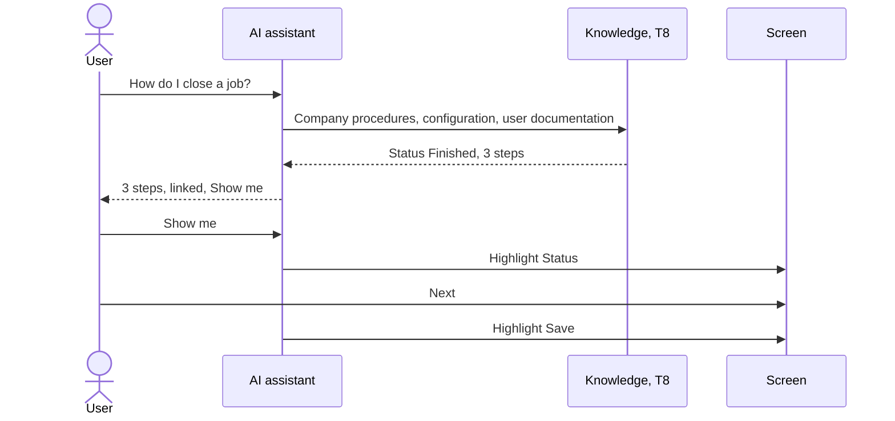

🏠 [Specs](../../../../README.md) › 🧩 [Functional capabilities](../../../README.md) › 🤖 [F3 Assistant](../../README.md) ›
📝 [Use cases](../README.md) › 📝 [Use cases: FL-F3-05 Find and get guided](README.md) ›
📝 UC-F3-05 Find a record or a screen, get guided

# 📝 UC-F3-05 Find a record or a screen, get guided

**Status:** ✅ specified

## Summary

A user asks the AI assistant to find a record, a screen or a setting, or how to do something; it opens or lists,
explains with the company's own setup, shows the way on screen, and turns a missing feature into a request.

## Personas

Every internal persona (D142): [U01](../../../../01-users/personas/u01-employee.md),
[U02](../../../../01-users/personas/u02-manager.md), [U03](../../../../01-users/personas/u03-sales.md),
[U04](../../../../01-users/personas/u04-purchasing.md), [U05](../../../../01-users/personas/u05-accounting.md),
[U06](../../../../01-users/personas/u06-hr.md), [U07](../../../../01-users/personas/u07-administrator.md),
[U12](../../../../01-users/personas/u12-marketing.md), [U13](../../../../01-users/personas/u13-owner.md),
[U14](../../../../01-users/personas/u14-field-worker.md),
[U15](../../../../01-users/personas/u15-warehouse-operator.md),
[U16](../../../../01-users/personas/u16-office-worker.md).

Requests: [U07 Administrator](../../../../01-users/personas/u07-administrator.md), Users with the Configurator role
(D96, D98)

## Goal

Never be lost in the ERP.

## Trigger

"Durand's last quote", "where are the leave settings?", "how do I close a job?".

## Frequency

Daily for new users, weekly after.

## Preconditions

As UC-F3-01.

## Postconditions

A record or screen is open, guidance is given, or a request is sent.

## Main flow

1. The user asks to find something.
2. One match opens; several are listed
   ([BR-F3-14](../../business-rules/br-f03-14-one-match-opens-several-are-listed.md)).
3. Or the user asks "how do I..."; the AI assistant answers with numbered steps in the company's labels, each linked
   ([BR-F3-15](../../business-rules/br-f03-15-guidance-matches-the-company-s-setup.md)).
4. The user chooses "Show me"; each button is highlighted on the real screen, one step at a time.

## Alternative flows

- 3a. **Company procedure:** the knowledge base has a procedure; its steps come first, linked.
- 3b. **Not possible yet:** the AI assistant says so and offers a request
  ([BR-F3-16](../../business-rules/br-f03-16-missing-features-become-requests.md)); the user edits and sends it.
- 3c. **Do it for me:** the user can ask the AI assistant to do it instead (UC-F3-03).
- **Configurators:** they see requests, answer, and mark them done, planned or declined; the requester is told.

## Error flows

- 2e. Nothing found: as BR-F3-04.
- 2e. Not reachable with the user's rights: as BR-F3-06.
- 4e. Show me loses its place (the user went elsewhere): it stops and offers to restart.

## Business rules

- [BR-F3-14 One match opens, several are listed](../../business-rules/br-f03-14-one-match-opens-several-are-listed.md)
- [BR-F3-15 Guidance matches the company's setup](../../business-rules/br-f03-15-guidance-matches-the-company-s-setup.md)
- [BR-F3-16 Missing features become requests](../../business-rules/br-f03-16-missing-features-become-requests.md)

## Entities

- [E-F3-06 Configuration request](../../data/e-f03-06-configuration-request.md)

## Permissions

Those of the user; requests are seen by configurators and administrators.

## Notifications

Configurators are told of a new request; the requester is told of its answer.

## Audit events

Requests: sent, answered, done, declined.

## AI involvement

The model understands the question and writes the steps; the ERP supplies the documentation, procedures and
configuration (T8) and the screens' names for Show me.

## API, MCP and A2A exposure

None.

## Screens

- [S-F3-01 Assistant panel](../../screens/01-ask-the-assistant/s-f03-01-assistant-panel.md)
- [S-F3-04 Show me overlay](../../screens/05-find-and-get-guided/s-f03-04-show-me-overlay.md)
- [S-F3-05 Configuration requests](../../screens/05-find-and-get-guided/s-f03-05-configuration-requests.md)

## Flowchart

See [FL-F3-05 Find and get guided](../../flows/fl-f03-05-find-and-get-guided.md#flowchart).

## Sequence diagram

## Acceptance criteria

1. **Given** one matching record **when** asked to find it **then** it opens.
2. **Given** several matches **when** asked **then** at most 10 are listed, best first.
3. **Given** a company label "Finished" **when** the user asks how to close a job **then** the steps use "Finished".
4. **Given** Show me **when** started **then** each button is highlighted on the real screen in turn.
5. **Given** a company procedure **when** relevant **then** its steps come first, linked.
6. **Given** a missing field **when** asked **then** the AI assistant says so and offers a pre-filled request.
7. **Given** a request sent **when** a configurator answers **then** the requester is told.

## Non-functional notes

A find opens within 2 seconds.

## Regulatory references

None.

## Related use cases

UC-F3-02 (explain the screen); UC-F3-03; UC-F3-07 (knowledge base); F2 (what configurators then build).

## Open questions

None.

---

⬅️ [UC-F3-04 Summarise and draft](../04-summarise-or-draft/uc-f03-04-summarise-and-draft.md) · ⬆️ [Up](README.md) ·
➡️ [UC-F3-06](../06-use-an-outside-tool/uc-f03-06-use-an-outside-tool-through-the-assistant.md)
