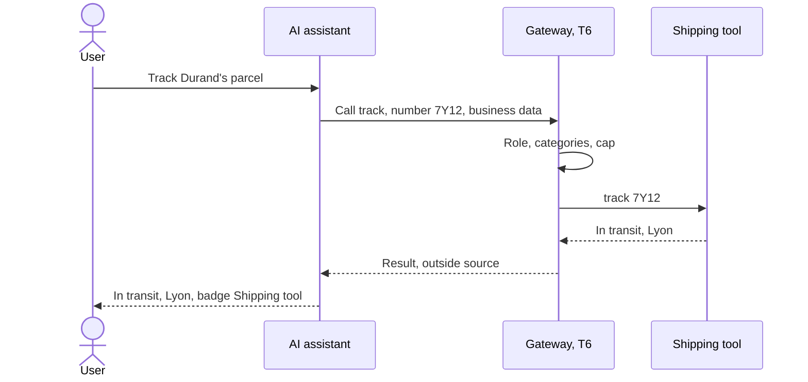

🏠 [Specs](../../../../README.md) › 🧩 [Functional capabilities](../../../README.md) › 🤖 [F3 Assistant](../../README.md) ›
📝 [Use cases](../README.md) › 📝 [Use cases: FL-F3-06 Use an outside tool](README.md) ›
📝 UC-F3-06 Use an outside tool through the AI assistant

# 📝 UC-F3-06 Use an outside tool through the AI assistant

**Status:** ✅ specified

## Summary

A user asks something that needs an outside tool (an MCP server, an A2A agent or an outside API, UC-F1-07); the
AI assistant calls it within the role's rights, the allowed data and the caps, and shows the result as outside.

## Personas

Roles allowed per connection (D80); every internal persona can be: [U01](../../../../01-users/personas/u01-employee.md),
[U02](../../../../01-users/personas/u02-manager.md), [U03](../../../../01-users/personas/u03-sales.md),
[U04](../../../../01-users/personas/u04-purchasing.md), [U05](../../../../01-users/personas/u05-accounting.md),
[U06](../../../../01-users/personas/u06-hr.md), [U07](../../../../01-users/personas/u07-administrator.md),
[U12](../../../../01-users/personas/u12-marketing.md), [U13](../../../../01-users/personas/u13-owner.md),
[U14](../../../../01-users/personas/u14-field-worker.md),
[U15](../../../../01-users/personas/u15-warehouse-operator.md),
[U16](../../../../01-users/personas/u16-office-worker.md).

## Goal

Use the company's other tools from one place.

## Trigger

"Track Durand's parcel", "add this meeting to my calendar", "open GitHub issues for this project".

## Frequency

Depends on the connections; daily for common ones.

## Preconditions

A connection is on, and the user's role has its See or Change (D80); or the user has a personal connection (BR-F3-19).

## Postconditions

The result is in the conversation, marked as outside; a change on the outside tool is done only after confirmation if
the connection says "always ask" (D81); the call is logged.

## Main flow

1. The user asks; the AI assistant picks the tool among those their role may use.
2. It sends only the needed, allowed data ([BR-F3-17](../../business-rules/br-f03-17-only-allowed-data-leaves.md)); the
   conversation shows "Sent to <tool>".
3. A read call runs; a change asks first when the connection is set to "always ask" (D81).
4. The result shows with the tool's name and an "outside source" badge
   ([BR-F3-18](../../business-rules/br-f03-18-outside-results-are-marked.md)).

## Alternative flows

- 4a. **Save it:** the user asks to save the result into a record; a confirmation card (UC-F3-03).
- **Personal connection:** the user connects their own account in My connections
  ([BR-F3-19](../../business-rules/br-f03-19-personal-connections-for-allowed-services.md)).
- **Cap near:** administrators are warned at 80 % ([BR-F3-20](../../business-rules/br-f03-20-outside-call-caps.md)).

## Error flows

- Every error above that comes from a call (the model, an outside tool, a sync, a queued question) is shown only after 3
  retries with exponential backoff ([BR-F3-32](../../business-rules/br-f03-32-retry-before-an-error.md)).
- 1e. No tool for the request among the user's: said; offers a configuration request (BR-F3-16).
- 2e. Data not allowed: refused, naming the tool, not the data.
- 3e. Outside tool down or slow: the error message pattern (D122), after 30 seconds.
- 3e. Cap reached: stopped, with when it resets.
- 3e. Personal sign-in expired: "Reconnect your calendar" with a link.

## Business rules

- [BR-F3-17 Only allowed data leaves](../../business-rules/br-f03-17-only-allowed-data-leaves.md)
- [BR-F3-18 Outside results are marked](../../business-rules/br-f03-18-outside-results-are-marked.md)
- [BR-F3-19 Personal connections for allowed services](../../business-rules/br-f03-19-personal-connections-for-allowed-services.md)
- [BR-F3-20 Outside call caps](../../business-rules/br-f03-20-outside-call-caps.md)

- [BR-F3-34 All capabilities via the AI assistant](../../business-rules/br-f03-34-every-capability-is-reachable-from-the-assistant.md)

## Entities

- [E-F1-08 Agent connection](../../../f01-administration/data/e-f01-08-agent-connection.md)
- [E-F3-07 Personal connection](../../data/e-f03-07-personal-connection.md)
- [E-F3-08 Outside call](../../data/e-f03-08-outside-call.md)
- [E-F3-22 AI assistant request](../../data/e-f03-22-ai-assistant-request.md)

## Permissions

The role matrix rows of each connection (D80); the administrator sets categories, caps and allowed personal services.

## Notifications

Administrators: a cap at 80 % and 100 %; the user: a personal sign-in to renew.

## Audit events

Each call: user, tool, operation, data categories sent, result status; personal connections added and removed.

## AI involvement

The model picks the tool and builds the call; the ERP enforces rights, categories, confirmation and caps.

## API, MCP and A2A exposure

This use case is the client side of T6; the server side is UC-F1-07's.

## Screens

- [S-F3-01 Assistant panel](../../screens/01-ask-the-assistant/s-f03-01-assistant-panel.md)
- [S-F3-06 My connections](../../screens/06-use-an-outside-tool/s-f03-06-my-connections.md)
- [S-F1-07 Connections](../../../f01-administration/screens/05-connect-an-external-tool/s-f01-07-connections.md)

## Flowchart

See [FL-F3-06 Use an outside tool](../../flows/fl-f03-06-use-an-outside-tool.md#flowchart).

## Sequence diagram

## Acceptance criteria

1. **Given** a role without the connection **when** the user asks **then** the tool is not used.
2. **Given** a connection allowing business data **when** a call needs a contact's email **then** it is refused.
3. **Given** a call **when** made **then** "Sent to <tool>" shows the exact data sent.
4. **Given** a result **when** shown **then** it has the tool's name and the outside source badge.
5. **Given** "save this" **when** asked **then** a confirmation card comes first.
6. **Given** an allowed personal service **when** the user signs in **then** the AI assistant can use it for that user
   only.
7. **Given** a cap reached **when** called **then** the call stops with when it resets; administrators were warned at 80
   %.

## Non-functional notes

Outside calls time out after 30 seconds.

## Regulatory references

GDPR: personal data sent outside only under an allowed category, logged; the outside service is a processor or recipient
the company must list.

## Related use cases

UC-F1-07 Connect an external MCP server or A2A agent; UC-F3-03; UC-F3-05.

- [UC-F3-15 Defend against instructions hidden in content](../11-trust-the-answers/uc-f03-15-defend-against-instructions-hidden-in-content.md)

## Open questions

None.

---

⬅️ [UC-F3-05](../05-find-and-get-guided/uc-f03-05-find-a-record-or-a-screen-get-guided.md) · ⬆️ [Up](README.md) ·
➡️ [UC-F3-07 Manage the company knowledge base](../07-manage-knowledge/uc-f03-07-manage-the-company-knowledge-base.md)
