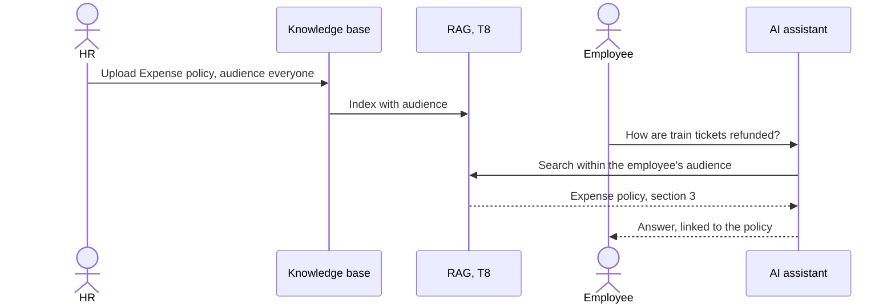

🏠 [Specs](../../../../README.md) › 🧩 [Functional capabilities](../../../README.md) › 🤖 [F3 Assistant](../../README.md) ›
📝 [Use cases](../README.md) › 📝 [Use cases: FL-F3-07 Manage knowledge](README.md) ›
📝 UC-F3-07 Manage the company knowledge base

# 📝 UC-F3-07 Manage the company knowledge base

**Status:** ✅ specified

## Summary

HR, administrators, the owner and the knowledge editors they name fill and keep the company's knowledge base
(procedures, policies, guides) for the AI assistant; any user proposes items and fixes.

## Personas

- [U06 HR](../../../../01-users/personas/u06-hr.md)
- [U07 Administrator](../../../../01-users/personas/u07-administrator.md)
- [U13 Owner](../../../../01-users/personas/u13-owner.md)
- Knowledge editors they name per folder (D176)
- Every internal persona proposes items and fixes (D176)

## Goal

The AI assistant answers with the company's own rules and ways of working.

## Trigger

A new procedure, a policy change, a review reminder, a user's proposal.

## Frequency

A few items a month; reviews yearly.

## Preconditions

The user is HR, an administrator, the owner or a folder's editor; any user to propose.

## Postconditions

Items are indexed (T8) for their audience; the AI assistant uses them.

## Main flow

1. The manager opens the knowledge base and a folder.
2. They upload files, write a page, or connect a synced folder
   ([D173](../../../../06-decisions/f03-assistant/d173-knowledge-content.md)).
3. They set the audience ([BR-F3-21](../../business-rules/br-f03-21-knowledge-stays-within-its-audience.md)), the owner
   and the review period ([BR-F3-22](../../business-rules/br-f03-22-out-of-date-knowledge-is-flagged.md)).
4. They publish; the items are indexed and the AI assistant uses them for their audience.

## Alternative flows

- 2a. **Synced folder:** a shared drive or website section, re-read on change
  ([BR-F3-24](../../business-rules/br-f03-24-synced-sources-follow-their-origin.md)).
- 3a. **Editors:** they name knowledge editors for a folder.
- **Proposal:** any user chooses "Propose an item" or "Propose a fix"; an editor approves, changes or declines
  ([BR-F3-23](../../business-rules/br-f03-23-proposals-need-an-editor.md)).
- **Review:** the owner gets a reminder, opens the item, updates it or marks it reviewed.
- **Test:** the editor asks the AI assistant a question "as" a role, to check what it would use.

## Error flows

- Every error above that comes from a call (the model, an outside tool, a sync, a queued question) is shown only after 3
  retries with exponential backoff ([BR-F3-32](../../business-rules/br-f03-32-retry-before-an-error.md)).
- 2e. A file not readable (scanned without text, protected): text is recognised (OCR) when possible,
  otherwise the editor is told, with the error message pattern (D122).
- 2e. A synced origin unreachable: the last copy is kept, editors are told.
- 2e. A file over 100 MB: refused.

## Business rules

- [BR-F3-21 Knowledge stays within its audience](../../business-rules/br-f03-21-knowledge-stays-within-its-audience.md)
- [BR-F3-22 Out-of-date knowledge is flagged](../../business-rules/br-f03-22-out-of-date-knowledge-is-flagged.md)
- [BR-F3-23 Proposals need an editor](../../business-rules/br-f03-23-proposals-need-an-editor.md)
- [BR-F3-24 Synced sources follow their origin](../../business-rules/br-f03-24-synced-sources-follow-their-origin.md)

## Entities

- [E-F3-09 Knowledge item](../../data/e-f03-09-knowledge-item.md)
- [E-F3-10 Knowledge folder](../../data/e-f03-10-knowledge-folder.md)
- [E-F3-11 Knowledge proposal](../../data/e-f03-11-knowledge-proposal.md)

## Permissions

HR, administrators, the owner: everything; knowledge editors: their folders; every internal user: read within the
audience, propose.

## Notifications

Editors: a new proposal, a sync failure; owners: a review due; proposers: the decision.

## Audit events

Items added, changed, published, removed; audience changes; proposals and decisions.

## AI involvement

Items are indexed by T8 with their audience; the AI assistant suggests a title, a summary and tags on upload.

## API, MCP and A2A exposure

Items can be added through the API, with the caller's rights.

## Screens

- [S-F3-07 Knowledge base](../../screens/07-manage-knowledge/s-f03-07-knowledge-base.md)
- [S-F3-08 Knowledge item editor](../../screens/07-manage-knowledge/s-f03-08-knowledge-item-editor.md)

## Flowchart

See [FL-F3-07 Manage knowledge](../../flows/fl-f03-07-manage-knowledge.md#flowchart).

## Sequence diagram

## Acceptance criteria

1. **Given** an item for HR only **when** a sales person asks a related question **then** it is not used.
2. **Given** an item past its review date **when** the AI assistant uses it **then** the answer warns it may be out of
   date, and its owner was reminded.
3. **Given** a synced folder **when** a file is deleted at the origin **then** it is no longer used within the hour.
4. **Given** a user's proposal **when** an editor approves **then** the item is updated and the proposer told.
5. **Given** a declined proposal **when** declined **then** the proposer gets the reason.
6. **Given** a knowledge editor of one folder **when** they open another folder **then** they cannot change it.

## Non-functional notes

A new item is usable by the AI assistant within 5 minutes.

## Regulatory references

GDPR: knowledge items with personal data follow their audience; copyright of uploaded material is the company's
responsibility.

## Related use cases

UC-F3-01; UC-F3-05 (procedures in guidance); F15 (the law, a separate corpus).

- [UC-F3-19 Turn unanswered topics into knowledge proposals](../12-personal-cost-aware-and-learning/uc-f03-19-turn-unanswered-topics-into-knowledge-proposals.md)

## Open questions

None.

---

⬅️ [UC-F3-06](../06-use-an-outside-tool/uc-f03-06-use-an-outside-tool-through-the-assistant.md) · ⬆️ [Up](README.md) ·
➡️ [UC-F3-08](../08-manage-and-share-conversations/uc-f03-08-manage-and-share-conversations.md)
