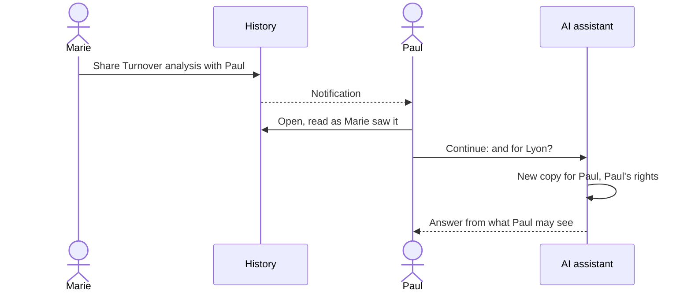

🏠 [Specs](../../../../README.md) › 🧩 [Functional capabilities](../../../README.md) › 🤖 [F3 Assistant](../../README.md) ›
📝 [Use cases](../README.md) › 📝 [Use cases: FL-F3-08 Manage and share conversations](README.md) ›
📝 UC-F3-08 Manage and share conversations

# 📝 UC-F3-08 Manage and share conversations

**Status:** ✅ specified

## Summary

A user finds, organises, shares and deletes their conversations with the AI assistant; colleagues read shared ones and
continue them as their own copy.

## Personas

Every internal persona (D142): [U01](../../../../01-users/personas/u01-employee.md),
[U02](../../../../01-users/personas/u02-manager.md), [U03](../../../../01-users/personas/u03-sales.md),
[U04](../../../../01-users/personas/u04-purchasing.md), [U05](../../../../01-users/personas/u05-accounting.md),
[U06](../../../../01-users/personas/u06-hr.md), [U07](../../../../01-users/personas/u07-administrator.md),
[U12](../../../../01-users/personas/u12-marketing.md), [U13](../../../../01-users/personas/u13-owner.md),
[U14](../../../../01-users/personas/u14-field-worker.md),
[U15](../../../../01-users/personas/u15-warehouse-operator.md),
[U16](../../../../01-users/personas/u16-office-worker.md).

## Goal

Find past answers and pass useful ones to colleagues.

## Trigger

"Where was that analysis?", a colleague who needs the same answer.

## Frequency

Weekly.

## Preconditions

The user has conversations.

## Postconditions

Conversations are organised, shared or deleted as chosen.

## Main flow

1. The user opens the history: conversations by date, pinned first.
2. They search the text, rename, pin, file into folders and tag
   ([D180](../../../../06-decisions/f03-assistant/d180-organise-conversations.md)).
3. They share one with named colleagues or a team
   ([BR-F3-26](../../business-rules/br-f03-26-share-only-with-chosen-colleagues.md)); the colleagues are notified.
4. A colleague opens it, reads it as the author saw it, and chooses Continue, which makes their own copy
   ([BR-F3-25](../../business-rules/br-f03-25-shared-conversations-continue-as-a-copy.md)).

## Alternative flows

- 2a. **Export:** a conversation as a document (PDF or Word), with its sources.
- 2b. **Delete:** a conversation, or a folder with its conversations, after confirmation.
- 3a. **Stop sharing:** closes it for the colleagues; their copies stay.
- **Retention:** a week before deletion, the owner is warned and can pin it
  ([BR-F3-27](../../business-rules/br-f03-27-conversation-retention.md)).

## Error flows

- 4e. Not shared with this user: "This conversation is not shared with you. Ask its author."
- 4e. Deleted: "This conversation was deleted by its author."
- 3e. A colleague who left the company: not offered.

## Business rules

- [BR-F3-25 Shared conversations continue as a copy](../../business-rules/br-f03-25-shared-conversations-continue-as-a-copy.md)
- [BR-F3-26 Share only with chosen colleagues](../../business-rules/br-f03-26-share-only-with-chosen-colleagues.md)
- [BR-F3-27 Conversation retention](../../business-rules/br-f03-27-conversation-retention.md)

## Entities

- [E-F3-01 Conversation](../../data/e-f03-01-conversation.md)
- [E-F3-12 Conversation folder](../../data/e-f03-12-conversation-folder.md)
- [E-F9-03 Department](../../../f09-hr-and-projects/data/e-f09-03-department.md)

## Permissions

The owner does everything on their conversations; colleagues it is shared with read and continue as a copy; the
administrator sets the retention, and sees no one's conversations.

## Notifications

Colleagues: a conversation shared with them; the owner: a deletion in a week.

## Audit events

Shared, sharing stopped, deleted, exported (never the content).

## AI involvement

The AI assistant suggests a title for each conversation.

## API, MCP and A2A exposure

None.

## Screens

- [S-F3-09 Conversation history](../../screens/08-manage-and-share-conversations/s-f03-09-conversation-history.md)
- [S-F3-10 Share a conversation](../../screens/08-manage-and-share-conversations/s-f03-10-share-a-conversation.md)

## Flowchart

See [FL-F3-08 Manage and share conversations](../../flows/fl-f03-08-manage-and-share-conversations.md#flowchart).

## Sequence diagram

## Acceptance criteria

1. **Given** a conversation shared with Paul **when** Lea opens the link **then** it is refused.
2. **Given** Paul reads it **when** he chooses Continue **then** a copy of his own is made and new answers use his
   rights.
3. **Given** sharing stopped **when** Paul opens it **then** it is refused, and his copy stays.
4. **Given** a conversation unused for the retention period and not pinned **when** the period ends **then** it is
   deleted, after a warning a week before.
5. **Given** the history **when** the user searches a word **then** matching conversations are listed.
6. **Given** folders and tags **when** the user files a conversation **then** it appears under that folder and tag.
7. **Given** an export **when** asked **then** a document with the questions, answers and sources is downloaded.

## Non-functional notes

Search returns within 1 second for 1,000 conversations.

## Regulatory references

GDPR: conversations are the owner's personal data; retention limits them; they are deleted with the account and included
in a data access request.

Legal values from the France country pack:
[CR-FR-051 Access and erasure requests](../../../../10-country-packs/france/data-protection/cr-fr-051-access-and-erasure.md).

## Related use cases

[UC-F3-01](../01-ask-the-assistant/uc-f03-01-ask-a-question-about-the-company-s-data.md); UC-F3-09 (the same history on
a phone).

- [UC-F3-17 Keep personal preferences in the AI assistant's memory](../12-personal-cost-aware-and-learning/uc-f03-17-keep-personal-preferences-in-the-assistants-memory.md)

## Open questions

None.

---

⬅️ [UC-F3-07 Manage the company knowledge base](../07-manage-knowledge/uc-f03-07-manage-the-company-knowledge-base.md) ·
⬆️ [Up](README.md) ·
➡️ [UC-F3-09 Use the AI assistant on a phone](../09-assistant-on-a-phone/uc-f03-09-use-the-assistant-on-a-phone.md)
