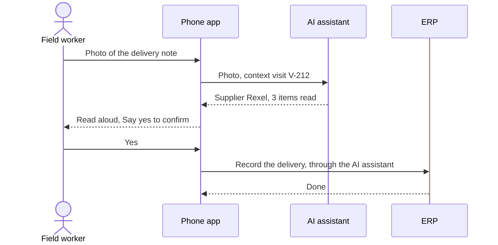

🏠 [Specs](../../../../README.md) › 🧩 [Functional capabilities](../../../README.md) › 🤖 [F3 Assistant](../../README.md) ›
📝 [Use cases](../README.md) › 📝 [Use cases: FL-F3-09 Assistant on a phone](README.md) ›
📝 UC-F3-09 Use the AI assistant on a phone

# 📝 UC-F3-09 Use the AI assistant on a phone

**Status:** ✅ specified

## Summary

A field worker or employee uses the AI assistant on a phone: by voice, hands-free if they wish, about the task at hand,
with photos, and with questions queued while offline.

## Personas

- [U14 Field worker](../../../../01-users/personas/u14-field-worker.md)
- [U01 Employee](../../../../01-users/personas/u01-employee.md)
- Every internal persona using a phone (D34)

## Goal

Get answers and record work without typing, on site.

## Trigger

"What did we fit last time?", a delivery note to record, a meter to read.

## Frequency

Several times a day for field workers.

## Preconditions

The user is signed in on the phone app (D34).

## Postconditions

As UC-F3-01 to UC-F3-03, on the phone.

## Main flow

1. On a task or visit, the user opens the AI assistant tab; the chip shows the task and the day
   ([BR-F3-31](../../business-rules/br-f03-31-phone-context-is-the-task-and-the-day.md)).
2. They tap the microphone and ask, or type.
3. The answer is shown, and read aloud in hands-free mode.
4. A change is read aloud and confirmed by voice, or by the card on screen
   ([BR-F3-28](../../business-rules/br-f03-28-hands-free-confirmations-are-spoken.md)).

## Alternative flows

- 2a. **Photo:** they take a photo; the AI assistant reads it and offers a record
  ([BR-F3-30](../../business-rules/br-f03-30-photos-fill-records-through-confirmation.md)).
- 2b. **Offline:** the question is queued and answered later, with a notification
  ([BR-F3-29](../../business-rules/br-f03-29-offline-questions-wait-for-the-network.md)).
- 1a. **Location:** a question needing it asks for permission first.
- 3a. **Short answers:** on a phone, answers are shorter, with "More" for the full answer.

## Error flows

- Every error above that comes from a call (the model, an outside tool, a sync, a queued question) is shown only after 3
  retries with exponential backoff ([BR-F3-32](../../business-rules/br-f03-32-retry-before-an-error.md)).
- 2e. Speech not understood: "I didn't catch that. Please say it again, or type it."
- 2e. Photo not readable: as BR-F3-30's example.
- 4e. Voice confirmation unclear: cancelled, the card stays on screen.
- Queued question failed: the error message pattern (D122), with Retry.

## Business rules

- [BR-F3-28 Hands-free confirmations are spoken](../../business-rules/br-f03-28-hands-free-confirmations-are-spoken.md)
- [BR-F3-29 Offline questions wait for the network](../../business-rules/br-f03-29-offline-questions-wait-for-the-network.md)
- [BR-F3-30 Photos fill records through confirmation](../../business-rules/br-f03-30-photos-fill-records-through-confirmation.md)
- [BR-F3-31 Phone context is the task and the day](../../business-rules/br-f03-31-phone-context-is-the-task-and-the-day.md)

## Entities

- [E-F3-13 Queued question](../../data/e-f03-13-queued-question.md)
- [E-F3-01 Conversation](../../data/e-f03-01-conversation.md)

## Permissions

Those of the user, as on a desktop.

## Notifications

An answer to a queued question; a confirmation waiting.

## Audit events

As UC-F3-01 and UC-F3-03; photos read (not their content).

## AI involvement

Speech to text and reading aloud (D145), the photo model (D183), the answering model; local by default (D5).

## API, MCP and A2A exposure

None beyond UC-F3-01.

## Screens

- [S-F3-11 Phone assistant](../../screens/09-assistant-on-a-phone/s-f03-11-phone-assistant.md)

## Flowchart

See [FL-F3-09 Assistant on a phone](../../flows/fl-f03-09-assistant-on-a-phone.md#flowchart).

## Sequence diagram

## Acceptance criteria

1. **Given** a visit open **when** the AI assistant opens **then** the chip shows the visit and the day.
2. **Given** hands-free mode **when** a change is asked **then** it is read aloud and done only after a clear yes.
3. **Given** a batch of 12 **when** asked by voice **then** the card is shown on screen.
4. **Given** no network **when** a question is asked **then** it is queued with the offline notice and answered later
   with a notification.
5. **Given** a delivery note photo **when** read **then** a confirmation card offers to record it.
6. **Given** location not allowed **when** a question needs it **then** permission is asked first.

## Non-functional notes

Speech is turned into text within 2 seconds; the phone app works on 4G and on weak networks.

## Regulatory references

GDPR: location only with the user's consent, withdrawable; photos may hold personal data and follow the record's
retention.

Legal values from the France country pack:
[CR-FR-054 Location only when needed and announced](../../../../10-country-packs/france/data-protection/cr-fr-054-location-with-consent.md).

## Related use cases

UC-F3-01 to UC-F3-03; UC-F3-08 (the same history on the phone); F9 field tasks.

## Open questions

None.

---

⬅️ [UC-F3-08](../08-manage-and-share-conversations/uc-f03-08-manage-and-share-conversations.md) · ⬆️ [Up](README.md) ·
➡️ [UC-F3-10 Create and run AI agents](../10-benchmark-additions/uc-f03-10-create-and-run-ai-agents.md)
