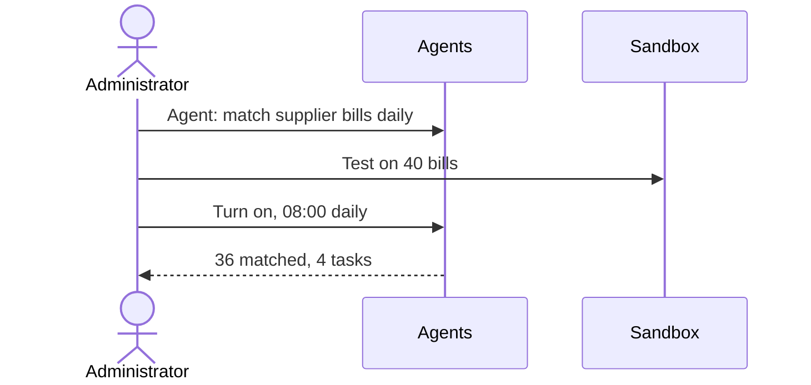

🏠 [Specs](../../../../README.md) › 🧩 [Functional capabilities](../../../README.md) › 🤖 [F3 Assistant](../../README.md) ›
📝 [Use cases](../README.md) › 📝 [Use cases: FL-F3-10 Benchmark additions](README.md) ›
📝 UC-F3-10 Create and run AI agents

# 📝 UC-F3-10 Create and run AI agents

**Status:** ✅ specified

## Summary

Define an agent's role, instructions, tools, sources and schedule; it runs always-on, on a schedule or on demand.

## Personas

- [U07 Administrator](../../../../01-users/personas/u07-administrator.md)
- [U05 Accounting](../../../../01-users/personas/u05-accounting.md)
- [U02 Manager](../../../../01-users/personas/u02-manager.md)

## Goal

Recurring work done by agents within set limits.

## Trigger

A recurring task to automate.

## Frequency

A few agents per company.

## Preconditions

F3 set up for the company.

## Postconditions

- **Succeeded:** the agent runs on its schedule within its limits.
- **Failed:** the agent stays off.

## Main flow

1. The administrator describes the agent on Agents ([S-F3-14](../../screens/10-benchmark-additions/s-f03-14-agents.md)):
   its role and instructions.
2. They choose its tools, sources, schedule (always-on, scheduled, on demand) and the role it acts as.
3. They test it in a sandbox,
   [UC-F2-16](../../../f02-no-code-configuration/use-cases/07-benchmark-additions/uc-f02-16-try-a-change-in-a-sandbox.md),
   on sample records.
4. They turn it on; it runs within its thresholds and amount limits
   ([BR-F3-35](../../business-rules/br-f03-35-agents-follow-thresholds-and-limits.md)).
5. Its actions are logged and checked by the audit agent ([UC-F3-11](uc-f03-11-govern-ai-agents.md)).

## Alternative flows

- 1a. Built from plain language,
  [UC-F2-15](../../../f02-no-code-configuration/use-cases/07-benchmark-additions/uc-f02-15-build-with-plain-language.md).

## Error flows

- 2e. A tool beyond the role: refused.
- 4e. Below its confidence threshold: a task for a person instead.

## Business rules

- [BR-F3-35 Agents follow thresholds and amount limits](../../business-rules/br-f03-35-agents-follow-thresholds-and-limits.md)

## Entities

- [E-F3-15 Agent](../../data/e-f03-15-agent.md)

## Permissions

Administrators; managers for agents on their team's work.

## Notifications

The owner of the agent: tasks and failures.

## Audit events

Created, changed, run, each action.

## AI involvement

Agents act within thresholds; people decide below.

## API, MCP and A2A exposure

Agents call T5 and T6 with their role's rights.

## Screens

- [S-F3-14](../../screens/10-benchmark-additions/s-f03-14-agents.md)

## Flowchart

See [FL-F3-10 Benchmark additions](../../flows/fl-f03-10-benchmark-additions.md#flowchart).

## Sequence diagram

## Acceptance criteria

1. **Given** an agent matching supplier bills with a threshold of 90 % **when** it runs on 40 bills **then** 36 are
   matched and 4 become tasks.
2. **Given** a tool for payments beyond its role **when** it is chosen **then** it is refused.
3. **Given** the agent off **when** 08:00 comes **then** nothing runs.

## Non-functional notes

D408's targets ([Performance](../../../../05-non-functional/performance.md)): 95 % of screens within 1 second; lists
paged on the server, the first page within 1 second; reports within 5 seconds or in the background.

## Regulatory references

Legal values from the country pack (D293).

## Related use cases

See [FL-F3-10](../../flows/fl-f03-10-benchmark-additions.md).

## Open questions

None.

---

⬅️ [UC-F3-09 Use the AI assistant on a phone](../09-assistant-on-a-phone/uc-f03-09-use-the-assistant-on-a-phone.md) ·
⬆️ [Up](README.md) · ➡️ [UC-F3-11 Govern AI agents](uc-f03-11-govern-ai-agents.md)
