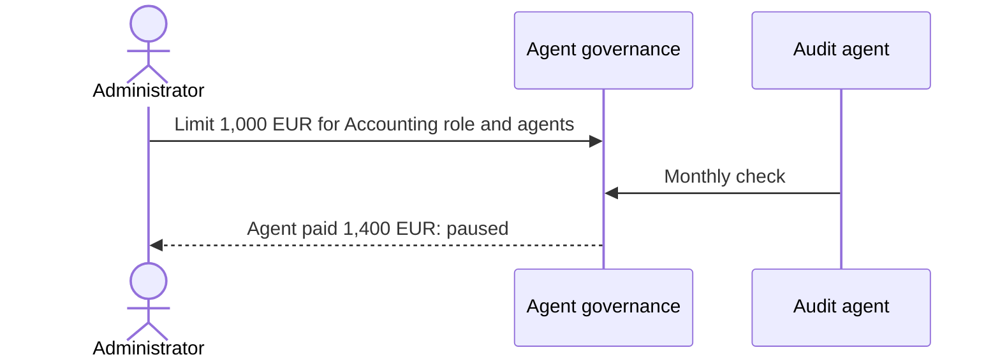

🏠 [Specs](../../../../README.md) › 🧩 [Functional capabilities](../../../README.md) › 🤖 [F3 Assistant](../../README.md) ›
📝 [Use cases](../README.md) › 📝 [Use cases: FL-F3-10 Benchmark additions](README.md) › 📝 UC-F3-11 Govern AI agents

# 📝 UC-F3-11 Govern AI agents

**Status:** ✅ specified

## Summary

Confidence thresholds, amount limits for people and agents alike, preview of affected records, written policies and an
audit agent.

## Personas

- [U07 Administrator](../../../../01-users/personas/u07-administrator.md)
- [U13 Owner](../../../../01-users/personas/u13-owner.md)
- [U05 Accounting](../../../../01-users/personas/u05-accounting.md)

## Goal

Agents and people under the same limits, and proof they keep them.

## Trigger

Setting up AI governance; a breach.

## Frequency

At setup; monthly reviews.

## Preconditions

F3 set up for the company.

## Postconditions

- **Succeeded:** thresholds, limits and policies apply; the audit report is read.
- **Failed:** a breaching agent is paused.

## Main flow

1. The administrator opens Agent governance
   ([S-F3-15](../../screens/10-benchmark-additions/s-f03-15-agent-governance.md)) and sets confidence thresholds and
   amount limits per role, the same for people and agents
   ([BR-F3-35](../../business-rules/br-f03-35-agents-follow-thresholds-and-limits.md)).
2. They write or upload the policies agents must follow.
3. Before an agent changes many records, it shows the records affected for confirmation.
4. The audit agent checks the agents' actions and reports monthly
   ([BR-F3-36](../../business-rules/br-f03-36-an-audit-agent-checks-agents.md)).
5. The owner reads the report.

## Alternative flows

- 4a. Pause an agent from the report.

## Error flows

- 4e. A breach: the agent is paused and the administrator told.

## Business rules

- [BR-F3-35 Agents follow thresholds and amount limits](../../business-rules/br-f03-35-agents-follow-thresholds-and-limits.md)
- [BR-F3-36 An audit agent checks the agents](../../business-rules/br-f03-36-an-audit-agent-checks-agents.md)

- [BR-F3-33 Usage reports never show content](../../business-rules/br-f03-33-usage-reports-never-show-content.md)

## Entities

- [E-F3-15 Agent](../../data/e-f03-15-agent.md)

## Permissions

Administrators and the owner.

## Notifications

Administrator: breaches; owner: monthly report.

## Audit events

Thresholds, limits, policies, pauses.

## AI involvement

The audit agent reviews; people decide.

## API, MCP and A2A exposure

None.

## Screens

- [S-F3-15](../../screens/10-benchmark-additions/s-f03-15-agent-governance.md)

## Flowchart

See [FL-F3-10 Benchmark additions](../../flows/fl-f03-10-benchmark-additions.md#flowchart).

## Sequence diagram

## Acceptance criteria

1. **Given** a limit of 1,000 EUR for the Accounting role **when** an agent acting as Accounting proposes 1,400 EUR
   **then** it needs a person's approval.
2. **Given** an agent breaching its policy **when** the audit agent finds it **then** it is paused and the administrator
   told.
3. **Given** the month ends **when** the report is produced **then** the owner reads it.

## Non-functional notes

D408's targets ([Performance](../../../../05-non-functional/performance.md)): 95 % of screens within 1 second; lists
paged on the server, the first page within 1 second; reports within 5 seconds or in the background.

## Regulatory references

Legal values from the country pack (D293).

## Related use cases

See [FL-F3-10](../../flows/fl-f03-10-benchmark-additions.md).

## Open questions

None.

---

⬅️ [UC-F3-10 Create and run AI agents](uc-f03-10-create-and-run-ai-agents.md) · ⬆️ [Up](README.md) ·
➡️ [UC-F3-12 Add AI fields to records](uc-f03-12-add-ai-fields-to-records.md)
