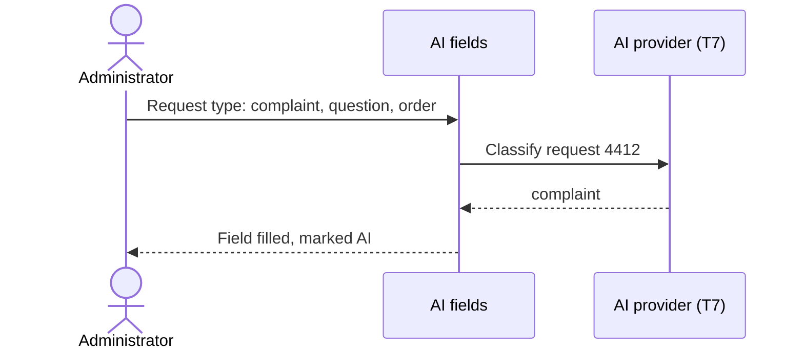

🏠 [Specs](../../../../README.md) › 🧩 [Functional capabilities](../../../README.md) › 🤖 [F3 Assistant](../../README.md) ›
📝 [Use cases](../README.md) › 📝 [Use cases: FL-F3-10 Benchmark additions](README.md) ›
📝 UC-F3-12 Add AI fields to records

# 📝 UC-F3-12 Add AI fields to records

**Status:** ✅ specified

## Summary

Fields filled by the AI: a summary, a classification, a live search result.

## Personas

- [U07 Administrator](../../../../01-users/personas/u07-administrator.md)
- [U02 Manager](../../../../01-users/personas/u02-manager.md)

## Goal

Records that summarise or classify themselves.

## Trigger

A record type needs an AI-filled field.

## Frequency

A few fields per company.

## Preconditions

F3 set up for the company.

## Postconditions

- **Succeeded:** the field fills and refreshes as set.
- **Failed:** the last value is kept and marked.

## Main flow

1. The administrator opens AI fields ([S-F3-16](../../screens/10-benchmark-additions/s-f03-16-ai-fields.md)) on a record
   type and adds a field: summary, classification or live search.
2. They write its instruction and its allowed values for a classification.
3. They choose when it refreshes: on change, daily, or by hand.
4. The field fills on records; users see it marked as AI-filled and can correct it.

## Alternative flows

- 3a. Bulk refresh of existing records.

## Error flows

- 4e. Provider down: the last value is kept and marked.
- 2e. A value outside the allowed list: left empty.

## Business rules

- See F3's rules.

## Entities

- [E-F3-16 AI field](../../data/e-f03-16-ai-field.md)

## Permissions

The Configurator role ([D96](../../../../06-decisions/f02-no-code-configuration/d96-configurator-role.md)) and
administrators; record rules apply to the data shown.

## Notifications

None.

## Audit events

Fields created; values written, corrected.

## AI involvement

Fills the field; a person may correct.

## API, MCP and A2A exposure

AI fields are read through T5 like any field.

## Screens

- [S-F3-16](../../screens/10-benchmark-additions/s-f03-16-ai-fields.md)

## Flowchart

See [FL-F3-10 Benchmark additions](../../flows/fl-f03-10-benchmark-additions.md#flowchart).

## Sequence diagram

## Acceptance criteria

1. **Given** a classification with complaint, question and order **when** a request "the delivery was late" is saved
   **then** the field shows complaint, marked AI.
2. **Given** a user corrects it to question **when** she saves **then** her value is kept.
3. **Given** the provider down **when** a refresh runs **then** the last value stays, marked as not refreshed.

## Non-functional notes

D408's targets ([Performance](../../../../05-non-functional/performance.md)): 95 % of screens within 1 second; lists
paged on the server, the first page within 1 second; reports within 5 seconds or in the background.

## Regulatory references

Legal values from the country pack (D293).

## Related use cases

See [FL-F3-10](../../flows/fl-f03-10-benchmark-additions.md).

## Open questions

None.

---

⬅️ [UC-F3-11 Govern AI agents](uc-f03-11-govern-ai-agents.md) · ⬆️ [Up](README.md) ·
➡️ [UC-F3-13 Use the AI assistant in chat apps](uc-f03-13-use-the-assistant-in-chat-apps.md)
