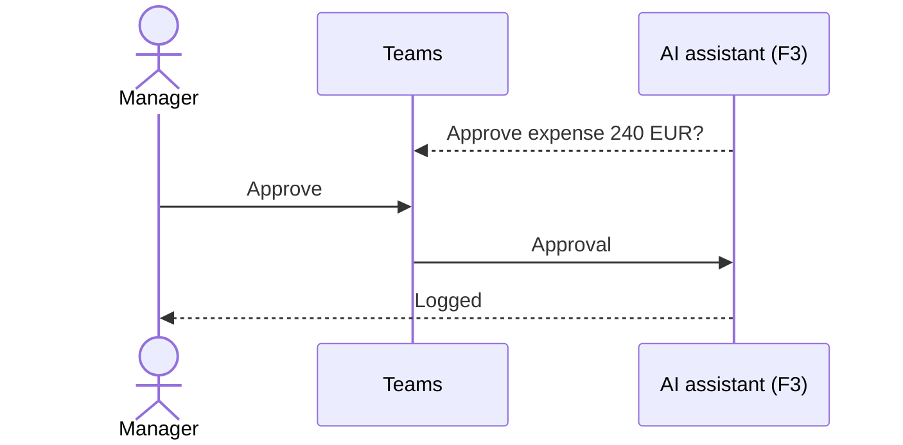

🏠 [Specs](../../../../README.md) › 🧩 [Functional capabilities](../../../README.md) › 🤖 [F3 Assistant](../../README.md) ›
📝 [Use cases](../README.md) › 📝 [Use cases: FL-F3-10 Benchmark additions](README.md) ›
📝 UC-F3-13 Use the AI assistant in chat apps

# 📝 UC-F3-13 Use the AI assistant in chat apps

**Status:** ✅ specified

## Summary

Ask, act and approve from Slack, Teams or Telegram, within the user's rights.

## Personas

- [U01 Employee](../../../../01-users/personas/u01-employee.md)
- [U02 Manager](../../../../01-users/personas/u02-manager.md)
- [U03 Sales](../../../../01-users/personas/u03-sales.md)

## Goal

Ask, act and approve from the chat app the team already uses.

## Trigger

A user links their account.

## Frequency

Daily.

## Preconditions

F3 set up for the company.

## Postconditions

- **Succeeded:** questions answered and approvals made in the chat app, logged in SimpleERP.
- **Failed:** an unlinked account is asked to link.

## Main flow

1. The administrator connects the chat app on Chat apps
   ([S-F3-17](../../screens/10-benchmark-additions/s-f03-17-chat-apps.md)) (T12).
2. Each user links their account once.
3. The user asks in the chat app; the AI assistant answers within their rights
   ([BR-F3-02](../../business-rules/br-f03-02-answers-use-only-what-the-user-may-see.md)).
4. Approvals are pushed to the chat app; the user approves there; the action is logged in SimpleERP.

## Alternative flows

- 4a. A change asked in chat shows the confirmation card as a message.

## Error flows

- 2e. Account not linked: asked to link.
- 4e. An approval already decided: the message says so.

## Business rules

- See F3's rules.

## Entities

- Existing entities of the capability.

## Permissions

Every user within their rights.

## Notifications

Approvals in the chat app.

## Audit events

Actions with "from chat app".

## AI involvement

The AI assistant prepares it for confirmation
([BR-F3-07](../../business-rules/br-f03-07-no-deletes-no-irreversible-acts.md)); it never acts beyond the user's rights.

## API, MCP and A2A exposure

The chat apps' APIs through T12.

## Screens

- [S-F3-17](../../screens/10-benchmark-additions/s-f03-17-chat-apps.md)

## Flowchart

See [FL-F3-10 Benchmark additions](../../flows/fl-f03-10-benchmark-additions.md#flowchart).

## Sequence diagram

## Acceptance criteria

1. **Given** Pierre linked to Teams **when** an expense of 240 EUR waits **then** he gets it in Teams and approves it
   there.
2. **Given** an unlinked user **when** she asks a question **then** she is asked to link her account.
3. **Given** an approval decided in SimpleERP meanwhile **when** Pierre clicks Approve in Teams **then** the message
   says it was already decided.

## Non-functional notes

D408's targets ([Performance](../../../../05-non-functional/performance.md)): 95 % of screens within 1 second; lists
paged on the server, the first page within 1 second; reports within 5 seconds or in the background.

## Regulatory references

Legal values from the country pack (D293).

## Related use cases

See [FL-F3-10](../../flows/fl-f03-10-benchmark-additions.md).

## Open questions

None.

---

⬅️ [UC-F3-12 Add AI fields to records](uc-f03-12-add-ai-fields-to-records.md) · ⬆️ [Up](README.md) ·
➡️ [UC-F3-14 Run the quality evaluation set](../11-trust-the-answers/uc-f03-14-run-the-quality-evaluation-set.md)
