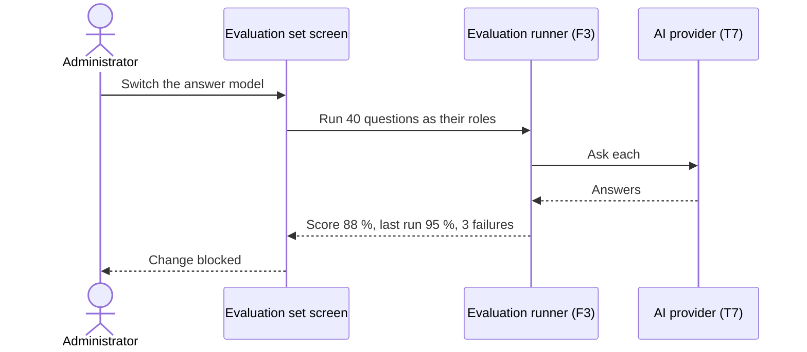

🏠 [Specs](../../../../README.md) › 🧩 [Functional capabilities](../../../README.md) › 🤖 [F3 Assistant](../../README.md) ›
📝 [Use cases](../README.md) › 📝 [Use cases: FL-F3-11 Trust the answers](README.md) ›
📝 UC-F3-14 Run the quality evaluation set

# 📝 UC-F3-14 Run the quality evaluation set

**Status:** 🔄 waiting for the owner

## Summary

The administrator keeps a set of test questions with expected answers; it runs at every model, provider or prompt
change, and a quality drop blocks the change.

## Personas

- [U07 Administrator](../../../../01-users/personas/u07-administrator.md)
- [U13 Owner](../../../../01-users/personas/u13-owner.md)

## Goal

An AI assistant that does not get worse when its model or prompts change.

## Trigger

A model, provider, prompt or knowledge change; or the administrator runs it by hand.

## Frequency

At each change; weekly by schedule (Proposed).

## Preconditions

- At least 20 evaluation questions (Proposed).

## Postconditions

- **Succeeded:** the run's score is kept; the change goes live if the score holds.
- **Failed:** the change is blocked; the previous model or prompt stays
  ([BR-F3-37](../../business-rules/br-f03-37-a-quality-drop-blocks-a-model-or-prompt-change.md)).

## Main flow

1. The administrator opens Assistant settings › Evaluation
   ([S-F3-18](../../screens/11-trust-the-answers/s-f03-18-evaluation-set.md)).
2. They add questions with the expected answer or the facts it must hold, the role to ask as, and the sources it must
   cite.
3. A change of model or prompt triggers a run; each question is asked as its role and scored on facts, sources and
   refusals.
4. The run shows the score per question and overall, against the last run.
5. Below the bar, the change is blocked and the administrator sees the failed questions.

## Alternative flows

- 2a. The AI assistant proposes questions from the knowledge base and frequent questions, for the administrator to
  check.
- 5a. The administrator overrides the block with a reason, recorded.

## Error flows

- 3e. The provider fails during the run: retried ([BR-F3-32](../../business-rules/br-f03-32-retry-before-an-error.md)),
  then the run is marked incomplete and the change waits.
- 2e. An expected answer refers to a record that no longer exists: the question is marked stale.

## Business rules

- [BR-F3-37 A quality drop blocks a model or prompt change](../../business-rules/br-f03-37-a-quality-drop-blocks-a-model-or-prompt-change.md)
- [BR-F3-04 Ask or say not found, never invent](../../business-rules/br-f03-04-never-invent.md)
- [BR-F3-01 Answers cite their sources](../../business-rules/br-f03-01-answers-cite-their-sources.md)

## Entities

- [E-F3-17 Evaluation question](../../data/e-f03-17-evaluation-question.md)
- [E-F3-18 Evaluation run](../../data/e-f03-18-evaluation-run.md)

## Permissions

Administrators; the owner reads the results.

## Notifications

The administrator is told of each run's result and of a blocked change.

## Audit events

Questions added and changed, runs with their score, overrides with reason.

## AI involvement

The AI assistant is the one tested; it can propose questions but never scores itself.

## API, MCP and A2A exposure

T5 read of runs; no MCP tool.

## Screens

- [S-F3-18 Evaluation set](../../screens/11-trust-the-answers/s-f03-18-evaluation-set.md)
- [S-F3-12 Assistant settings](../../screens/03-act-through-the-assistant/s-f03-12-assistant-settings.md)

## Flowchart

See [FL-F3-11 Trust the answers](../../flows/fl-f03-11-trust-the-answers.md#flowchart).

## Sequence diagram

## Acceptance criteria

1. **Given** 40 questions and a bar of 90 % (Proposed) **when** a model change scores 88 % **then** the change is
   blocked and the 3 failed questions are shown.
2. **Given** the same **when** the score is 96 % **then** the change goes live.
3. **Given** a question asked as Sales about salaries **when** it is run **then** the expected refusal scores as passed.
4. **Given** an override with the reason "provider retired" **when** the administrator confirms **then** the change goes
   live and the reason is kept.

## Non-functional notes

A run of 100 questions finishes within 15 minutes (Proposed).

## Regulatory references

Human oversight of AI ([CR-FR-057](../../../../10-country-packs/france/ai-and-recording/cr-fr-057-human-oversight.md)).

## Related use cases

- [UC-F1-08 Choose the AI provider of a feature](../../../f01-administration/use-cases/06-choose-an-ai-provider/uc-f01-08-choose-the-ai-provider-of-a-feature.md)
- [UC-F15-01 Use the legal assistant](../../../f15-legal-assistant/use-cases/01-ask-a-legal-question/uc-f15-01-use-the-legal-assistant.md)
- [UC-F4-24 Track transcription accuracy per language and model](../../../f04-meetings/use-cases/11-insights-and-accessibility/uc-f04-24-track-transcription-accuracy-per-language-and-model.md)

## Open questions

None.

---

⬅️ [UC-F3-13 Use the AI assistant in chat apps](../10-benchmark-additions/uc-f03-13-use-the-assistant-in-chat-apps.md) ·
⬆️ [Up](README.md) · ➡️ [UC-F3-15](uc-f03-15-defend-against-instructions-hidden-in-content.md)
