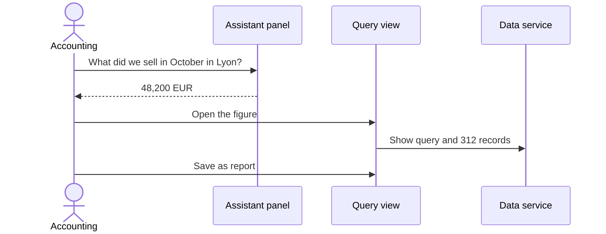

🏠 [Specs](../../../../README.md) › 🧩 [Functional capabilities](../../../README.md) › 🤖 [F3 Assistant](../../README.md) ›
📝 [Use cases](../README.md) › 📝 [Use cases: FL-F3-11 Trust the answers](README.md) ›
📝 UC-F3-16 See the query behind a figure

# 📝 UC-F3-16 See the query behind a figure

**Status:** ✅ specified

## Summary

Every figure in an answer opens the query that produced it, in plain words and as code, so that an accountant or the
owner can check and reuse it.

## Personas

- [U05 Accounting](../../../../01-users/personas/u05-accounting.md)
- [U13 Owner](../../../../01-users/personas/u13-owner.md)
- [U08 External accountant](../../../../01-users/personas/u08-external-accountant.md)

## Goal

Trust a figure because its calculation can be read.

## Trigger

A user clicks a figure in an answer.

## Frequency

Several times a week for accountants and owners.

## Preconditions

- The answer holds a figure computed by a query
  ([BR-F3-03](../../business-rules/br-f03-03-figures-come-from-queries.md)).

## Postconditions

- **Succeeded:** the user saw the query and, if they wish, saved it as a report.
- **Failed:** nothing changes.

## Main flow

1. The accountant asks "what did we sell in October in Lyon"; the answer says 48,200 EUR
   ([S-F3-01](../../screens/01-ask-the-assistant/s-f03-01-assistant-panel.md)).
2. She clicks the figure: the query view opens ([S-F3-20](../../screens/11-trust-the-answers/s-f03-20-query-view.md))
   with the plain-words description (invoices, posted, October 2026, site Lyon, excluding VAT) and the query code.
3. She sees the records counted (312 invoices) and opens the list.
4. She saves it as a report or a dashboard tile,
   [UC-F2-12](../../../f02-no-code-configuration/use-cases/07-benchmark-additions/uc-f02-12-build-live-spreadsheets-and-dashboards.md).

## Alternative flows

- 2a. She changes a filter (including credit notes) and reruns; the new figure shows beside the old.

## Error flows

- 2e. Part of the data is outside her rights: the query view says the figure covers only what she may see
  ([BR-F3-02](../../business-rules/br-f03-02-answers-use-only-what-the-user-may-see.md)).
- 4e. The query uses a source no longer available: saving is refused with the reason.

## Business rules

- [BR-F3-40 Every figure opens its query](../../business-rules/br-f03-40-every-figure-opens-its-query.md)
- [BR-F3-03 Figures come from queries, never the model](../../business-rules/br-f03-03-figures-come-from-queries.md)
- [BR-F3-02 Answers use only what the user may see](../../business-rules/br-f03-02-answers-use-only-what-the-user-may-see.md)

## Entities

- [E-F3-02 Assistant answer](../../data/e-f03-02-assistant-answer.md)

## Permissions

Every user, within their rights ([BR-F3-02](../../business-rules/br-f03-02-answers-use-only-what-the-user-may-see.md)).

## Notifications

None.

## Audit events

Query opened and saved as a report.

## AI involvement

The AI assistant writes the query and its description; the figure always comes from running it, never from the model.

## API, MCP and A2A exposure

The query is returned with the answer through T5 and T6.

## Screens

- [S-F3-20 Query view](../../screens/11-trust-the-answers/s-f03-20-query-view.md)
- [S-F3-01 Assistant panel](../../screens/01-ask-the-assistant/s-f03-01-assistant-panel.md)

## Flowchart

See [FL-F3-11 Trust the answers](../../flows/fl-f03-11-trust-the-answers.md#flowchart).

## Sequence diagram

## Acceptance criteria

1. **Given** an answer of 48,200 EUR **when** the accountant opens it **then** she sees the description, the code and
   the 312 invoices counted.
2. **Given** a manager who may see only Lyon **when** he opens a company-wide figure **then** the view says it covers
   Lyon only.
3. **Given** the query **when** she saves it as a report **then** the report shows 48,200 EUR for October 2026.

## Non-functional notes

The query view opens within 1 second.

## Regulatory references

None.

## Related use cases

- [UC-F3-01 Ask a question about the company's data](../01-ask-the-assistant/uc-f03-01-ask-a-question-about-the-company-s-data.md)
- [UC-F2-12 Build live spreadsheets and dashboards](../../../f02-no-code-configuration/use-cases/07-benchmark-additions/uc-f02-12-build-live-spreadsheets-and-dashboards.md)

## Open questions

None.

---

⬅️ [UC-F3-15](uc-f03-15-defend-against-instructions-hidden-in-content.md) · ⬆️ [Up](README.md) ·
➡️ [UC-F3-17](../12-personal-cost-aware-and-learning/uc-f03-17-keep-personal-preferences-in-the-assistants-memory.md)
