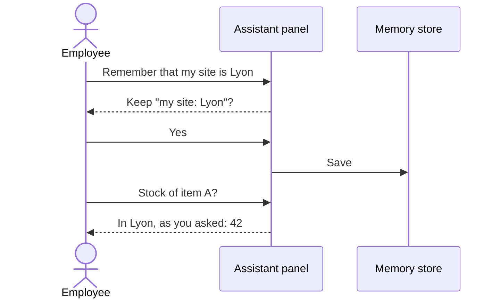

🏠 [Specs](../../../../README.md) › 🧩 [Functional capabilities](../../../README.md) › 🤖 [F3 Assistant](../../README.md) ›
📝 [Use cases](../README.md) › 📝 [Use cases: FL-F3-12 Personal, cost-aware and learning](README.md) ›
📝 UC-F3-17 Keep personal preferences in the AI assistant's memory

# 📝 UC-F3-17 Keep personal preferences in the AI assistant's memory

**Status:** ✅ specified

## Summary

A user asks the AI assistant to remember a preference (my site, my report format, my language for drafts); the memory is
opt-in, visible and erasable.

## Personas

- [U01 Employee](../../../../01-users/personas/u01-employee.md)
- [U02 Manager](../../../../01-users/personas/u02-manager.md)

## Goal

Fewer repeated instructions, without the AI assistant keeping anything unasked.

## Trigger

The user says "remember" or accepts a suggestion to remember.

## Frequency

A few times per user.

## Preconditions

- Personal memory is allowed by the administrator
  ([S-F3-12](../../screens/03-act-through-the-assistant/s-f03-12-assistant-settings.md)).

## Postconditions

- **Succeeded:** the preference is used in later answers and shown in My assistant memory.
- **Failed:** nothing is kept.

## Main flow

1. The user says "remember that my site is Lyon" in the panel.
2. The AI assistant shows what it will keep and asks to confirm
   ([BR-F3-39](../../business-rules/br-f03-39-memory-is-opt-in-visible-and-erasable.md)).
3. Later answers use it and say so ("for Lyon, as you asked").
4. The user opens My assistant memory
   ([S-F3-21](../../screens/12-personal-cost-aware-and-learning/s-f03-21-my-assistant-memory.md)), changes or erases an
   item, or erases all.

## Alternative flows

- 2a. The AI assistant suggests remembering a repeated instruction; nothing is kept without a yes.

## Error flows

- 2e. The item holds someone else's personal data: refused with the reason.
- 1e. Memory is off for the company: the AI assistant says so.

## Business rules

- [BR-F3-39 Memory is opt-in, visible and erasable](../../business-rules/br-f03-39-memory-is-opt-in-visible-and-erasable.md)

## Entities

- [E-F3-20 Memory item](../../data/e-f03-20-memory-item.md)

## Permissions

Each user for their own memory only; nobody else reads it, administrators included.

## Notifications

None.

## Audit events

Item kept, changed, erased (without its content).

## AI involvement

The AI assistant proposes; only the user keeps or erases.

## API, MCP and A2A exposure

None.

## Screens

- [S-F3-21 My assistant memory](../../screens/12-personal-cost-aware-and-learning/s-f03-21-my-assistant-memory.md)
- [S-F3-01 Assistant panel](../../screens/01-ask-the-assistant/s-f03-01-assistant-panel.md)

## Flowchart

See [FL-F3-12 Personal, cost-aware and learning](../../flows/fl-f03-12-personal-cost-aware-and-learning.md#flowchart).

## Sequence diagram

## Acceptance criteria

1. **Given** memory allowed **when** the user says "remember my site is Lyon" and confirms **then** the item shows in My
   assistant memory.
2. **Given** that item **when** she asks the stock of item A **then** the answer is for Lyon and says why.
3. **Given** that item **when** she erases it **then** the next answer asks which site.
4. **Given** an item about a colleague's health **when** it is asked to be kept **then** it is refused.

## Non-functional notes

None.

## Regulatory references

GDPR: the user's own data, erasable at any time
([CR-FR-051](../../../../10-country-packs/france/data-protection/cr-fr-051-access-and-erasure.md)).

## Related use cases

- [UC-F3-01 Ask a question about the company's data](../01-ask-the-assistant/uc-f03-01-ask-a-question-about-the-company-s-data.md)
- [UC-F3-08 Manage and share conversations](../08-manage-and-share-conversations/uc-f03-08-manage-and-share-conversations.md)

## Open questions

None.

---

⬅️ [UC-F3-16 See the query behind a figure](../11-trust-the-answers/uc-f03-16-see-the-query-behind-a-figure.md) ·
⬆️ [Up](README.md) ·
➡️ [UC-F3-18 See the cost before an expensive question](uc-f03-18-see-the-cost-before-an-expensive-question.md)
