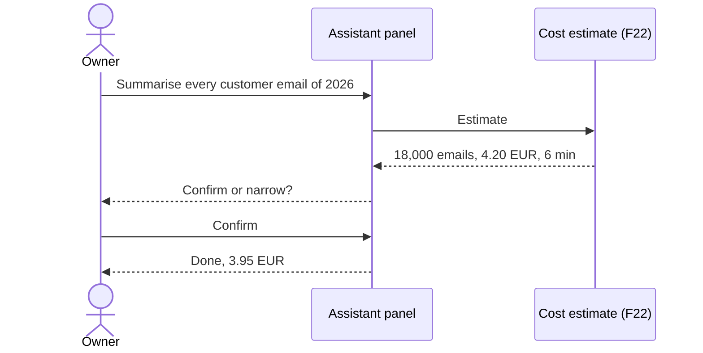

🏠 [Specs](../../../../README.md) › 🧩 [Functional capabilities](../../../README.md) › 🤖 [F3 Assistant](../../README.md) ›
📝 [Use cases](../README.md) › 📝 [Use cases: FL-F3-12 Personal, cost-aware and learning](README.md) ›
📝 UC-F3-18 See the cost before an expensive question

# 📝 UC-F3-18 See the cost before an expensive question

**Status:** ✅ specified

## Summary

Before running a question that will cost more than a threshold (many records, an outside model, a long agent run), the
AI assistant shows the estimate and asks to confirm or narrow it.

## Personas

- [U01 Employee](../../../../01-users/personas/u01-employee.md)
- [U13 Owner](../../../../01-users/personas/u13-owner.md)

## Goal

No surprise on the AI bill.

## Trigger

A question whose estimate is above the threshold.

## Frequency

Rare; a few a month per company.

## Preconditions

- A threshold is set ([S-F3-12](../../screens/03-act-through-the-assistant/s-f03-12-assistant-settings.md)); the
  estimate comes from F22,
  [UC-F22-10](../../../f22-unified-cost-management/use-cases/03-runs/uc-f22-10-estimate-a-run-before-it-starts.md).

## Postconditions

- **Succeeded:** the user confirmed and the question ran; or narrowed and it ran cheaper.
- **Failed:** nothing ran and nothing was spent.

## Main flow

1. The owner asks "summarise every customer email of 2026".
2. The AI assistant estimates: 18,000 emails, about 4.20 EUR on the outside model, about 6 minutes
   ([S-F3-22](../../screens/12-personal-cost-aware-and-learning/s-f03-22-cost-estimate.md)).
3. It offers to narrow (last quarter, one customer) or to confirm
   ([BR-F3-41](../../business-rules/br-f03-41-an-expensive-question-asks-first.md)).
4. The owner confirms; the cost after the run is shown beside the estimate.

## Alternative flows

- 3a. Above the user's cap: the request goes to the administrator for approval.

## Error flows

- 4e. The run would pass the company's monthly cap: refused with the cap reached.

## Business rules

- [BR-F3-41 An expensive question asks first](../../business-rules/br-f03-41-an-expensive-question-asks-first.md)
- [BR-F3-20 Outside call caps](../../business-rules/br-f03-20-outside-call-caps.md)

## Entities

- [E-F3-02 Assistant answer](../../data/e-f03-02-assistant-answer.md)

## Permissions

Every user, within their rights ([BR-F3-02](../../business-rules/br-f03-02-answers-use-only-what-the-user-may-see.md)).

## Notifications

The administrator is told of runs above the user's cap.

## Audit events

Estimate shown, confirmed or narrowed, actual cost.

## AI involvement

The estimate comes from F22's counters, not from the model.

## API, MCP and A2A exposure

Estimates are returned through T5 before a long run.

## Screens

- [S-F3-22 Cost estimate](../../screens/12-personal-cost-aware-and-learning/s-f03-22-cost-estimate.md)
- [S-F3-01 Assistant panel](../../screens/01-ask-the-assistant/s-f03-01-assistant-panel.md)

## Flowchart

See [FL-F3-12 Personal, cost-aware and learning](../../flows/fl-f03-12-personal-cost-aware-and-learning.md#flowchart).

## Sequence diagram

## Acceptance criteria

1. **Given** a threshold of 1 EUR **when** a question estimated at 4.20 EUR is asked **then** the estimate
   shows and nothing runs before confirmation.
2. **Given** the estimate **when** the owner narrows to the last quarter **then** a new estimate of 1.10 EUR shows.
3. **Given** a run of 3.95 EUR **when** it ends **then** the actual cost shows beside the estimate.
4. **Given** a monthly cap reached **when** a question is confirmed **then** it is refused with the cap.

## Non-functional notes

The estimate shows within 2 seconds.

## Regulatory references

None.

## Related use cases

- [UC-F22-10 Estimate a run before it starts](../../../f22-unified-cost-management/use-cases/03-runs/uc-f22-10-estimate-a-run-before-it-starts.md)
- [UC-F3-01 Ask a question about the company's data](../01-ask-the-assistant/uc-f03-01-ask-a-question-about-the-company-s-data.md)

## Open questions

None.

---

⬅️ [UC-F3-17](uc-f03-17-keep-personal-preferences-in-the-assistants-memory.md) · ⬆️ [Up](README.md) ·
➡️ [UC-F3-19](uc-f03-19-turn-unanswered-topics-into-knowledge-proposals.md)
