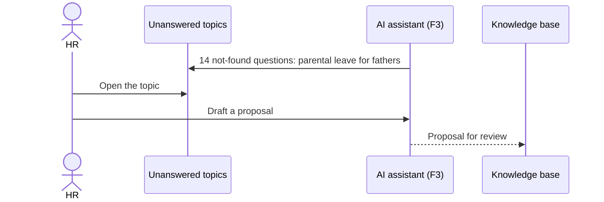

🏠 [Specs](../../../../README.md) › 🧩 [Functional capabilities](../../../README.md) › 🤖 [F3 Assistant](../../README.md) ›
📝 [Use cases](../README.md) › 📝 [Use cases: FL-F3-12 Personal, cost-aware and learning](README.md) ›
📝 UC-F3-19 Turn unanswered topics into knowledge proposals

# 📝 UC-F3-19 Turn unanswered topics into knowledge proposals

**Status:** 🔄 waiting for the owner

## Summary

Questions the AI assistant could not answer are grouped by topic; an editor turns a frequent topic into a knowledge
proposal.

## Personas

- [U06 Human resources](../../../../01-users/personas/u06-hr.md)
- [U07 Administrator](../../../../01-users/personas/u07-administrator.md)
- [U13 Owner](../../../../01-users/personas/u13-owner.md)

## Goal

The knowledge base grows where people actually ask.

## Trigger

A topic reaches the threshold of unanswered questions.

## Frequency

Weekly review by knowledge editors (Proposed).

## Preconditions

- Knowledge editors are named ([D176](../../../../06-decisions/f03-assistant/d176-knowledge-editors.md)).

## Postconditions

- **Succeeded:** a knowledge proposal is drafted for the topic
  ([BR-F3-23](../../business-rules/br-f03-23-proposals-need-an-editor.md)).
- **Failed:** the topic stays listed.

## Main flow

1. The AI assistant says "not found" ([BR-F3-04](../../business-rules/br-f03-04-never-invent.md)); the question is
   counted
   in a topic, without who asked ([BR-F3-42](../../business-rules/br-f03-42-unanswered-topics-hold-no-names.md)).
2. HR opens Unanswered topics
   ([S-F3-23](../../screens/12-personal-cost-aware-and-learning/s-f03-23-unanswered-topics.md)): "parental leave for
   fathers: 14 questions this month".
3. She opens the topic's sample questions, anonymised, and drafts a proposal, or asks the AI assistant to draft one from
   the company's documents.
4. The proposal follows the knowledge review
   ([UC-F3-07](../07-manage-knowledge/uc-f03-07-manage-the-company-knowledge-base.md)); once approved, the topic is
   marked answered.

## Alternative flows

- 3a. The topic is a missing feature, not knowledge: it becomes a configuration request
  ([BR-F3-16](../../business-rules/br-f03-16-missing-features-become-requests.md)).

## Error flows

- 3e. A sample question holds personal data: it is masked before the editor sees it.

## Business rules

- [BR-F3-42 Unanswered topics hold no names](../../business-rules/br-f03-42-unanswered-topics-hold-no-names.md)
- [BR-F3-23 Proposals need an editor](../../business-rules/br-f03-23-proposals-need-an-editor.md)
- [BR-F3-04 Ask or say not found, never invent](../../business-rules/br-f03-04-never-invent.md)

## Entities

- [E-F3-21 Unanswered topic](../../data/e-f03-21-unanswered-topic.md)
- [E-F3-11 Knowledge proposal](../../data/e-f03-11-knowledge-proposal.md)

## Permissions

Knowledge editors, HR, administrators, the owner.

## Notifications

Editors are told when a topic passes the threshold.

## Audit events

Topic created, turned into a proposal, answered.

## AI involvement

The AI assistant groups topics and drafts proposals; an editor approves.

## API, MCP and A2A exposure

None.

## Screens

- [S-F3-23 Unanswered topics](../../screens/12-personal-cost-aware-and-learning/s-f03-23-unanswered-topics.md)
- [S-F3-07 Knowledge base](../../screens/07-manage-knowledge/s-f03-07-knowledge-base.md)

## Flowchart

See [FL-F3-12 Personal, cost-aware and learning](../../flows/fl-f03-12-personal-cost-aware-and-learning.md#flowchart).

## Sequence diagram

## Acceptance criteria

1. **Given** 14 questions not found on parental leave this month **when** HR opens Unanswered topics **then** the topic
   shows with 14 and anonymised samples.
2. **Given** the topic **when** HR drafts a proposal **then** it enters the knowledge review.
3. **Given** the proposal approved **when** a user asks again **then** the AI assistant answers with the new item as
   source.

## Non-functional notes

None.

## Regulatory references

GDPR: topics hold no names
([CR-FR-050](../../../../10-country-packs/france/data-protection/cr-fr-050-privacy-by-design.md)).

## Related use cases

- [UC-F3-07 Manage the company knowledge base](../07-manage-knowledge/uc-f03-07-manage-the-company-knowledge-base.md)
- [UC-F3-01 Ask a question about the company's data](../01-ask-the-assistant/uc-f03-01-ask-a-question-about-the-company-s-data.md)

## Open questions

None.

---

⬅️ [UC-F3-18 See the cost before an expensive question](uc-f03-18-see-the-cost-before-an-expensive-question.md) ·
⬆️ [Up](README.md) · ➡️ [UC-F3-20](../13-voice-agents-and-briefings/uc-f03-20-talk-to-the-assistant-hands-free.md)
