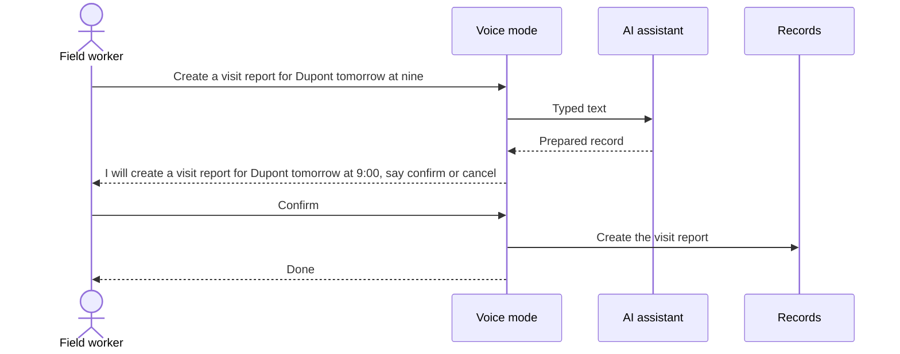

🏠 [Specs](../../../../README.md) › 🧩 [Functional capabilities](../../../README.md) › 🤖 [F3 Assistant](../../README.md) ›
📝 [Use cases](../README.md) › 📝 [Use cases: FL-F3-13 Voice, agents and briefings](README.md) ›
📝 UC-F3-20 Talk to the AI assistant hands-free

# 📝 UC-F3-20 Talk to the AI assistant hands-free

**Status:** ✅ specified

## Summary

A person whose hands are busy (on a site, in a van, in a kitchen) speaks to the AI assistant and hears the answer.
Questions are answered aloud and on screen. Anything that would write to the company's data is read back first, and
nothing is saved until the person says confirm.

## Personas

- [U14 Field worker](../../../../01-users/personas/u14-field-worker.md)
- [U13 Owner](../../../../01-users/personas/u13-owner.md)

## Goal

Ask and do simple things without touching the phone, and never write something that was misheard.

## Trigger

The user taps the microphone and says what they need, or says the wake word the company enabled.

## Frequency

Several times a day for people working away from a desk.

## Preconditions

- The user is signed in on the phone app
  ([UC-F3-09](../09-assistant-on-a-phone/uc-f03-09-use-the-assistant-on-a-phone.md)) and allowed the microphone.
- Voice mode is switched on for the company and for the user
  ([S-F3-12](../../screens/03-act-through-the-assistant/s-f03-12-assistant-settings.md)).
- The user's language is one the speech recognition supports
  ([E-F1-03 User](../../../f01-administration/data/e-f01-03-user.md)).

## Postconditions

- **Succeeded:** the question was answered aloud and on screen, or the action was confirmed aloud and saved with the
  spoken text kept in the conversation ([E-F3-01 Conversation](../../data/e-f03-01-conversation.md)).
- **Failed:** nothing was written; the screen shows what was heard so the user can correct it.

## Main flow

1. The user opens voice mode ([S-F3-24](../../screens/13-voice-agents-and-briefings/s-f03-24-voice-mode.md)) and says,
   for example, "What is on my schedule this afternoon?".
2. SimpleERP turns the speech into text on the phone or in the company's region, shows it, and sends it to the AI
   assistant as a typed question.
3. The AI assistant answers within the user's rights
   ([BR-F3-02](../../business-rules/br-f03-02-answers-use-only-what-the-user-may-see.md)); the answer is spoken and
   shown, with its sources ([BR-F3-01](../../business-rules/br-f03-01-answers-cite-their-sources.md)).
4. The user says "Create a visit report for Dupont tomorrow at nine".
5. The AI assistant prepares the record and reads it back: "I will create a visit report for Dupont tomorrow at 9:00.
   Say confirm or cancel."
   ([BR-F3-43](../../business-rules/br-f03-43-voice-actions-are-confirmed-aloud-before-writing.md)).
6. The user says "confirm"; the record is created and the AI assistant says it is done.
7. The user ends voice mode by saying "stop" or tapping the button.

## Alternative flows

- 4a. The user says "cancel" or stays silent for 10 seconds: nothing is saved and the AI assistant says so.
- 4b. The user corrects: "No, at ten": the AI assistant reads the corrected record back before asking again.
- 3a. The answer is long: the AI assistant speaks a short version and shows the rest on screen.
- 1a. In a noisy place the user types instead; the same confirmation applies.

## Error flows

- 2e. The speech is not understood: the AI assistant says it did not understand and shows what it heard so the user can
  repeat or edit it.
- 5e. The action is one the AI assistant may not do by voice (delete, send out, pay): it refuses and opens the
  confirmation card on screen ([BR-F3-07](../../business-rules/br-f03-07-no-deletes-no-irreversible-acts.md)).
- 1e. No network: the question waits for the network
  ([BR-F3-29](../../business-rules/br-f03-29-offline-questions-wait-for-the-network.md)) and the user is told.
- Any step: a service does not answer; the call is retried first
  ([BR-F3-32](../../business-rules/br-f03-32-retry-before-an-error.md)), then the message follows the error pattern
  ([D122](../../../../06-decisions/ux/d122-error-message-standard.md)) and what was heard stays on screen.

## Business rules

- [BR-F3-43 Voice actions are confirmed aloud before writing](../../business-rules/br-f03-43-voice-actions-are-confirmed-aloud-before-writing.md)
- [BR-F3-28 Hands-free confirmations are spoken](../../business-rules/br-f03-28-hands-free-confirmations-are-spoken.md)
- [BR-F3-02 Answers use only what the user may see](../../business-rules/br-f03-02-answers-use-only-what-the-user-may-see.md)
- [BR-F3-07 No deletes, no irreversible acts](../../business-rules/br-f03-07-no-deletes-no-irreversible-acts.md)
- [BR-F3-29 Offline questions wait for the network](../../business-rules/br-f03-29-offline-questions-wait-for-the-network.md)

## Entities

- [E-F3-01 Conversation](../../data/e-f03-01-conversation.md): changed, the spoken turns are saved as text
- [E-F3-02 Assistant answer](../../data/e-f03-02-assistant-answer.md): created

## Permissions

Every user of the phone app, within their own rights; voice adds no right. The administrator may switch voice mode off
for the company or a role ([S-F3-12](../../screens/03-act-through-the-assistant/s-f03-12-assistant-settings.md)).

## Notifications

None: the AI assistant speaks its answer; a failure is spoken and shown.

## Audit events

Each written action with the spoken text, the read-back and the confirmation; audio is not stored once converted to text
.

## AI involvement

The AI assistant answers and prepares actions as for typed requests; voice only changes how the user speaks and hears.
It never identifies a person by their voice
([BR-F4-02](../../../f04-meetings/business-rules/br-f04-02-no-voice-prints.md),
[CR-FR-053](../../../../10-country-packs/france/data-protection/cr-fr-053-no-biometric-voice-prints.md)).

## API, MCP and A2A exposure

The phone app uses the T5 operations of the AI assistant with the converted text; no new operation, no MCP tool and no
A2A skill.

## Screens

- [S-F3-24 Voice mode](../../screens/13-voice-agents-and-briefings/s-f03-24-voice-mode.md)

## Flowchart

See [FL-F3-13 Voice, agents and briefings](../../flows/fl-f03-13-voice-agents-and-briefings.md#flowchart).

## Sequence diagram

## Acceptance criteria

1. **Given** the user asks for tomorrow's schedule **when** voice mode is on **then** the answer is spoken and shown
   with its sources.
2. **Given** the user asks to create a visit report **when** the AI assistant prepares it **then** it is read back and
   not saved before the user says confirm.
3. **Given** the user says cancel **when** the read-back ends **then** nothing is saved.
4. **Given** an unclear sentence **when** the AI assistant cannot understand **then** it says so and shows what it
   heard.
5. **Given** a request to delete a record **when** the user asks by voice **then** it is refused and the card opens on
   screen.

## Non-functional notes

The spoken answer starts within 3 seconds of the end of the question on a 4G network.

## Regulatory references

No voice prints:
[CR-FR-053](../../../../10-country-packs/france/data-protection/cr-fr-053-no-biometric-voice-prints.md); recordings are
announced and not kept:
[CR-FR-059](../../../../10-country-packs/france/ai-and-recording/cr-fr-059-recordings-are-announced.md). The speech is
converted to text and the audio is not kept.

## Related use cases

- [UC-F3-09 Use the AI assistant on a phone](../09-assistant-on-a-phone/uc-f03-09-use-the-assistant-on-a-phone.md)
- [UC-F3-03 Have the AI assistant create or change records](../03-act-through-the-assistant/uc-f03-03-have-the-assistant-create-or-change-records.md)
- [UC-F4-10 Capture from the desktop, a file or dictation](../../../f04-meetings/use-cases/07-prepare-and-capture-anywhere/uc-f04-10-capture-from-the-desktop-a-file-or-dictation.md)

## Open questions

None.

---

⬅️ [UC-F3-19](../12-personal-cost-aware-and-learning/uc-f03-19-turn-unanswered-topics-into-knowledge-proposals.md) ·
⬆️ [Up](README.md) · ➡️ [UC-F3-21 Switch on a ready-made agent](uc-f03-21-switch-on-a-ready-made-agent.md)
