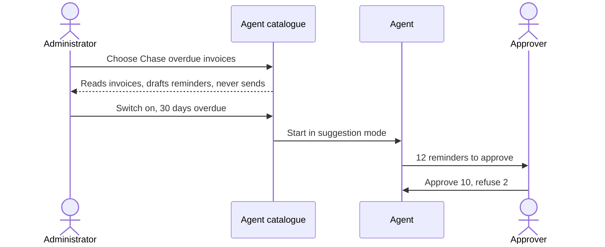

🏠 [Specs](../../../../README.md) › 🧩 [Functional capabilities](../../../README.md) › 🤖 [F3 Assistant](../../README.md) ›
📝 [Use cases](../README.md) › 📝 [Use cases: FL-F3-13 Voice, agents and briefings](README.md) ›
📝 UC-F3-21 Switch on a ready-made agent

# 📝 UC-F3-21 Switch on a ready-made agent

**Status:** ✅ specified

## Summary

The administrator or the accounting user browses a catalogue of ready-made agents (chase overdue invoices, triage
supplier invoices, check stock every week, answer common HR questions), reads what each does and needs, and switches one
on. A new agent starts in suggestion mode: it proposes, a person approves, and only after a trial period and the owner's
agreement may it act alone within thresholds.

## Personas

- [U07 Administrator](../../../../01-users/personas/u07-administrator.md)
- [U05 Accounting](../../../../01-users/personas/u05-accounting.md)

## Goal

A useful agent is running in minutes, with its limits set and its first results checked by a person.

## Trigger

A repetitive task that a ready-made agent covers, or a suggestion from the AI assistant.

## Frequency

A few agents per company, switched on over the first months.

## Preconditions

- The capability the agent works on is switched on, for example accounting
  ([E-F1-01 Company](../../../f01-administration/data/e-f01-01-company.md)).
- The user may create agents ([UC-F3-10](../10-benchmark-additions/uc-f03-10-create-and-run-ai-agents.md)).
- Thresholds and amount limits are set
  ([BR-F3-35](../../business-rules/br-f03-35-agents-follow-thresholds-and-limits.md)).

## Postconditions

- **Succeeded:** the agent exists ([E-F3-15 Agent](../../data/e-f03-15-agent.md)) from its template
  ([E-F3-24 Agent template](../../data/e-f03-24-agent-template.md)), is running in suggestion mode, and shows its
  suggestions to the person who approves them.
- **Failed:** no agent is created and the catalogue stays as it was.

## Main flow

1. The user opens the agent catalogue
   ([S-F3-25](../../screens/13-voice-agents-and-briefings/s-f03-25-agent-catalogue.md)) and filters by capability or by
   need.
2. The user opens a template and reads what the agent does, the data it reads, what it may suggest, what it may do alone
   later, and its default thresholds.
3. The user chooses the scope (which site, which record types), sets or accepts the thresholds, and names who approves
   its suggestions.
4. The user switches the agent on: it starts in suggestion mode
   ([BR-F3-44](../../business-rules/br-f03-44-ready-made-agents-start-in-suggestion-mode.md)).
5. The agent makes its first suggestions; the approver accepts, edits or refuses each one.
6. After the trial (20 suggestions or 14 days) the agent shows its acceptance rate; the owner may move it to
   act alone within thresholds ([UC-F3-11](../10-benchmark-additions/uc-f03-11-govern-ai-agents.md)).

## Alternative flows

- 2a. The user asks the AI assistant for the right agent for a need; it proposes templates, the user chooses.
- 3a. The user copies a template and changes its steps: it becomes a company agent
  ([UC-F3-10](../10-benchmark-additions/uc-f03-10-create-and-run-ai-agents.md)).
- 6a. The acceptance rate is low: the agent stays in suggestion mode and the approver sends feedback
  ([UC-F3-14](../11-trust-the-answers/uc-f03-14-run-the-quality-evaluation-set.md)).

## Error flows

- 4e. The agent needs a capability that is not switched on: the screen says which and links to it.
- 4f. The thresholds are above the company's maximum
  ([BR-F3-35](../../business-rules/br-f03-35-agents-follow-thresholds-and-limits.md)): refused with the maximum.
- 5e. The agent fails on a record: the failure is shown in its log and the record is left untouched.
- Any step: a service does not answer; the call is retried first
  ([BR-F3-32](../../business-rules/br-f03-32-retry-before-an-error.md)), then the message follows the error pattern
  ([D122](../../../../06-decisions/ux/d122-error-message-standard.md)) and no agent is created.

## Business rules

- [BR-F3-44 Ready-made agents start in suggestion mode](../../business-rules/br-f03-44-ready-made-agents-start-in-suggestion-mode.md)
- [BR-F3-35 Agents follow thresholds and amount limits](../../business-rules/br-f03-35-agents-follow-thresholds-and-limits.md)
- [BR-F3-36 An audit agent checks the agents](../../business-rules/br-f03-36-an-audit-agent-checks-agents.md)
- [BR-F3-34 All capabilities via the AI assistant](../../business-rules/br-f03-34-every-capability-is-reachable-from-the-assistant.md)

## Entities

- [E-F3-24 Agent template](../../data/e-f03-24-agent-template.md): read
- [E-F3-15 Agent](../../data/e-f03-15-agent.md): created
- [E-F1-08 Agent connection](../../../f01-administration/data/e-f01-08-agent-connection.md): read

## Permissions

The administrator and the users with the right to create agents. An agent acts with the rights of its rule account,
never above the person who switched it on
([BR-F2-12](../../../f02-no-code-configuration/business-rules/br-f02-12-rule-accounts-never-exceed-their-author.md)).

## Notifications

- The approver: suggestions waiting.
- The owner: an agent ready to leave suggestion mode, with its acceptance rate.

## Audit events

Template chosen and version, thresholds, scope, switch-on, each suggestion with its outcome, each change of mode.

## AI involvement

The agents are AI steps; the audit agent checks them
([BR-F3-36](../../business-rules/br-f03-36-an-audit-agent-checks-agents.md)). Their outputs are suggestions first; the
AI assistant never switches an agent on by itself.

## API, MCP and A2A exposure

T5 operations of F3 for agents; an MCP tool may list templates, never switch one on. No A2A skill.

## Screens

- [S-F3-25 Agent catalogue](../../screens/13-voice-agents-and-briefings/s-f03-25-agent-catalogue.md)

## Flowchart

See [FL-F3-13 Voice, agents and briefings](../../flows/fl-f03-13-voice-agents-and-briefings.md#flowchart).

## Sequence diagram

## Acceptance criteria

1. **Given** a template chosen **when** the user switches it on **then** the agent starts in suggestion mode.
2. **Given** an agent in suggestion mode **when** it finds 12 overdue invoices **then** it proposes 12 reminders and
   sends none.
3. **Given** an acceptance rate of 85 % after 20 suggestions **when** the owner reviews **then** the agent can be moved
   to act alone within thresholds.
4. **Given** thresholds above the maximum **when** the user saves them **then** they are refused.
5. **Given** a template that needs accounting **when** accounting is off **then** the screen says so.

## Non-functional notes

The catalogue loads in 2 seconds; a ready-made agent is created in under 10 seconds.

## Regulatory references

A high-risk use (scoring people) is not offered as a ready-made agent:
[BR-F4-21](../../../f04-meetings/business-rules/br-f04-21-candidate-scoring-is-high-risk-ai.md).

## Related use cases

- [UC-F3-10 Create and run AI agents](../10-benchmark-additions/uc-f03-10-create-and-run-ai-agents.md)
- [UC-F3-11 Govern AI agents](../10-benchmark-additions/uc-f03-11-govern-ai-agents.md)
- [UC-F3-14 Run the quality evaluation set](../11-trust-the-answers/uc-f03-14-run-the-quality-evaluation-set.md)
- [UC-F3-12 Add AI fields to records](../10-benchmark-additions/uc-f03-12-add-ai-fields-to-records.md)

## Open questions

None.

---

⬅️ [UC-F3-20 Talk to the AI assistant hands-free](uc-f03-20-talk-to-the-assistant-hands-free.md) · ⬆️ [Up](README.md) ·
➡️ [UC-F3-22 Use ERP data in a spreadsheet add-in](uc-f03-22-use-erp-data-in-a-spreadsheet-add-in.md)
