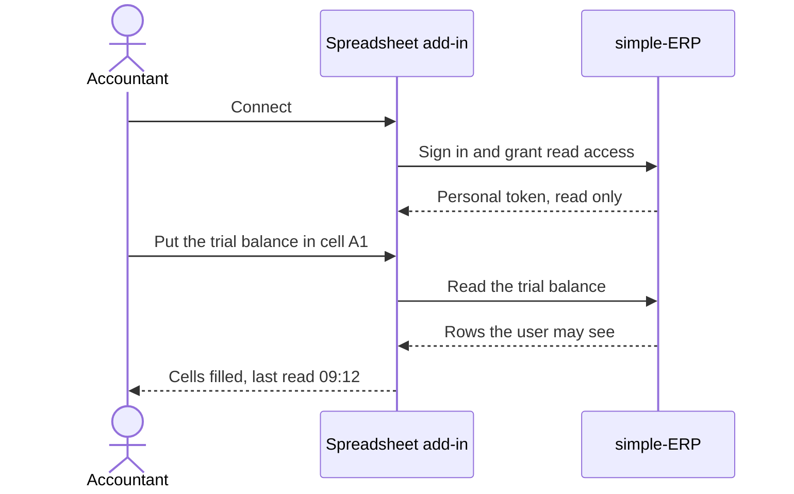

🏠 [Specs](../../../../README.md) › 🧩 [Functional capabilities](../../../README.md) › 🤖 [F3 Assistant](../../README.md) ›
📝 [Use cases](../README.md) › 📝 [Use cases: FL-F3-13 Voice, agents and briefings](README.md) ›
📝 UC-F3-22 Use ERP data in a spreadsheet add-in

# 📝 UC-F3-22 Use ERP data in a spreadsheet add-in

**Status:** ✅ specified

## Summary

A user installs the add-in in their spreadsheet application and connects it to simple-ERP with a personal sign-in. They
pull lists and reports into cells with formulas, refresh them, and ask the AI assistant a question from a cell. The
add-in sees exactly what the user sees in simple-ERP, nothing more.

## Personas

- [U05 Accounting](../../../../01-users/personas/u05-accounting.md)
- [U13 Owner](../../../../01-users/personas/u13-owner.md)

## Goal

Finance and management work in the spreadsheet they know, on live company data, without exports.

## Trigger

Building a closing workbook, a budget, a board pack or a quick analysis in a spreadsheet.

## Frequency

Weekly for accounting, monthly for the owner.

## Preconditions

- The company allowed spreadsheet add-ins
  ([S-F3-12](../../screens/03-act-through-the-assistant/s-f03-12-assistant-settings.md)).
- The user has a spreadsheet application where the add-in can be installed.
- The user can sign in to simple-ERP, with single sign-on if the company uses it
  ([UC-F1-09](../../../f01-administration/use-cases/07-set-up-single-sign-on/uc-f01-09-set-up-single-sign-on.md)).

## Postconditions

- **Succeeded:** the add-in is connected ([E-F3-25 Add-in connection](../../data/e-f03-25-add-in-connection.md)), the
  cells show live data within the user's rights, and every refresh is counted.
- **Failed:** no data reaches the spreadsheet and the connection stays as it was.

## Main flow

1. The user installs the add-in and chooses Connect; the browser opens simple-ERP's sign-in.
2. The user signs in and grants the add-in read access; the add-in receives a personal token limited to the user's
   rights ([BR-F3-45](../../business-rules/br-f03-45-add-ins-use-the-users-own-rights.md),
   [BR-F1-27](../../../f01-administration/business-rules/br-f01-27-tokens-are-scoped-dated-and-shown-once.md)).
3. In the spreadsheet the user picks a list or a report from the add-in pane
   ([S-F3-26](../../screens/13-voice-agents-and-briefings/s-f03-26-spreadsheet-add-in.md)) and chooses where to put it.
4. The add-in fills the cells; the same data can be used by formulas that read a list, a total or a report by name.
5. The user refreshes by hand or on opening the workbook; the add-in shows when the data was last read.
6. The user types a question in a cell with the AI assistant formula; the answer comes back with its source
   ([BR-F3-01](../../business-rules/br-f03-01-answers-cite-their-sources.md)).
7. The user disconnects or an administrator revokes the connection; the cells keep their last values, marked as not
   refreshed.

## Alternative flows

- 3a. The workbook is shared with a colleague: the colleague's refresh uses the colleague's own sign-in and rights;
  cells they may not see show a message instead of values.
- 5a. The administrator limits refreshes per hour per user.
- 6a. The question is expensive: the cost estimate is shown first
  ([UC-F3-18](../12-personal-cost-aware-and-learning/uc-f03-18-see-the-cost-before-an-expensive-question.md)).

## Error flows

- 2e. The token expired: the pane asks the user to sign in again.
- 4e. A list the user may not see: the pane does not offer it
  ([BR-F3-45](../../business-rules/br-f03-45-add-ins-use-the-users-own-rights.md)).
- 5e. The company's refresh limit is reached: the add-in says when it can refresh again.
- Any step: a service does not answer; the call is retried first
  ([BR-F3-32](../../business-rules/br-f03-32-retry-before-an-error.md)), then the message follows the error pattern
  ([D122](../../../../06-decisions/ux/d122-error-message-standard.md)) and the cells keep their last values.

## Business rules

- [BR-F3-45 Add-ins use the user's own rights](../../business-rules/br-f03-45-add-ins-use-the-users-own-rights.md)
- [BR-F3-02 Answers use only what the user may see](../../business-rules/br-f03-02-answers-use-only-what-the-user-may-see.md)
- [BR-F1-27 Tokens are scoped, dated and shown once](../../../f01-administration/business-rules/br-f01-27-tokens-are-scoped-dated-and-shown-once.md)
- [BR-F3-20 Outside call caps](../../business-rules/br-f03-20-outside-call-caps.md)

## Entities

- [E-F3-25 Add-in connection](../../data/e-f03-25-add-in-connection.md): created, changed
- [E-F1-18 API token](../../../f01-administration/data/e-f01-18-api-token.md): created
- [E-F1-03 User](../../../f01-administration/data/e-f01-03-user.md): read

## Permissions

Each user connects with their own account and sees what their roles allow; the administrator switches add-ins on or off
and revokes connections but never sees a user's data through them.

## Notifications

- The user: a connection that is about to expire.
- The administrator: a connection revoked, or an unusual number of refreshes.

## Audit events

Each connection and revocation; each refresh with the user, the list or report and the number of rows; each question
asked from a cell.

## AI involvement

The AI assistant formula is the AI assistant with the user's rights and the same limits
([BR-F3-02](../../business-rules/br-f03-02-answers-use-only-what-the-user-may-see.md),
[BR-F3-17](../../business-rules/br-f03-17-only-allowed-data-leaves.md)); its answers carry their sources.

## API, MCP and A2A exposure

T5 read operations with a personal token scoped to read; the add-in uses the same operations as the MCP
tools. No A2A skill.

## Screens

- [S-F3-26 Spreadsheet add-in](../../screens/13-voice-agents-and-briefings/s-f03-26-spreadsheet-add-in.md)

## Flowchart

See [FL-F3-13 Voice, agents and briefings](../../flows/fl-f03-13-voice-agents-and-briefings.md#flowchart).

## Sequence diagram

## Acceptance criteria

1. **Given** an accountant who connected the add-in **when** she loads the trial balance **then** the cells hold what
   she sees in simple-ERP.
2. **Given** a list she may not see **when** she opens the add-in pane **then** it is not offered.
3. **Given** a workbook shared with a colleague **when** the colleague refreshes **then** the data follows the
   colleague's rights.
4. **Given** a revoked connection **when** the user refreshes **then** the cells keep their last values marked as not
   refreshed.
5. **Given** a question typed in a cell **when** it is answered **then** the answer shows its source.

## Non-functional notes

A refresh of 10,000 rows returns in under 10 seconds; the token is never written in the workbook.

## Regulatory references

Data leaving for another application follows the user's rights: GDPR,
[Regulation (EU) 2016/679](https://eur-lex.europa.eu/eli/reg/2016/679/oj), article 32;
[CR-FR-050](../../../../10-country-packs/france/data-protection/cr-fr-050-privacy-by-design.md).

## Related use cases

- [UC-F3-01 Ask a question about the company's data](../01-ask-the-assistant/uc-f03-01-ask-a-question-about-the-company-s-data.md)
- [UC-F1-20 Create and revoke API tokens and service accounts](../../../f01-administration/use-cases/12-portal-accounts-and-integrations/uc-f01-20-create-and-revoke-api-tokens-and-service-accounts.md)
- [UC-F2-12 Build live spreadsheets and dashboards](../../../f02-no-code-configuration/use-cases/07-benchmark-additions/uc-f02-12-build-live-spreadsheets-and-dashboards.md)
- [UC-F3-18 See the cost before an expensive question](../12-personal-cost-aware-and-learning/uc-f03-18-see-the-cost-before-an-expensive-question.md)

## Open questions

None.

---

⬅️ [UC-F3-21 Switch on a ready-made agent](uc-f03-21-switch-on-a-ready-made-agent.md) · ⬆️ [Up](README.md) ·
➡️ [UC-F3-23 Read the daily briefing](uc-f03-23-read-the-daily-briefing.md)
