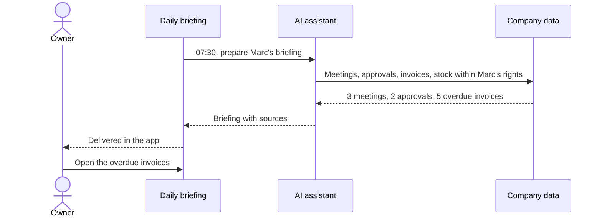

🏠 [Specs](../../../../README.md) › 🧩 [Functional capabilities](../../../README.md) › 🤖 [F3 Assistant](../../README.md) ›
📝 [Use cases](../README.md) › 📝 [Use cases: FL-F3-13 Voice, agents and briefings](README.md) ›
📝 UC-F3-23 Read the daily briefing

# 📝 UC-F3-23 Read the daily briefing

**Status:** ✅ specified

## Summary

Each morning, at the time the user chose, the AI assistant prepares a short briefing of what changed and what needs the
person: today's meetings, approvals waiting, overdue invoices, stock alerts, tasks due. Every item shows its source and
opens the record. The briefing contains only what its reader may see.

## Personas

- [U13 Owner](../../../../01-users/personas/u13-owner.md)
- [U02 Manager](../../../../01-users/personas/u02-manager.md)

## Goal

The reader starts the day knowing what matters, in two minutes, without opening ten screens.

## Trigger

The briefing time set by the user, or the reader opening the briefing on demand.

## Frequency

Every working day.

## Preconditions

- Daily briefings are switched on for the company
  ([S-F3-12](../../screens/03-act-through-the-assistant/s-f03-12-assistant-settings.md)).
- The user chose the sections, the time and the channel
  ([S-F3-27](../../screens/13-voice-agents-and-briefings/s-f03-27-daily-briefing.md)).
- The data of the sections exists in the capabilities the user may use.

## Postconditions

- **Succeeded:** the briefing was generated and delivered ([E-F3-26 Briefing](../../data/e-f03-26-briefing.md)), each
  item cites its source and opens its record, and the reader's rights were applied to every line.
- **Failed:** no briefing is delivered and the user can open the last one or ask for it again.

## Main flow

1. At the chosen time, the AI assistant collects, section by section, what the user may see: meetings of the day,
   approvals waiting for them, tasks due, overdue invoices, stock alerts, anything the user follows.
2. It writes a short briefing: a headline per section, the items that need action first, the figures from queries, never
   from the model ([BR-F3-03](../../business-rules/br-f03-03-figures-come-from-queries.md)).
3. The briefing is delivered in the app, by email or in a chat app, as the user chose.
4. The user opens it on a phone ([S-F3-27](../../screens/13-voice-agents-and-briefings/s-f03-27-daily-briefing.md)),
   reads the headline and taps an item to open its record.
5. The user marks an item Done, Snooze until tomorrow, or Not useful; the choices tune the next briefing.
6. A manager's briefing also covers their team (late tasks, absences), within what they may see
   ([BR-F3-46](../../business-rules/br-f03-46-briefings-show-only-what-the-reader-may-see.md)).
7. The user changes sections or time at any moment, or turns the briefing off.

## Alternative flows

- 3a. The briefing goes out by email or chat: sensitive sections carry only a title and a count, with a link to the app
  ([BR-F3-46](../../business-rules/br-f03-46-briefings-show-only-what-the-reader-may-see.md)).
- 4a. The user asks a follow-up in the AI assistant panel about an item; the AI assistant answers from the same sources.
- 1a. A weekend or an absence: no briefing, or a lighter one on the first day back.

## Error flows

- 1e. A section's data is not available (a capability off, a source down): the briefing says which section is missing
  and goes on.
- 3e. The email or chat delivery fails: the briefing stays in the app and the user is told.
- 2e. A figure cannot be computed: the item says so, it never shows a guess
  ([BR-F3-04](../../business-rules/br-f03-04-never-invent.md)).
- Any step: a service does not answer; the call is retried first
  ([BR-F3-32](../../business-rules/br-f03-32-retry-before-an-error.md)), then the message follows the error pattern
  ([D122](../../../../06-decisions/ux/d122-error-message-standard.md)) and the last briefing stays available.

## Business rules

- [BR-F3-46 Briefings show only what the reader may see](../../business-rules/br-f03-46-briefings-show-only-what-the-reader-may-see.md)
- [BR-F3-02 Answers use only what the user may see](../../business-rules/br-f03-02-answers-use-only-what-the-user-may-see.md)
- [BR-F3-03 Figures come from queries, never the model](../../business-rules/br-f03-03-figures-come-from-queries.md)
- [BR-F3-01 Answers cite their sources](../../business-rules/br-f03-01-answers-cite-their-sources.md)

## Entities

- [E-F3-26 Briefing](../../data/e-f03-26-briefing.md): created, changed
- [E-F3-01 Conversation](../../data/e-f03-01-conversation.md): read
- [E-F1-03 User](../../../f01-administration/data/e-f01-03-user.md): read

## Permissions

Each user has their own briefing and reads only it; nobody can read another user's briefing, not even an administrator.

## Notifications

The briefing itself is the notification, in the channel the user chose.

## Audit events

Each briefing generated with its sections and the number of items, delivery and opening; never the content for another
reader.

## AI involvement

The AI assistant writes the briefing from queries and cites its sources
([BR-F3-01](../../business-rules/br-f03-01-answers-cite-their-sources.md),
[BR-F3-03](../../business-rules/br-f03-03-figures-come-from-queries.md)); it cannot add an item the user may not see
([BR-F3-02](../../business-rules/br-f03-02-answers-use-only-what-the-user-may-see.md)).

## API, MCP and A2A exposure

T5 operations of F3 to read and configure one's own briefing; an MCP tool may read the caller's own briefing.
No A2A skill.

## Screens

- [S-F3-27 Daily briefing](../../screens/13-voice-agents-and-briefings/s-f03-27-daily-briefing.md)

## Flowchart

See [FL-F3-13 Voice, agents and briefings](../../flows/fl-f03-13-voice-agents-and-briefings.md#flowchart).

## Sequence diagram

## Acceptance criteria

1. **Given** a briefing at 07:30 **when** it is generated **then** it lists the day's meetings, the approvals waiting
   and the overdue invoices the owner may see.
2. **Given** a payroll section **when** a reader without payroll rights gets the briefing **then** that section is not
   in it.
3. **Given** an item **when** the reader taps it **then** its record opens.
4. **Given** delivery by email **when** a section is sensitive **then** the email shows a count and a link, not details.
5. **Given** a source that is down **when** the briefing is made **then** it names the missing section.

## Non-functional notes

A briefing is ready within 2 minutes of its time and opens in under 2 seconds.

## Regulatory references

None specific: it shows only what the reader may see
([BR-F3-46](../../business-rules/br-f03-46-briefings-show-only-what-the-reader-may-see.md)).

## Related use cases

- [UC-F3-01 Ask a question about the company's data](../01-ask-the-assistant/uc-f03-01-ask-a-question-about-the-company-s-data.md)
- [UC-F4-09 Prepare a meeting](../../../f04-meetings/use-cases/07-prepare-and-capture-anywhere/uc-f04-09-prepare-a-meeting.md)
- [UC-F3-24 Keep personal to-dos and memos](uc-f03-24-keep-personal-to-dos-and-memos.md)
- [UC-F3-10 Create and run AI agents](../10-benchmark-additions/uc-f03-10-create-and-run-ai-agents.md)

## Open questions

None.

---

⬅️ [UC-F3-22 Use ERP data in a spreadsheet add-in](uc-f03-22-use-erp-data-in-a-spreadsheet-add-in.md) ·
⬆️ [Up](README.md) · ➡️ [UC-F3-24 Keep personal to-dos and memos](uc-f03-24-keep-personal-to-dos-and-memos.md)
