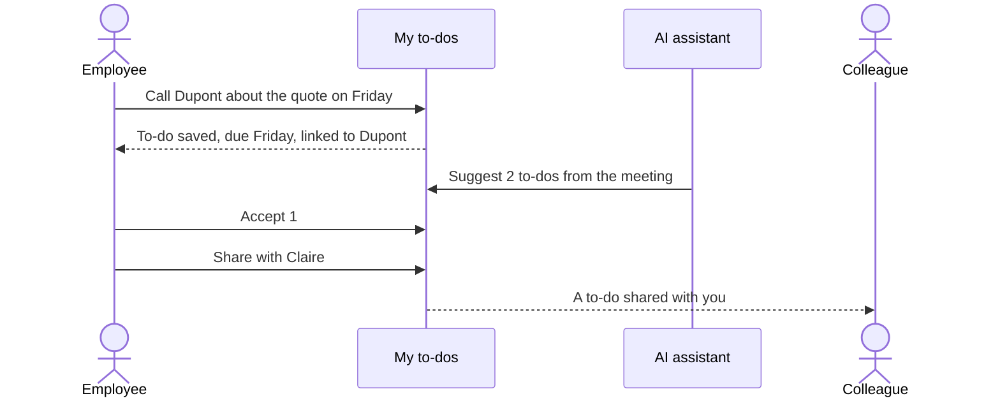

🏠 [Specs](../../../../README.md) › 🧩 [Functional capabilities](../../../README.md) › 🤖 [F3 Assistant](../../README.md) ›
📝 [Use cases](../README.md) › 📝 [Use cases: FL-F3-13 Voice, agents and briefings](README.md) ›
📝 UC-F3-24 Keep personal to-dos and memos

# 📝 UC-F3-24 Keep personal to-dos and memos

**Status:** ✅ specified

## Summary

Every user has a private list of to-dos and quick memos: typed, dictated or created by the AI AI assistant from a
conversation or a meeting. A to-do has a due date and may link to a record. It is private to its owner unless the owner
shares it with chosen colleagues.

## Personas

- [U01 Employee](../../../../01-users/personas/u01-employee.md)
- [U16 Office worker](../../../../01-users/personas/u16-office-worker.md)

## Goal

Small things are written down in seconds, found again, and never lost in an inbox or a notebook.

## Trigger

A thought to keep, a promise made in a call, something to do before a meeting.

## Frequency

Several times a day.

## Preconditions

- The user is signed in on a phone or a desktop ([E-F1-03 User](../../../f01-administration/data/e-f01-03-user.md)).
- To-dos are switched on for the company
  ([S-F3-12](../../screens/03-act-through-the-assistant/s-f03-12-assistant-settings.md)).

## Postconditions

- **Succeeded:** the to-do or memo is saved ([E-F3-27 To-do](../../data/e-f03-27-to-do.md)) in the user's private list,
  with its reminder if set.
- **Failed:** nothing is saved and the typed text stays in the field.

## Main flow

1. The user opens My to-dos ([S-F3-28](../../screens/13-voice-agents-and-briefings/s-f03-28-my-to-dos.md)) and types or
   dictates a line: "Call Dupont about the quote on Friday".
2. simple-ERP saves a to-do with the title, and a due date and a link to the Dupont record when it recognises them; the
   user corrects them if needed.
3. A quick memo is a to-do without a due date: a note with a title and a few lines.
4. The user ticks a to-do Done when finished, or Drops it; done items move to the archive.
5. A reminder notifies the user at the due time.
6. The user shares a to-do with chosen colleagues: they see it, tick it and comment; the owner can stop sharing
   ([BR-F3-47](../../business-rules/br-f03-47-to-dos-are-private-unless-shared.md)).
7. The AI assistant offers to create to-dos from a conversation, a meeting's action items or an email, and the user
   accepts or refuses each one, see
   [UC-F4-27](../../../f04-meetings/use-cases/13-outside-people-and-follow-up/uc-f04-27-keep-meeting-actions-in-step-with-tasks.md).

## Alternative flows

- 2a. The user links the to-do to a record by search; the record shows a small mark with the number of its owner's
  to-dos only to that owner.
- 6a. A shared to-do is ticked by a colleague: the owner sees who and when.
- 7a. The user turns a to-do into a task of the company (assigned, tracked by others): the to-do stays as a link.

## Error flows

- 2e. The title is empty: refused under the field.
- 6e. The user shares with someone who has left the company: the share is removed with their account, see
  [BR-F1-21](../../../f01-administration/business-rules/br-f01-21-deprovisioned-users-are-deactivated-never-deleted.md).
- 5e. A reminder fails to send: it shows on the list as overdue instead.
- Any step: a service does not answer; the call is retried first
  ([BR-F3-32](../../business-rules/br-f03-32-retry-before-an-error.md)), then the message follows the error pattern
  ([D122](../../../../06-decisions/ux/d122-error-message-standard.md)) and the typed text stays in the field.

## Business rules

- [BR-F3-47 To-dos are private unless shared](../../business-rules/br-f03-47-to-dos-are-private-unless-shared.md)
- [BR-F3-39 Memory is opt-in, visible and erasable](../../business-rules/br-f03-39-memory-is-opt-in-visible-and-erasable.md)
- [BR-F4-30 Actions and tasks stay in step](../../../f04-meetings/business-rules/br-f04-30-actions-and-tasks-stay-in-step.md)
- [BR-F1-21 Deprovisioned users are deactivated, never deleted](../../../f01-administration/business-rules/br-f01-21-deprovisioned-users-are-deactivated-never-deleted.md)

## Entities

- [E-F3-27 To-do](../../data/e-f03-27-to-do.md): created, changed
- [E-F4-04 Action item](../../../f04-meetings/data/e-f04-04-action-item.md): read, when a to-do comes from a meeting

## Permissions

A to-do is private to its owner; administrators cannot read it; a shared to-do is visible to the colleagues chosen, with
the right to tick and comment only.

## Notifications

- The owner: a to-do due now or overdue.
- The colleague: a to-do shared with them.

## Audit events

Creation and deletion of a to-do (not its text); each share and each stop of sharing, with who and when.

## AI involvement

The AI assistant may suggest to-dos from a conversation, a meeting or an email; each is a suggestion the user accepts
([BR-F3-39](../../business-rules/br-f03-39-memory-is-opt-in-visible-and-erasable.md) for what it remembers).

## API, MCP and A2A exposure

T5 operations of F3 for the caller's own to-dos; an MCP tool may add a to-do to the caller's list. No A2A
skill.

## Screens

- [S-F3-28 My to-dos](../../screens/13-voice-agents-and-briefings/s-f03-28-my-to-dos.md)

## Flowchart

See [FL-F3-13 Voice, agents and briefings](../../flows/fl-f03-13-voice-agents-and-briefings.md#flowchart).

## Sequence diagram

## Acceptance criteria

1. **Given** a typed line with a day and a customer **when** the user saves it **then** a to-do is created with its due
   date and link.
2. **Given** a to-do never shared **when** an administrator searches **then** they cannot see it.
3. **Given** a to-do shared with Claire **when** she ticks it **then** the owner sees who and when.
4. **Given** the owner stops sharing **when** Claire opens her list **then** the to-do is gone.
5. **Given** two suggested to-dos from a meeting **when** the user accepts one **then** only that one is saved.

## Non-functional notes

A to-do is saved in under 1 second and works offline on the phone, syncing later.

## Regulatory references

A private list of personal notes: not accessible to the employer by design (Proposed: the France pack rule on private
notes is written later).

## Related use cases

- [UC-F3-17 Keep personal preferences in the AI assistant's memory](../12-personal-cost-aware-and-learning/uc-f03-17-keep-personal-preferences-in-the-assistants-memory.md)
- [UC-F3-23 Read the daily briefing](uc-f03-23-read-the-daily-briefing.md)
- [UC-F4-27 Keep meeting actions in step with tasks](../../../f04-meetings/use-cases/13-outside-people-and-follow-up/uc-f04-27-keep-meeting-actions-in-step-with-tasks.md)
- [UC-F4-05 Review a meeting](../../../f04-meetings/use-cases/03-review-a-meeting/uc-f04-05-review-a-meeting.md)

## Open questions

None.

---

⬅️ [UC-F3-23 Read the daily briefing](uc-f03-23-read-the-daily-briefing.md) · ⬆️ [Up](README.md)
