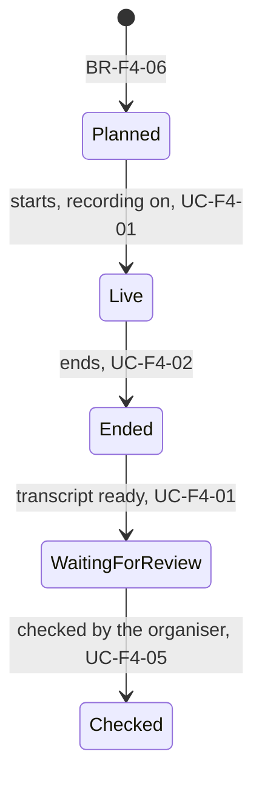

🏠 [Specs](../../../README.md) › 🧩 [Functional capabilities](../../README.md) › 🎙️ [F4 Meetings](../README.md) ›
🗃️ [Data](README.md) › 🗃️ E-F4-01 Meeting

# 🗃️ E-F4-01 Meeting

**Status:** ✅ specified

## Purpose

A meeting and what came out of it (D208 to D211).

## Fields

| Name | Type | Required | Validation | Default | Example | Personal data | Custom fields |
|---|---|---|---|---|---|---|---|
| title | text | yes | - | from the calendar | Durand SA, kitchen project | no | yes |
| starts | date and time | yes | - | - | 2026-11-10 14:00 | no | no |
| platform | Teams, Meet, Zoom, Jitsi, BigBlueButton, in person, phone | yes | - | - | Teams | no | no |
| recording | on, off | yes | BR-F4-06 | on | on | no | no |
| source | bot, platform transcript, app, phone system | yes | BR-F4-07 | per platform | bot | no | no |
| participants | people | yes | - | from the calendar | Léa Moreau, J. Durand | yes | no |
| linked records | records | no | - | suggested | Durand SA | no | no |
| kind | ordinary, HR | yes | - | ordinary | ordinary | no | no |
| status | planned, live, ended, waiting for review, checked | yes | - | planned | checked | no | no |

## Relations

Has one [transcript](e-f04-02-transcript.md); linked to records.

## Lifecycle

## Indexes and search

By title, date, participant, linked record; transcripts searched through T8.

## Retention

As the linked records; recordings as BR-F4-03.

## Audit

See UC-F4-01's audit events.

## Import and export

Platform transcripts imported (UC-F4-02); summaries exported as documents.

## Used by

- [UC-F4-01](../use-cases/01-record-an-online-meeting/uc-f04-01-record-an-online-meeting-with-the-bot.md)
- [UC-F4-02](../use-cases/01-record-an-online-meeting/uc-f04-02-import-a-platform-s-own-transcript.md)
- [UC-F4-20 Analyse topics and trends across calls](../use-cases/11-insights-and-accessibility/uc-f04-20-analyse-topics-and-trends-across-calls.md)
- [UC-F4-21 Book a meeting room and equipment](../use-cases/12-rooms-and-client-video/uc-f04-21-book-a-meeting-room-and-equipment.md)
- [UC-F4-25 Hold a client video meeting](../use-cases/12-rooms-and-client-video/uc-f04-25-hold-a-client-video-meeting.md)
- [UC-F4-26 Receive and confirm the agreed actions](../use-cases/13-outside-people-and-follow-up/uc-f04-26-receive-and-confirm-the-agreed-actions.md)

## Open questions

None.

---

⬆️ [Up](README.md) · ➡️ [E-F4-02 Transcript](e-f04-02-transcript.md)
