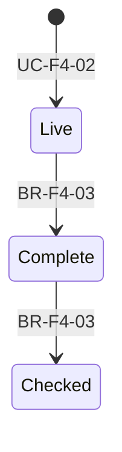

🏠 [Specs](../../../README.md) › 🧩 [Functional capabilities](../../README.md) › 🎙️ [F4 Meetings](../README.md) ›
🗃️ [Data](README.md) › 🗃️ E-F4-02 Transcript

# 🗃️ E-F4-02 Transcript

**Status:** ✅ specified

## Purpose

What was said in a meeting, by whom and when.

## Fields

| Name | Type | Required | Validation | Default | Example | Personal data | Custom fields |
|---|---|---|---|---|---|---|---|
| segments | list of time, speaker, text, language | yes | - | - | 14:12 Léa Moreau: so we agree... | yes | no |
| source | bot, platform, app, phone | yes | - | - | bot | no | no |
| gaps | list of times | no | - | - | 14:30 to 14:31 | no | no |
| audio | file | no | deleted as BR-F4-03 | - | (deleted) | yes | no |

## Relations

Belongs to one [meeting](e-f04-01-meeting.md).

## Lifecycle

Live, then complete, then checked; audio deleted at check or after the retention period.

## Indexes and search

Full text and meaning (T8), for those who may see it (BR-F4-04).

## Retention

As its meeting.

## Audit

Read by whom.

## Import and export

From platforms; exported as text by participants.

## Used by

- [UC-F4-01](../use-cases/01-record-an-online-meeting/uc-f04-01-record-an-online-meeting-with-the-bot.md)
- [UC-F4-02](../use-cases/01-record-an-online-meeting/uc-f04-02-import-a-platform-s-own-transcript.md)
- [UC-F4-22 Turn on live captions and translation](../use-cases/11-insights-and-accessibility/uc-f04-22-turn-on-live-captions-and-translation.md)
- [UC-F4-23 Handle an outside speaker's objection or erasure](../use-cases/13-outside-people-and-follow-up/uc-f04-23-handle-an-outside-speakers-objection-or-erasure.md)

## Open questions

None.

---

⬅️ [E-F4-01 Meeting](e-f04-01-meeting.md) · ⬆️ [Up](README.md) ·
➡️ [E-F4-03 Summary template](e-f04-03-summary-template.md)
