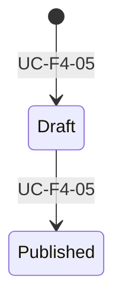

🏠 [Specs](../../../README.md) › 🧩 [Functional capabilities](../../README.md) › 🎙️ [F4 Meetings](../README.md) ›
🗃️ [Data](README.md) › 🗃️ E-F4-03 Summary template

# 🗃️ E-F4-03 Summary template

**Status:** ✅ specified

## Purpose

The sections of a summary for a meeting kind (D224).

## Fields

| Name | Type | Required | Validation | Default | Example | Personal data | Custom fields |
|---|---|---|---|---|---|---|---|
| kind | text | yes | unique | - | Site meeting | no | no |
| sections | list | yes | at least one | summary, decisions, actions, open points | attendees, progress per trade, safety, decisions, actions | no | no |
| origin | shipped, configured, pack | yes | - | configured | shipped | no | no |

## Relations

Used by meetings of its kind; part of configuration packs (UC-F2-11).

## Lifecycle

Drafted and published like any configuration (UC-F2-09).

## Indexes and search

By kind.

## Retention

As configuration.

## Audit

Changes.

## Import and export

In configuration packs.

## Used by

- [UC-F4-05](../use-cases/03-review-a-meeting/uc-f04-05-review-a-meeting.md)

## Open questions

None.

---

⬅️ [E-F4-02 Transcript](e-f04-02-transcript.md) · ⬆️ [Up](README.md) ·
➡️ [E-F4-04 Action item](e-f04-04-action-item.md)
