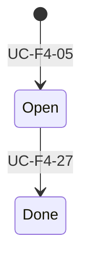

🏠 [Specs](../../../README.md) › 🧩 [Functional capabilities](../../README.md) › 🎙️ [F4 Meetings](../README.md) ›
🗃️ [Data](README.md) › 🗃️ E-F4-04 Action item

# 🗃️ E-F4-04 Action item

**Status:** ✅ specified

## Purpose

Something someone must do after a meeting (D225).

## Fields

| Name | Type | Required | Validation | Default | Example | Personal data | Custom fields |
|---|---|---|---|---|---|---|---|
| text | text | yes | - | - | Order tiles | no | no |
| who | colleague or outside person | yes | - | - | Paul Martin | yes | no |
| due | date | no | - | - | 2026-11-13 | no | no |
| becomes | task, follow-up line | yes | BR-F4-14 | by who | task | no | no |
| status | open, done | yes | - | open | open | no | no |

## Relations

From one meeting; a task when for a colleague.

## Lifecycle

Open until its task is done or the next meeting closes it.

## Indexes and search

By meeting, owner, status.

## Retention

As its meeting.

## Audit

Created, done.

## Import and export

None.

## Used by

- [UC-F4-05](../use-cases/03-review-a-meeting/uc-f04-05-review-a-meeting.md)
- [UC-F4-06](../use-cases/04-find-and-reuse-meetings/uc-f04-06-find-and-reuse-past-meetings.md)
- [UC-F4-26 Receive and confirm the agreed actions](../use-cases/13-outside-people-and-follow-up/uc-f04-26-receive-and-confirm-the-agreed-actions.md)
- [UC-F4-27 Keep meeting actions in step with tasks](../use-cases/13-outside-people-and-follow-up/uc-f04-27-keep-meeting-actions-in-step-with-tasks.md)

## Open questions

None.

---

⬅️ [E-F4-03 Summary template](e-f04-03-summary-template.md) · ⬆️ [Up](README.md) ·
➡️ [E-F4-05 Calendar sync](e-f04-05-calendar-sync.md)
