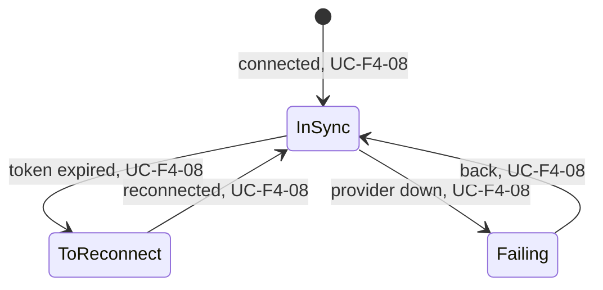

🏠 [Specs](../../../README.md) › 🧩 [Functional capabilities](../../README.md) › 🎙️ [F4 Meetings](../README.md) ›
🗃️ [Data](README.md) › 🗃️ E-F4-05 Calendar sync

# 🗃️ E-F4-05 Calendar sync

**Status:** ✅ specified

## Purpose

One user's calendar kept in step with simple-ERP (D228 to D230).

## Fields

| Name | Type | Required | Validation | Default | Example | Personal data | Custom fields |
|---|---|---|---|---|---|---|---|
| user | user | yes | - | - | Léa Moreau | yes | no |
| provider | Google Calendar, Microsoft 365 | yes | - | - | Google Calendar | no | no |
| mode | Workspace, personal | yes | D229 | - | Workspace | no | no |
| last change received | date and time | yes | - | - | 2026-11-10 16:41 | no | no |
| status | in sync, to reconnect, failing | yes | - | in sync | in sync | no | no |

## Relations

Feeds [meetings](e-f04-01-meeting.md); a personal connection (E-F3-07) in personal mode.

## Lifecycle

## Indexes and search

By user and status.

## Retention

While connected.

## Audit

Connected, disconnected.

## Import and export

None.

## Used by

- [UC-F4-08](../use-cases/06-set-up-meetings-and-calendars/uc-f04-08-set-up-meeting-sources-calendars-and-retention.md)

## Open questions

None.

---

⬅️ [E-F4-04 Action item](e-f04-04-action-item.md) · ⬆️ [Up](README.md) · ➡️ [E-F4-06 Scorecard](e-f04-06-scorecard.md)
