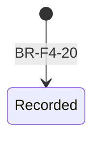

🏠 [Specs](../../../README.md) › 🧩 [Functional capabilities](../../README.md) › 🎙️ [F4 Meetings](../README.md) ›
🗃️ [Data](README.md) › 🗃️ E-F4-06 Scorecard

# 🗃️ E-F4-06 Scorecard

**Status:** ✅ specified

## Purpose

A sales call's scores (D234).

## Fields

| Name | Type | Required | Validation | Default | Example | Personal data | Custom fields |
|---|---|---|---|---|---|---|---|
| criteria | list of name, definition | yes | configured (F2) | - | Next steps agreed | no | no |
| scores | list of 0 to 5 with quotes | yes | BR-F4-20 | - | 4, at 38:12 | yes | no |
| total | 0 to 100 | yes | - | - | 72 | no | no |
| talk-time | percent per speaker | yes | - | - | Léa 58 % | yes | no |
| changes | list | no | original kept | - | 4 to 3 by Marc Durand | yes | no |

## Relations

Belongs to its meeting or owner.

## Lifecycle

## Indexes and search

By meeting and owner.

## Retention

As its meeting; HR data as BR-F4-18.

## Audit

Changes logged.

## Import and export

In exports (UC-F4-11) as allowed.

## Used by

- [UC-F4-12](../use-cases/09-score-calls-and-interviews/uc-f04-12-score-a-sales-call.md)

## Open questions

None.

---

⬅️ [E-F4-05 Calendar sync](e-f04-05-calendar-sync.md) · ⬆️ [Up](README.md) ·
➡️ [E-F4-07 Evaluation grid](e-f04-07-evaluation-grid.md)
