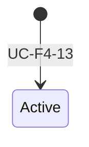

🏠 [Specs](../../../README.md) › 🧩 [Functional capabilities](../../README.md) › 🎙️ [F4 Meetings](../README.md) ›
🗃️ [Data](README.md) › 🗃️ E-F4-07 Evaluation grid

# 🗃️ E-F4-07 Evaluation grid

**Status:** ✅ specified

## Purpose

An interview's criteria, scores and match score (D234, BR-F4-21).

## Fields

| Name | Type | Required | Validation | Default | Example | Personal data | Custom fields |
|---|---|---|---|---|---|---|---|
| job | job | yes | - | - | Site manager | no | no |
| criteria | list | yes | job-related | - | Site safety experience | no | no |
| answers | list with quotes and times | yes | - | - | Notice period: 1 month, at 12:40 | yes | no |
| scores | list of 0 to 5 | if scoring on | to validate | - | 4 | yes | no |
| match score | 0 to 100 | if scoring on | to validate | - | 78 | yes | no |
| validated by | user | no | - | - | Claire Petit | yes | no |

## Relations

Belongs to its meeting or owner.

## Lifecycle

## Indexes and search

By meeting and owner.

## Retention

As its meeting; HR data as BR-F4-18.

## Audit

Changes logged.

## Import and export

In exports (UC-F4-11) as allowed.

## Used by

- [UC-F4-13](../use-cases/09-score-calls-and-interviews/uc-f04-13-interview-a-candidate.md)

## Open questions

None.

---

⬅️ [E-F4-06 Scorecard](e-f04-06-scorecard.md) · ⬆️ [Up](README.md) · ➡️ [E-F4-08 Key moment](e-f04-08-key-moment.md)
