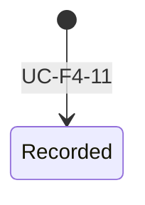

🏠 [Specs](../../../README.md) › 🧩 [Functional capabilities](../../README.md) › 🎙️ [F4 Meetings](../README.md) ›
🗃️ [Data](README.md) › 🗃️ E-F4-08 Key moment

# 🗃️ E-F4-08 Key moment

**Status:** ✅ specified

## Purpose

A marked passage, maybe clipped (UC-F4-11).

## Fields

| Name | Type | Required | Validation | Default | Example | Personal data | Custom fields |
|---|---|---|---|---|---|---|---|
| meeting | meeting | yes | - | - | Durand SA | no | no |
| from, to | times | yes | - | - | 14:11 to 14:13 | no | no |
| title | text | yes | - | - | Price agreed | no | no |
| clip | audio or video | no | while recordings are kept | - | - | yes | no |

## Relations

Belongs to its meeting or owner.

## Lifecycle

## Indexes and search

By meeting and owner.

## Retention

As its meeting; HR data as BR-F4-18.

## Audit

Changes logged.

## Import and export

In exports (UC-F4-11) as allowed.

## Used by

- [UC-F4-11](../use-cases/08-share-and-reuse-outside/uc-f04-11-share-export-and-clip-a-meeting.md)

## Open questions

None.

---

⬅️ [E-F4-07 Evaluation grid](e-f04-07-evaluation-grid.md) · ⬆️ [Up](README.md) ·
➡️ [E-F4-09 Scheduled digest](e-f04-09-scheduled-digest.md)
