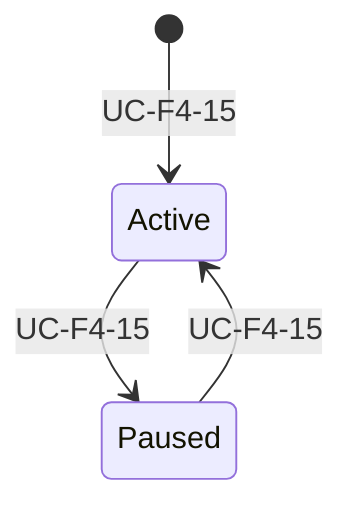

🏠 [Specs](../../../README.md) › 🧩 [Functional capabilities](../../README.md) › 🎙️ [F4 Meetings](../README.md) ›
🗃️ [Data](README.md) › 🗃️ E-F4-09 Scheduled digest

# 🗃️ E-F4-09 Scheduled digest

**Status:** ✅ specified

## Purpose

A recurring request run by the AI assistant (UC-F4-15).

## Fields

| Name | Type | Required | Validation | Default | Example | Personal data | Custom fields |
|---|---|---|---|---|---|---|---|
| owner | user | yes | - | - | Marc Durand | yes | no |
| request | text | yes | - | - | Deals at risk from last week's calls | no | no |
| schedule | recurrence | yes | - | - | Mondays 9:00 | no | no |
| channel | email, in-app | yes | - | in-app | email | no | no |
| status | active, paused | yes | - | active | active | no | no |

## Relations

Belongs to its meeting or owner.

## Lifecycle

## Indexes and search

By meeting and owner.

## Retention

As its meeting; HR data as BR-F4-18.

## Audit

Changes logged.

## Import and export

In exports (UC-F4-11) as allowed.

## Used by

- [UC-F4-15](../use-cases/08-share-and-reuse-outside/uc-f04-15-schedule-recurring-digests.md)

## Open questions

None.

---

⬅️ [E-F4-08 Key moment](e-f04-08-key-moment.md) · ⬆️ [Up](README.md) ·
➡️ [E-F4-10 Chat channel](e-f04-10-chat-channel.md)
