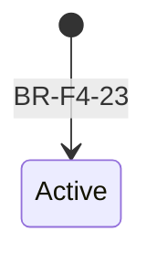

🏠 [Specs](../../../README.md) › 🧩 [Functional capabilities](../../README.md) › 🎙️ [F4 Meetings](../README.md) ›
🗃️ [Data](README.md) › 🗃️ E-F4-11 Appointment type

# 🗃️ E-F4-11 Appointment type

**Status:** ✅ specified

## Purpose

What customers can book.

## Fields

| Name | Type | Required | Validation | Default | Example | Personal data | Custom fields |
|---|---|---|---|---|---|---|---|
| name | text | yes | - | - | Boiler visit | no | no |
| with | people or resources | yes | BR-F4-23 | - | Technicians | no | no |
| duration, notice | minutes, hours | yes | - | 60, 24 | 90, 48 | no | no |
| payment | none, deposit, full | yes | - | none | deposit | no | no |

## Relations

As its use cases.

## Lifecycle

## Indexes and search

By name, date, owner.

## Retention

Kept for the period of its kind of record in the country pack (D293), or else its kind's default in the
[retention schedule](../../../05-non-functional/data-retention.md).

## Audit

Every change.

## Import and export

CSV.

## Used by

- [UC-F4-18](../use-cases/10-benchmark-additions/uc-f04-18-let-customers-book-appointments.md)

## Open questions

None.

---

⬅️ [E-F4-10 Chat channel](e-f04-10-chat-channel.md) · ⬆️ [Up](README.md) ·
➡️ [E-F4-12 Call route](e-f04-12-call-route.md)
