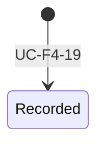

🏠 [Specs](../../../README.md) › 🧩 [Functional capabilities](../../README.md) › 🎙️ [F4 Meetings](../README.md) ›
🗃️ [Data](README.md) › 🗃️ E-F4-12 Call route

# 🗃️ E-F4-12 Call route

**Status:** ✅ specified

## Purpose

How incoming calls are routed.

## Fields

| Name | Type | Required | Validation | Default | Example | Personal data | Custom fields |
|---|---|---|---|---|---|---|---|
| number | phone number | yes | - | - | +33 4 72 00 00 00 | no | no |
| hours | schedule | yes | - | - | Mon to Fri 8-18 | no | no |
| menu, queues | flow | yes | - | - | 1 sales, 2 support | no | no |

## Relations

As its use cases.

## Lifecycle

## Indexes and search

By name, date, owner.

## Retention

Kept for the period of its kind of record in the country pack (D293), or else its kind's default in the
[retention schedule](../../../05-non-functional/data-retention.md).

## Audit

Every change.

## Import and export

CSV.

## Used by

- [UC-F4-19](../use-cases/10-benchmark-additions/uc-f04-19-route-incoming-calls.md)

## Open questions

None.

---

⬅️ [E-F4-11 Appointment type](e-f04-11-appointment-type.md) · ⬆️ [Up](README.md) ·
➡️ [E-F4-13 Call topic](e-f04-13-call-topic.md)
