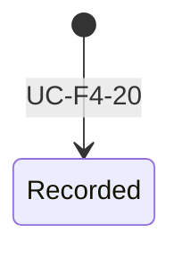

🏠 [Specs](../../../README.md) › 🧩 [Functional capabilities](../../README.md) › 🎙️ [F4 Meetings](../README.md) ›
🗃️ [Data](README.md) › 🗃️ E-F4-13 Call topic

# 🗃️ E-F4-13 Call topic

**Status:** 🔄 waiting for the owner

## Purpose

A theme found across checked meetings, with its count and quoted passages.

## Fields

| Name | Type | Required | Validation | Default | Example | Personal data | Custom fields |
|---|---|---|---|---|---|---|---|
| name | text | yes | - | - | Price objection | no | - |
| kind | objection, competitor, request, theme | yes | - | - | objection | no | - |
| count per period | numbers | yes | - | - | Q3: 42 | no | - |
| passages | meeting, time, text | yes | - | - | Meeting 812 at 14:32 | yes | - |

## Relations

Points to Meetings and their Transcripts.

## Lifecycle

Recomputed each night (Proposed).

## Indexes and search

By kind, name and period.

## Retention

As the meetings it quotes.

## Audit

Read and exported.

## Import and export

None.

## Used by

- [UC-F4-20 Analyse topics and trends across calls](../use-cases/11-insights-and-accessibility/uc-f04-20-analyse-topics-and-trends-across-calls.md)

## Open questions

None.

---

⬅️ [E-F4-12 Call route](e-f04-12-call-route.md) · ⬆️ [Up](README.md) ·
➡️ [E-F4-14 Speaker request](e-f04-14-speaker-request.md)
