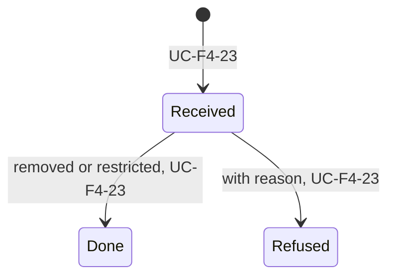

🏠 [Specs](../../../README.md) › 🧩 [Functional capabilities](../../README.md) › 🎙️ [F4 Meetings](../README.md) ›
🗃️ [Data](README.md) › 🗃️ E-F4-14 Speaker request

# 🗃️ E-F4-14 Speaker request

**Status:** ✅ specified

## Purpose

An outside speaker's objection or erasure request and its handling.

## Fields

| Name | Type | Required | Validation | Default | Example | Personal data | Custom fields |
|---|---|---|---|---|---|---|---|
| person | name and contact | yes | - | - | J. Morel, Lemoine | yes | - |
| kind | objection, erasure | yes | - | - | erasure | no | - |
| meetings | list | yes | - | - | 2 meetings | no | - |
| due | date | yes | received + 1 month | - | 2026-12-12 | no | - |
| outcome | removed, restricted, refused | no | - | - | removed | no | - |

## Relations

Points to Meetings.

## Lifecycle

## Indexes and search

By person and status.

## Retention

3 years as proof of the answer.

## Audit

As UC-F4-23's audit events.

## Import and export

None.

## Used by

- [UC-F4-23 Handle an outside speaker's objection or erasure](../use-cases/13-outside-people-and-follow-up/uc-f04-23-handle-an-outside-speakers-objection-or-erasure.md)

## Open questions

None.

---

⬅️ [E-F4-13 Call topic](e-f04-13-call-topic.md) · ⬆️ [Up](README.md) ·
➡️ [E-F4-15 Accuracy measure](e-f04-15-accuracy-measure.md)
