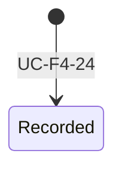

🏠 [Specs](../../../README.md) › 🧩 [Functional capabilities](../../README.md) › 🎙️ [F4 Meetings](../README.md) ›
🗃️ [Data](README.md) › 🗃️ E-F4-15 Accuracy measure

# 🗃️ E-F4-15 Accuracy measure

**Status:** ✅ specified

## Purpose

Transcription accuracy per language, model and period.

## Fields

| Name | Type | Required | Validation | Default | Example | Personal data | Custom fields |
|---|---|---|---|---|---|---|---|
| language | language | yes | - | - | fr | no | - |
| model | AI model | yes | - | - | local speech model | no | - |
| words right | percent | yes | - | - | 96 | no | - |
| meetings | number | yes | - | - | 120 | no | - |

## Relations

Computed from Transcripts and their corrections.

## Lifecycle

Recomputed monthly.

## Indexes and search

By language and model.

## Retention

2 years.

## Audit

None: computed.

## Import and export

None.

## Used by

- [UC-F4-24 Track transcription accuracy per language and model](../use-cases/11-insights-and-accessibility/uc-f04-24-track-transcription-accuracy-per-language-and-model.md)

## Open questions

None.

---

⬅️ [E-F4-14 Speaker request](e-f04-14-speaker-request.md) · ⬆️ [Up](README.md) ·
➡️ [E-F4-16 Client video meeting](e-f04-16-client-video-meeting.md)
