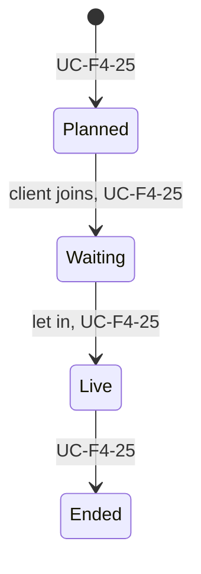

🏠 [Specs](../../../README.md) › 🧩 [Functional capabilities](../../README.md) › 🎙️ [F4 Meetings](../README.md) ›
🗃️ [Data](README.md) › 🗃️ E-F4-16 Client video meeting

# 🗃️ E-F4-16 Client video meeting

**Status:** ✅ specified

## Purpose

A video meeting with a client through the connected suite, with its one-meeting link.

## Fields

| Name | Type | Required | Validation | Default | Example | Personal data | Custom fields |
|---|---|---|---|---|---|---|---|
| meeting | meeting | yes | - | - | Appointment 2026-12-02 10:00 | no | - |
| link | URL | yes | valid for this meeting | - | https://meet... | no | - |
| consent to record | yes, no | yes | - | no | no | no | - |
| status | planned, waiting, live, ended | yes | - | planned | ended | no | - |

## Relations

One per Meeting (E-F4-01) held by video with a client.

## Lifecycle

## Indexes and search

On the client's record.

## Retention

As the meeting.

## Audit

As UC-F4-25's audit events.

## Import and export

None.

## Used by

- [UC-F4-25 Hold a client video meeting](../use-cases/12-rooms-and-client-video/uc-f04-25-hold-a-client-video-meeting.md)

## Open questions

None.

---

⬅️ [E-F4-15 Accuracy measure](e-f04-15-accuracy-measure.md) · ⬆️ [Up](README.md) ·
➡️ [E-F4-17 Meeting summary](e-f04-17-meeting-summary.md)
