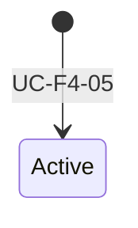

🏠 [Specs](../../../README.md) › 🧩 [Functional capabilities](../../README.md) › 🎙️ [F4 Meetings](../README.md) ›
🗃️ [Data](README.md) › 🗃️ E-F4-17 Meeting summary

# 🗃️ E-F4-17 Meeting summary

**Status:** 🔄 waiting for the owner

## Purpose

(Proposed) The meeting summary the flow charts name with the words "Summaries", "Summary", "summary"
([FL-F4-03](../flows/fl-f04-03-review-a-meeting.md), [FL-F4-04](../flows/fl-f04-04-find-and-reuse-meetings.md),
[FL-F4-05](../flows/fl-f04-05-hr-meeting.md)). The owner decided to create it
([D516](../../../06-decisions/foundations/d516-naming-rules-and-the-seven-classes-of-names.md)); what it holds waits for
the owner's confirmation.

## Fields

(Proposed) To define with the owner: the flow charts name the record, not its fields.

### Merged in: E-F4-23 Meeting notes

From [E-F4-23 Meeting notes](e-f04-23-meeting-notes.md), merged here (the owner's answer S2-9 of 2026-11-13). (Proposed)
The meeting notes the flow charts name with the words "notes" ([FL-F4-05](../flows/fl-f04-05-hr-meeting.md)). The owner
decided to create it ([D516](../../../06-decisions/foundations/d516-naming-rules-and-the-seven-classes-of-names.md));
what it holds waits for the owner's confirmation.

## Relations

(Proposed) To define with the owner, from the use cases below.

## Lifecycle

## Indexes and search

(Proposed) To define with the owner.

## Retention

(Proposed) As the other records of its capability, to confirm with the owner.

## Audit

(Proposed) Every change, as the other records of its capability.

## Import and export

(Proposed) To define with the owner.

## Used by

- [UC-F4-05 Review a meeting](../use-cases/03-review-a-meeting/uc-f04-05-review-a-meeting.md)
- [UC-F4-06 Find and reuse past meetings](../use-cases/04-find-and-reuse-meetings/uc-f04-06-find-and-reuse-past-meetings.md)
- [UC-F4-07 HR meeting](../use-cases/05-hr-meeting/uc-f04-07-hr-meeting.md)

## Open questions

(Proposed) Its fields, relations and states wait for the owner (waiting list, step 36e).

---

⬅️ [E-F4-16 Client video meeting](e-f04-16-client-video-meeting.md) · ⬆️ [Up](README.md) ·
➡️ [E-F4-18 Recording notice](e-f04-18-recording-notice.md)
