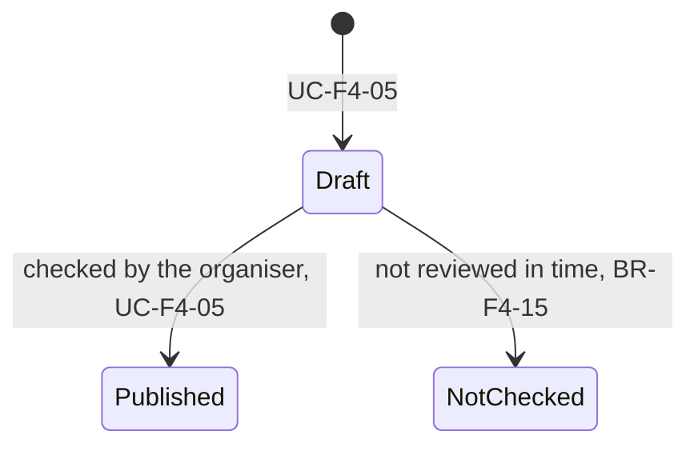

🏠 [Specs](../../../README.md) › 🧩 [Functional capabilities](../../README.md) › 🎙️ [F4 Meetings](../README.md) ›
🗃️ [Data](README.md) › 🗃️ E-F4-17 Meeting summary

# 🗃️ E-F4-17 Meeting summary

**Status:** ✅ specified

## Purpose

The meeting summary the flow charts name with the words "Summaries", "Summary", "summary"
([FL-F4-03](../flows/fl-f04-03-review-a-meeting.md), [FL-F4-04](../flows/fl-f04-04-find-and-reuse-meetings.md),
[FL-F4-05](../flows/fl-f04-05-hr-meeting.md)). The owner decided to create it
([D516](../../../06-decisions/foundations/d516-naming-rules-and-the-seven-classes-of-names.md)); its fields are derived
from the specifications and confirmed by the owner (D572).

## Fields

| Name | Type | Required | Validation | Default | Example | Personal data | Custom fields |
|---|---|---|---|---|---|---|---|
| title | text | yes | - | the meeting's title | Durand SA, kitchen project | no | no |
| meeting | meeting | yes | - | - | Weekly site meeting, 9 Nov | no | no |
| summary template | summary template | yes | BR-F4-13 | the meeting kind's template | Site meeting minutes | no | no |
| sections | list of heading, text | yes | the template's sections | summary, decisions, actions, open points | Decisions: 1. Model B tiles | yes | no |
| note template | note template | no | - | the team's template for the meeting kind | Discovery call | no | no |
| note fields | list of label, value, transcript time, draft or confirmed | no | BR-F4-35 | draft | Budget: 48,000 EUR, at 12:40, draft | yes | no |
| language | language | yes | BR-F4-05 | the organiser's language | French | no | no |
| typed notes | text | no | - | - | Objectives reviewed, no recording | yes | no |
| correction requests | list of comment, answer | no | HR meetings only, BR-F4-18 | - | Wished: Excel course | yes | no |
| shared with the manager | yes, no | yes | HR meetings only, BR-F4-18 | no | yes | no | no |
| state | draft, published, not checked | yes | the lifecycle below | draft | published | no | no |

Derived from [UC-F4-05](../use-cases/03-review-a-meeting/uc-f04-05-review-a-meeting.md) (sections, kind, checked and
published), [UC-F4-07](../use-cases/05-hr-meeting/uc-f04-07-hr-meeting.md) (correction, sharing, notes when the
recording stops),
[UC-F4-30](../use-cases/14-video-messages-and-webinars/uc-f04-30-choose-a-note-template-per-meeting-type.md) (note
fields), [BR-F4-05](../business-rules/br-f04-05-summaries-in-the-reader-s-language.md),
[BR-F4-13](../business-rules/br-f04-13-summaries-follow-the-meeting-kind.md),
[BR-F4-15](../business-rules/br-f04-15-unreviewed-meetings-publish-as-not-checked.md), [S-F4-05 Meeting
review](../screens/03-review-a-meeting/s-f04-05-meeting-review.md) and the list
[S-F4-L17](../screens/00-lists/s-f04-l17-meeting-summaries.md).

### Merged in: E-F4-23 Meeting notes

From [E-F4-23 Meeting notes](e-f04-23-meeting-notes.md), merged here (the owner's answer S2-9 of 2026-11-13).
The meeting notes the flow charts name with the words "notes" ([FL-F4-05](../flows/fl-f04-05-hr-meeting.md)) are the
field **typed notes** above: what HR types when someone asks to stop the recording
([UC-F4-07](../use-cases/05-hr-meeting/uc-f04-07-hr-meeting.md), alternative flow 1a), or the recruiter when a candidate
refuses it ([UC-F4-13](../use-cases/09-score-calls-and-interviews/uc-f04-13-interview-a-candidate.md)); they are then
the record of the meeting. The structured notes a note template asks for are the field **note fields**.

## Relations

Belongs to one [meeting](e-f04-01-meeting.md); follows one [summary template](e-f04-03-summary-template.md) and, when
its team has one for the meeting kind, one [note template](e-f04-29-note-template.md); its actions are
[action items](e-f04-04-action-item.md), and the outside people's actions go to its meeting's
[follow-up email](e-f04-19-follow-up-email.md). Reviewed note fields may fill the linked record
([UC-F4-30](../use-cases/14-video-messages-and-webinars/uc-f04-30-choose-a-note-template-per-meeting-type.md)).

## Lifecycle

Drafted when the transcript is ready, published when its meeting is checked, or published to the participants marked
"not checked" when nobody reviews it (BR-F4-15); a not checked summary leaves its links as suggestions.

## Indexes and search

By title, meeting, state; full text and meaning (T8), for the participants and, once published and checked, the readers
of a linked record ([BR-F4-04](../business-rules/br-f04-04-transcripts-stay-with-participants.md),
[UC-F4-06](../use-cases/04-find-and-reuse-meetings/uc-f04-06-find-and-reuse-past-meetings.md)); an HR meeting's summary
only for HR, the employee and a manager HR shared it with (BR-F4-18).

## Retention

As the other records of its capability.

## Audit

Every change, as the other records of its capability.

## Import and export

Exported as a document by those who may read it ([E-F4-01](e-f04-01-meeting.md)), and as CSV or XLSX of the visible
rows and columns from [S-F4-L17](../screens/00-lists/s-f04-l17-meeting-summaries.md); no import.

## Used by

- [UC-F4-05 Review a meeting](../use-cases/03-review-a-meeting/uc-f04-05-review-a-meeting.md)
- [UC-F4-06 Find and reuse past meetings](../use-cases/04-find-and-reuse-meetings/uc-f04-06-find-and-reuse-past-meetings.md)
- [UC-F4-07 HR meeting](../use-cases/05-hr-meeting/uc-f04-07-hr-meeting.md)

## Open questions

None.

---

⬅️ [E-F4-16 Client video meeting](e-f04-16-client-video-meeting.md) · ⬆️ [Up](README.md) ·
➡️ [E-F4-18 Recording notice](e-f04-18-recording-notice.md)
