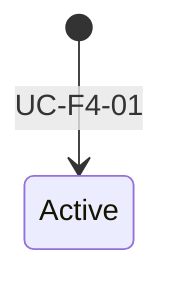

🏠 [Specs](../../../README.md) › 🧩 [Functional capabilities](../../README.md) › 🎙️ [F4 Meetings](../README.md) ›
🗃️ [Data](README.md) › 🗃️ E-F4-18 Recording notice

# 🗃️ E-F4-18 Recording notice

**Status:** ✅ specified

## Purpose

The recording notice the flow charts name with the words "Spoken message", "message", "notice"
([FL-F4-01](../flows/fl-f04-01-record-an-online-meeting.md),
[FL-F4-02](../flows/fl-f04-02-record-in-person-or-by-phone.md),
[FL-F4-07](../flows/fl-f04-07-prepare-and-capture-anywhere.md)). The owner decided to create it
([D516](../../../06-decisions/foundations/d516-naming-rules-and-the-seven-classes-of-names.md)); its fields are derived
from the specifications and confirmed by the owner (D572).

## Fields

| Name | Type | Required | Validation | Default | Example | Personal data | Custom fields |
|---|---|---|---|---|---|---|---|
| name | text | yes | - | - | Notice for client calls | no | no |
| channel | bot chat, spoken message, call chat, in-person confirmation | yes | BR-F4-01, BR-F4-19 | - | spoken message | no | no |
| language | language | yes | - | - | English | no | no |
| words | text | yes | - | - | This call is recorded and transcribed. | no | no |
| state | active | yes | the lifecycle below | active | active | no | no |

Derived from [BR-F4-01](../business-rules/br-f04-01-every-recording-is-announced.md) (the bot's notice, the spoken
message whose words are set per language, the in-person confirmation),
[BR-F4-11](../business-rules/br-f04-11-business-calls-are-recorded.md),
[BR-F4-19](../business-rules/br-f04-19-desktop-capture-is-announced-too.md) (the notice posted in the call's chat),
[UC-F4-01](../use-cases/01-record-an-online-meeting/uc-f04-01-record-an-online-meeting-with-the-bot.md),
[UC-F4-04](../use-cases/02-record-in-person-or-by-phone/uc-f04-04-record-a-phone-call.md),
[UC-F4-10](../use-cases/07-prepare-and-capture-anywhere/uc-f04-10-capture-from-the-desktop-a-file-or-dictation.md),
[S-F4-04 Call](../screens/02-record-in-person-or-by-phone/s-f04-04-call.md) and the list
[S-F4-L18](../screens/00-lists/s-f04-l18-recording-notices.md).

## Relations

Posted or played at the start of each recorded [meeting](e-f04-01-meeting.md) or call; the bot's name, "SimpleERP recorder"
([BR-F4-01](../business-rules/br-f04-01-every-recording-is-announced.md)), is held by the
[meeting recording setting](e-f04-25-meeting-recording-setting.md). The time it was posted shows on the
[desktop recorder](../screens/07-prepare-and-capture-anywhere/s-f04-09-desktop-recorder.md).

## Lifecycle

## Indexes and search

By name, channel, language, state.

## Retention

As the other records of its capability.

## Audit

Every change, as the other records of its capability.

## Import and export

CSV or XLSX of the visible rows and columns from [S-F4-L18](../screens/00-lists/s-f04-l18-recording-notices.md); no
import.

## Used by

- [UC-F4-01 Record an online meeting with the bot](../use-cases/01-record-an-online-meeting/uc-f04-01-record-an-online-meeting-with-the-bot.md)
- [UC-F4-04 Record a phone call](../use-cases/02-record-in-person-or-by-phone/uc-f04-04-record-a-phone-call.md)
- [UC-F4-10 Capture from the desktop, a file or dictation](../use-cases/07-prepare-and-capture-anywhere/uc-f04-10-capture-from-the-desktop-a-file-or-dictation.md)

## Open questions

None.

---

⬅️ [E-F4-17 Meeting summary](e-f04-17-meeting-summary.md) · ⬆️ [Up](README.md) ·
➡️ [E-F4-19 Follow-up email](e-f04-19-follow-up-email.md)
