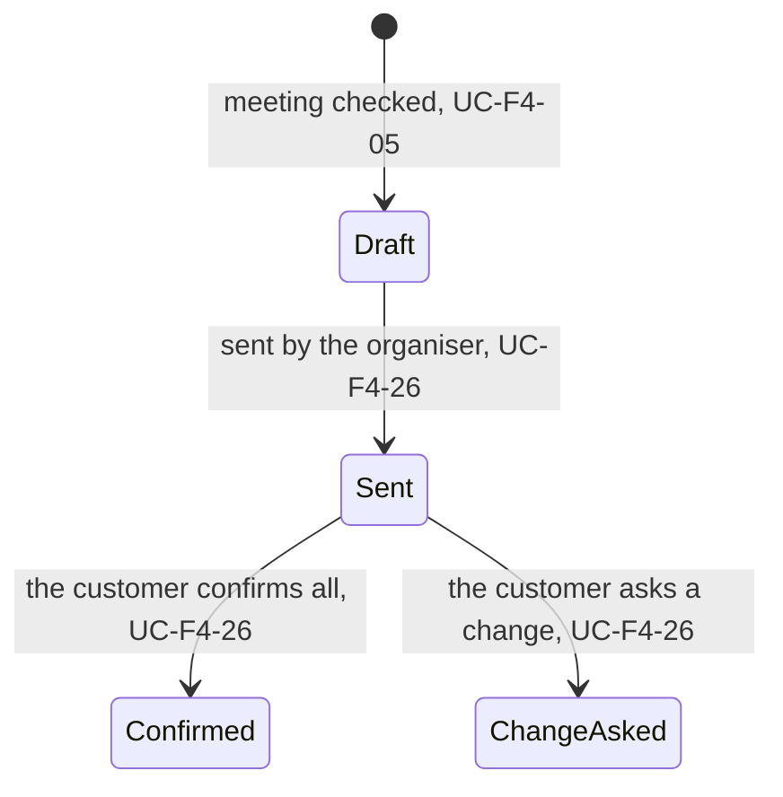

🏠 [Specs](../../../README.md) › 🧩 [Functional capabilities](../../README.md) › 🎙️ [F4 Meetings](../README.md) ›
🗃️ [Data](README.md) › 🗃️ E-F4-19 Follow-up email

# 🗃️ E-F4-19 Follow-up email

**Status:** ✅ specified

## Purpose

The follow-up email the flow charts name with the words "Follow-up draft"
([FL-F4-03](../flows/fl-f04-03-review-a-meeting.md)). The owner decided to create it
([D516](../../../06-decisions/foundations/d516-naming-rules-and-the-seven-classes-of-names.md)); its fields are derived
from the specifications and confirmed by the owner (D572).

## Fields

| Name | Type | Required | Validation | Default | Example | Personal data | Custom fields |
|---|---|---|---|---|---|---|---|
| subject | text | yes | - | - | Follow-up Durand SA | no | no |
| meeting | meeting | yes | a checked meeting | - | Durand SA, kitchen project | no | no |
| to | outside participants | yes | - | the meeting's outside participants | Claire Durand | yes | no |
| body | text | yes | - | drafted by the AI assistant | Thank you for this morning's meeting... | yes | no |
| actions | list of action items | yes | only the actions the organiser chose to send, BR-F4-29 | the outside people's actions, BR-F4-14 | Durand: confirm the colour, 2026-12-08 | yes | no |
| link valid until | date | no | 30 days after sending, for a customer with no portal account | - | 2026-12-28 | no | no |
| sent by | user | no | the organiser | - | Léa Moreau | yes | no |
| sent on | date and time | no | - | - | 2026-11-28 10:05 | no | no |
| reminded on | date | no | once, 3 days after sending without an answer | - | 2026-12-01 | no | no |
| state | draft, sent, confirmed, change asked | yes | the lifecycle below | draft | sent | no | no |

Derived from [UC-F4-05](../use-cases/03-review-a-meeting/uc-f04-05-review-a-meeting.md) (the draft opened at checking),
[UC-F4-26](../use-cases/13-outside-people-and-follow-up/uc-f04-26-receive-and-confirm-the-agreed-actions.md) (sending,
the 30-day link, the reminder, the answer),
[BR-F4-14](../business-rules/br-f04-14-colleagues-get-tasks-outsiders-the-follow-up.md),
[BR-F4-29](../business-rules/br-f04-29-customers-see-only-the-actions-sent-to-them.md),
[BR-F3-12](../../f03-assistant/business-rules/br-f03-12-drafts-go-to-their-editor.md) (the user sends the draft, never
the AI assistant), [S-F4-05 Meeting review](../screens/03-review-a-meeting/s-f04-05-meeting-review.md),
[S-F4-23 Agreed actions](../screens/13-outside-people-and-follow-up/s-f04-23-agreed-actions.md) and the list
[S-F4-L19](../screens/00-lists/s-f04-l19-follow-up-emails.md).

## Relations

Belongs to one checked [meeting](e-f04-01-meeting.md) and its [summary](e-f04-17-meeting-summary.md); lists
[action items](e-f04-04-action-item.md), never the transcript or internal actions (BR-F4-29); sent to the meeting's
outside participants, who answer on [S-F4-23](../screens/13-outside-people-and-follow-up/s-f04-23-agreed-actions.md)
from the email's link or the customer portal.

## Lifecycle

A draft the organiser skips is never sent (UC-F4-05, alternative flow 5a); a change asked reopens its action.

## Indexes and search

By subject, meeting, recipient, state.

## Retention

As the other records of its capability.

## Audit

Every change, as the other records of its capability.

## Import and export

CSV or XLSX of the visible rows and columns from [S-F4-L19](../screens/00-lists/s-f04-l19-follow-up-emails.md); no
import.

## Used by

- [UC-F4-05 Review a meeting](../use-cases/03-review-a-meeting/uc-f04-05-review-a-meeting.md)

## Open questions

None.

---

⬅️ [E-F4-18 Recording notice](e-f04-18-recording-notice.md) · ⬆️ [Up](README.md) ·
➡️ [E-F4-20 Human review request](e-f04-20-human-review-request.md)
