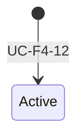

🏠 [Specs](../../../README.md) › 🧩 [Functional capabilities](../../README.md) › 🎙️ [F4 Meetings](../README.md) ›
🗃️ [Data](README.md) › 🗃️ E-F4-20 Human review request

# 🗃️ E-F4-20 Human review request

**Status:** ✅ specified

## Purpose

The human review request the flow charts name with the words "Human review"
([FL-F4-09](../flows/fl-f04-09-score-calls-and-interviews.md)). The owner decided to create it
([D516](../../../06-decisions/foundations/d516-naming-rules-and-the-seven-classes-of-names.md)); its fields are derived
from the specifications and confirmed by the owner (D572).

## Fields

| Name | Type | Required | Validation | Default | Example | Personal data | Custom fields |
|---|---|---|---|---|---|---|---|
| title | text | yes | - | - | Scorecard Lemoine, score | no | no |
| subject | scorecard, evaluation grid | yes | - | - | Evaluation grid, site manager | no | no |
| asked by | person | yes | the scored person | - | Karim B. | yes | no |
| asks | explanation, human review | yes | BR-F4-21 | - | human review | no | no |
| asked on | date | yes | - | - | 2026-11-27 | no | no |
| reviewer | user | no | a person, never the AI assistant | - | Claire Petit | yes | no |
| answer | text | no | the criteria, the quoted answers and the validation, BR-F4-21 | - | Criteria and quotes sent, score kept at 3 | yes | no |
| answered on | date | no | - | - | 2026-12-02 | no | no |
| state | active | yes | the lifecycle below | active | active | no | no |

Derived from [FL-F4-09](../flows/fl-f04-09-score-calls-and-interviews.md) ("Human review logged"),
[UC-F4-12](../use-cases/09-score-calls-and-interviews/uc-f04-12-score-a-sales-call.md) (the scored seller's scorecard,
coaching and not the sole basis for an HR decision),
[UC-F4-13](../use-cases/09-score-calls-and-interviews/uc-f04-13-interview-a-candidate.md) (a candidate asks for an
explanation or a human review: given, logged),
[BR-F4-20](../business-rules/br-f04-20-scores-come-with-their-evidence.md),
[BR-F4-21](../business-rules/br-f04-21-candidate-scoring-is-high-risk-ai.md),
[S-F4-11 Call scorecard](../screens/09-score-calls-and-interviews/s-f04-11-call-scorecard.md) and the list
[S-F4-L20](../screens/00-lists/s-f04-l20-human-review-requests.md).

## Relations

About one [scorecard](e-f04-06-scorecard.md) or one [evaluation grid](e-f04-07-evaluation-grid.md), and through it one
[meeting](e-f04-01-meeting.md); asked by the scored seller or by the candidate, an
[applicant](../../f09-hr-and-projects/data/e-f09-07-applicant.md); answered by a
[user](../../f01-administration/data/e-f01-03-user.md).

## Lifecycle

## Indexes and search

By title, subject, asker, state.

## Retention

As the other records of its capability.

## Audit

Every change, as the other records of its capability.

## Import and export

CSV or XLSX of the visible rows and columns from [S-F4-L20](../screens/00-lists/s-f04-l20-human-review-requests.md); no
import.

## Used by

- [UC-F4-12 Score a sales call](../use-cases/09-score-calls-and-interviews/uc-f04-12-score-a-sales-call.md)

## Open questions

None.

---

⬅️ [E-F4-19 Follow-up email](e-f04-19-follow-up-email.md) · ⬆️ [Up](README.md) ·
➡️ [E-F4-21 Interview debrief](e-f04-21-interview-debrief.md)
